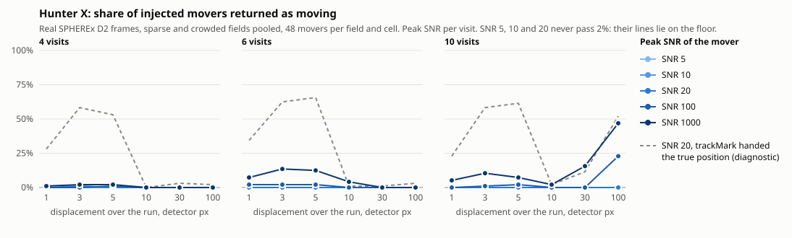

# Muninn

Muninn is a public viewer for NASA SPHEREx images that shows how a patch of sky changes
between visits: blink, wipe or subtract any two dates, mark a spot and get its track,
brightness, spectrum and catalogue identity. It reads the Level-2 frames of Data Release 1
and Quick Release 3 straight from NASA's public archive mirror, in the browser, a few
megabytes at a time.

- **Live:** <https://muninn.mydevbox.xyz> — open *(152) Atala* under the search and press Space.
- **Talk** (ten slides and an appendix; slide 2 reads real frames as you watch):
  <https://muninn.mydevbox.xyz/talk.html> · PDF [English](https://muninn.mydevbox.xyz/talk.pdf),
  [Russian](https://muninn.mydevbox.xyz/talk.ru.pdf)
- **Run it:** `node server.js`, then open <http://127.0.0.1:5173> (Node 18+, nothing to install).
- **Stack:** plain JavaScript modules, HTML and CSS in the browser; a dependency-free Node
  server that relays the NASA services without CORS. No build step, no framework.
- **Challenge:** NASA Space Apps Challenge 2026, *Planet X and SPHEREx*.
- **Team Yggdrasil:** Khurshiddinov Timur Khurshiddinovich (team owner), Stepan Ionichev,
  Muhammadyusuf Bahtiyarov, Edem Galiev, Temur Kholjigitov, Khamidkhodjayeva Fayziya.


Three things it shows on real data:

- **It finds and names a mover.** On 25 Dec 2025 one dot appears in the Atala field at SNR 374
  and in no other visit. SkyBoT names it at that exposure's own timestamp: asteroid (152) Atala.
- **It refuses a false discovery.** A second "flash" on 6 Jul 2025 (SNR 140) was a single pixel
  the SPHEREx pipeline had already flagged as a cosmic ray. Muninn reads the `FLAGS` plane and
  masks it.
- **It measures how far SPHEREx is from Planet Nine.** 17.61 AB per visit, from delivered
  detector pixels, against a prediction of V 22.6–24.3: 5.0–6.7 mag short per visit, and still
  2.1–3.8 mag short with 200 visits coadded. The page says so.

Odin's two ravens flew over the worlds each day and came back at evening to tell him what had
changed; the second was called Muninn, Memory. SPHEREx photographs the whole sky in 102
near-infrared bands about twice a year, so most positions have several dates. Stars stay put;
asteroids, comets and anything else bound to the Sun do not. Blinking two visits is the trick
Clyde Tombaugh used to find Pluto in 1930, here on an all-sky infrared survey.

A longer walk through every formula, data source and test, in Russian:
[docs/study-guide.ru.pdf](docs/study-guide.ru.pdf) ([Markdown](docs/study-guide.ru.md)).

---

## What you can do with it

- **Open a field** by name (`M51`, `Vega`, resolved through SIMBAD), by coordinates in decimal
  or sexagesimal, from the sky map, by one of the ten ready fields, or at random.
- **Compare visits:** *Blink* every visit in turn, *Wipe* two of them against each other with a
  draggable divider, take their *Difference* (violet where A is brighter, amber where B is, the
  colours of the A and B chips), look at a *Single* visit, or *Stack* a season.
- **See the wavelength A and B saw.** SPHEREx observes through a linear variable filter, so two
  visits in the same band can see the field at different wavelengths. Under Wipe and Difference
  the page reads each frame's `WCS-WAVE` table at the field's centre and prints both
  wavelengths. When the two channels share less than half of the narrower
  one, it warns that the residual may hold the spectrum and not only change in time
  (`channelOverlap` in `public/js/spectrum.js`). **Pick B at A's wavelength** reads the other
  visits in A's band and sets B to the one whose channel overlaps A's most, nearest in time on a
  tie, or says that no visit sees A's wavelength there.
- **Stack a season.** SPHEREx comes back to a field in seasons: a few visits over a week or two,
  then nothing for half a year. The stack adds one season's visits in one band (the middle of
  three values, or the mean without the brightest of four or more, which removes a missed
  cosmic ray or a passing asteroid), after putting every visit on the same sky level, and says
  how deep that gets. ← → step from season to season.
- **Put another survey beside the frame** as B of the wipe: the AllWISE picture of 2010–2011,
  or a Gaia sky. Gaia publishes a catalogue, not images, so that one is a model and is labelled
  so: every Gaia DR3 source down to the overlay's G limit (G 18.5 for a 9′ field, brighter for
  wider ones), carried by proper motion to the date of visit A and drawn as wide as SPHEREx's
  own blur in that band (median FWHM D1 6.6″ to D6 9.9″, measured with
  `tools/sharpness-calibrate.mjs`). What is left of the divider and missing on the right is what
  Gaia does not account for.
- **Overlay catalogue positions** of Gaia DR3 (moved to the date of each visit) and AllWISE.
- **Mark a spot** by clicking or tapping it. Muninn re-measures that sky position in every loaded
  visit (position, AB magnitude, one bar per visit), classifies what it finds, asks the known
  solar-system objects at the moment of each exposure, and identifies the source in SIMBAD,
  Gaia DR3, 2MASS, AllWISE, CatWISE2020 and VSX. A mark folds to one line, and unfolded sets its
  evidence in labelled groups: Verdict, Catalogues, Brightness, Position.
- **A spectrum and a light curve** for a mark, from up to sixty exposures (see below).
- **Link a mark across seasons** along its parallax arc (see below).
- **Adjust the picture:** asinh, square-root, log or linear stretch; the white point; three
  colour ramps; per-visit or shared brightness scaling. Per-visit stretching makes movement easy
  to see and hides brightness change; shared scaling does the opposite, and the tool says so.
- **Take it out:** a mark's measurements as CSV, the plate as PNG, the blink as WebM. The
  address carries the field, size, band, language, mode, overlay, the visit held and the marks,
  so a copied link reproduces the view.
- **Planets of a star:** a star with known planets opens its system in ExoVision (see below).
- English and Russian, switchable at any time; day and night themes.

Keyboard: <kbd>Space</kbd> play/pause, <kbd>←</kbd> <kbd>→</kbd> step between visits,
<kbd>H</kbd> give the picture the whole window (<kbd>Esc</kbd> leaves it).

**Phones and modest devices.** The layout works from 320 px wide: below 768 px the controls sit
under the picture in one transport row, a full-width mode track and a two-row band wheel; a
phone on its side puts the picture beside its controls. Touch targets are 44 px and safe-area
insets are respected. On a device with four cores or less, or 4 GB of memory or less, the page
reads four frames at once instead of six and does not animate the run while frames load; phones
stop filling at thirty visits instead of sixty. The stretch is a precomputed table rather than
an `asinh` per pixel, run thumbnails are made once per size, canvases are resized only when the
size changes, and a link straight to a field does not build the sky map behind it.

**Saturated stars.** The pipeline blanks a saturated core. For display only, a blank enclosed by
bright glow is filled from its rim, so a bright star is not a white disc with a black square in
it; the measured data are not touched, and a mark there reads *saturated* and quotes no
brightness or position.

**The interface.** The plate is grey, so the picture never changes brightness with the hue; the
chrome takes the hue of the band in view, from violet at D1 to red at D6. Each colour ramp rises
in luminance over all 256 entries, and the two arms of the difference ramp are matched in
lightness, so "brighter in A" and "brighter in B" are equally loud. The day theme runs every ramp
as a photographic negative, black stars on clear glass, the way plates were blinked in 1930.

---

## The challenge's test targets

The challenge names five fields to test a tool like this on. Each opens in one press from
*Challenge targets* under the search, or by URL, e.g. `/#ra=133.7595&dec=-7.2422&fov=0.3&band=D6`.
Their frame indexes ship with the page. A field opened this way, or by a name typed into the
search, rings its target on the plate, carried by catalogue proper motion to the date of each
visit. The fast movers are centred where they were at the mean date of their SPHEREx visits; for
WISE 0855−0714 that is 2.1′ west of the challenge's 2010.6 WISE position (motion from Kirkpatrick
et al. 2021). Barnard's Star and ε Indi B are carried from Gaia DR3.

| target | why it is a test | what to do in Muninn | archive, at bake time |
| --- | --- | --- | --- |
| Barnard's Star | fastest proper motion in the sky, 10.4″/yr | blink; mark the star and read the verdict | 17 D2 visits over 397 days |
| ε Indi B | a pair of brown dwarfs beside their star, ε Indi A | blink in D2, then D6 | 29 D2 visits over 526 days |
| WISE 0855−0714 | the coldest known brown dwarf, 8.1″/yr | opens in D6, the only band it is bright in. At W2 ≈ 13.9 (about 17.2 AB) it is below the one-visit D6 limit (16.7 AB): a test of the Stack, not of a single frame | 17 D6 visits over 370 days |
| RW Aurigae | a young, irregular variable star | shared scaling, then blink | 16 D2 visits over 372 days |
| R Draconis | a Mira variable near the north ecliptic pole | shared scaling; step season to season | 55 D3 visits over 414 days (index capped) |

A star has to cross one 6.15″ detector pixel to be seen to move. Barnard's Star would, by 11.3″
over its 397 days of D2 visits, but at J ≈ 5 it saturates the detector in every one of them and
the pipeline blanks its core. A mark on it reads *saturated*, quotes no brightness and no motion,
and states the catalogue motion against the pixel instead. R Draconis and RW Aurigae saturate in
their opening bands too. For unsaturated variables a mark reports an AB magnitude per visit in a
3×3-pixel aperture; each visit sees the source at a different wavelength inside the band, so a
Mira's swing of magnitudes shows through and a few tenths do not, and the mark says so.

---

## ExoVision: from a star to its planets

[ExoVision](https://exovision.mydevbox.xyz) is the team's exoplanet explorer (source in a
separate repository, [root3315/TIC-id](https://github.com/root3315/TIC-id)). Muninn links into it.

- `tools/planet-hosts.mjs` asks the NASA Exoplanet Archive's Planetary Systems Composite
  Parameters table (`pscomppars`) for every host star and bakes them into
  `public/data/planet-hosts.json` (4 862 hosts: position, number of planets, name). Nothing asks
  the archive at run time; run the tool again when the archive grows.
- A star on Muninn's sky, or a challenge field's target, with a known host within 90″ shows
  **"N planets · ExoVision"** in its card. A field is looked up at its target's own catalogue
  position, not at the field centre.
- A press plays a short transition (the sky closes over and the star brightens with its name;
  skipped when reduced motion is asked for) and opens
  `/system?ra=…&dec=…&from=muninn&name=…` in ExoVision: the orbits on a log scale, the habitable
  zone, a top-down view of the orbits, and the star's and planets' parameters, with a link back
  to Muninn. A modified click opens it in a new tab as usual.

---

## NASA data and services used

| what | from | used for |
| --- | --- | --- |
| SPHEREx Level-2 spectral images (DR1 and QR3) | NASA/JPL-Caltech · IPAC/IRSA, via the AWS Open Data mirror `nasa-irsa-spherex` | every pixel on screen, read by HTTP range request |
| SPHEREx frame index | IRSA Simple Image Access v2, collections `spherex_dr1`, `spherex_dr1_deep`, `spherex_qr3`, `spherex_qr3_deep` | which frames cover a position, when, and in which band |
| SPHEREx `FLAGS` plane | the same files | masking cosmic-ray hits and bad pixels before anything is measured |
| AllWISE Atlas images, W1 and W2 | NASA WISE, IRSA SIA (`wise_allwise`) and an IBE cutout, relayed by `/api/wise` | the field as WISE saw it in 2010–2011, on the same north-up grid, as B of the wipe. The idea is WiseView's, the blink tool the challenge names as a model |
| AllWISE W1/W2 | IRSA TAP (`allwise_p3as_psd`), raced against CDS VizieR | identifying a marked source at 3.4 and 4.6 µm; an overlay of AllWISE positions |
| CatWISE2020 | IRSA TAP (`catwise_2020`) | whether a marked source moves: ten years of WISE/NEOWISE, stated only at five times its error |
| 2MASS | IRSA TAP (`fp_psc`), raced against CDS VizieR | J, H and K of a marked source |
| Gaia DR3 | ESA Gaia, through NASA MAST (one marked star, in a second or two), IRSA TAP (`gaia_dr3_source`) and CDS VizieR | what a faint marked star is and whether Gaia saw it vary; the overlay, carried by proper motion from J2016.0 to each visit; the Gaia model beside the frame |
| Known solar-system objects | NASA/JPL Small-Body Identification (`sb_ident`), merged with SkyBoT (IMCCE) | naming asteroids and comets at the moment of each exposure; either service alone is enough |
| Stars with known planets | NASA Exoplanet Archive (NExScI, Caltech/IPAC), `pscomppars`, baked by `tools/planet-hosts.mjs` into `public/data/planet-hosts.json` | a star with planets within 90″ offers its system in [ExoVision](https://exovision.mydevbox.xyz), the team's exoplanet explorer |
| Other telescopes of the field | Canadian Astronomy Data Centre, CAOM index (Argus TAP), relayed by `/api/archives` | how many science observations HST, JWST, TESS, Chandra, Gemini, CFHT, JCMT, SDSS, VLASS and the CSA's NEOSSat hold of the field; Barnard's Star has 572 NEOSSat frames from 2019 |

Outside NASA: object names from SIMBAD / Sesame and variable stars from AAVSO VSX through
VizieR (CDS Strasbourg), for which NASA has no equivalent; SkyBoT from IMCCE. Each catalogue is
asked on its own: one that does not answer leaves the rest of the card standing, and the card
names it. Muninn is not affiliated with NASA and adds nothing to the data it shows.

### The challenge's Resources tab

| resource | how Muninn uses it |
| --- | --- |
| NASA/IPAC IRSA, SPHEREx | every pixel, the frame index, the FLAGS plane; also the AllWISE, CatWISE2020, 2MASS and Gaia DR3 catalogues and AllWISE Atlas images. IRSA's SPHEREx cutout service was measured and not used: 4 MB and 13–21 s a frame, against 1–3 MB in a few seconds by byte range from the S3 mirror |
| SPHEREx Tutorial Notebooks | the reference for the DR1 file layout (IMAGE, Rice-compressed FLAGS, WCS-WAVE); `notebooks/verify-with-astropy.ipynb` follows them to check Muninn's numbers with astropy |
| WiseView | the model for the wipe between a SPHEREx visit and the AllWISE picture |
| Gaia mission data (DR3) | from MAST for a marked star, from IRSA or VizieR for the overlay |
| CADC (CSA partner) | the "In other archives" panel, NEOSSat included |
| NEOSSat pages, tutorial and dataset | reached through CADC; the same notebook follows the NEOSSat Data Tutorial to open a frame of Barnard's Star |

---

## How it works

### Reading 65–72 MB files a few megabytes at a time

A SPHEREx Level-2 file is a 65–72 MB multi-extension FITS; most of it is the PSF cube, and the
flux plane is 2040 × 2040 float32 near the front. The public mirror answers HTTP Range requests
with `Access-Control-Allow-Origin: *`, so the browser:

1. reads the headers (`public/js/fits.js`) and builds the `RA---TAN-SIP` WCS with forward and
   inverse SIP coefficients (`public/js/wcs.js`);
2. fetches only the detector rows the field lands on: 1–3 MB instead of the whole file;
3. fetches the same rows of the `FLAGS` plane (Rice-compressed from DR1 on, decoded in
   `public/js/rice.js`) and blanks every pixel the pipeline marked as not having seen the sky —
   cosmic-ray jumps (`TRANSIENT`), processing errors, dead, hot and cold pixels, lost data,
   persistence, crosstalk and halo — before anything is measured. `OVERFLOW` is kept beside the
   pixels so a measurement on a saturated core says *saturated*;
4. resamples the visit onto one shared north-up tangent grid centred on the target, through the
   full TAN + SIP inverse, in a worker (`public/js/stamp.js`). SPHEREx rolls between visits —
   the Atala field's December and July frames are 180° apart — so without this a blink would show
   only rotation. `npm run probe` checks the round trip against a live header: worst case
   0.015 px over the whole detector.

A field opens with ten visits spread over the whole baseline, then reads the rest in the
background, widest gaps first, up to sixty (thirty on a phone); "Load all" reads the remainder.
The page prints the megabytes it has read.

The field-size control sets the **short side, the height**; the width follows the window (up to
twice the height), and the caption names both, e.g. "33′ × 18′". SPHEREx samples the sky at
6.15″ a pixel, so an 18′ field holds about 176 real pixels however wide the screen is; the grid is
cut to about 2.5 samples per detector pixel and the browser's resampler does the rest. The black
point sits at the median plus one sigma of the lower half of the pixel distribution, which stars
cannot contaminate.

### The sector matrix: an attention map

The frame is cut into a 5 × 4 grid of sectors, and every sector is scored in every visit:

    score = (peak in this visit − median peak across visits) / noise

The noise is the larger of the sector's own spread of peaks and the frame's pixel noise. A star
that is always there scores zero. A visit scores high when **the sector's dominant peak
changed**: something brighter than everything else in the sector appeared, or the brightest
source brightened. It is an attention map, not a detector of moving sources: a faint newcomer
in a sector that a brighter steady star always tops does not change the sector's peak and is not
flagged, and a slow mover present in every visit is part of the median. Each cell says "score
above its usual — an attention score, not a significance". The matrix is drawn under each frame
of the run; pressing a lit cell goes to that visit and lights that sector on the picture.

### Hunter X: a candidate-ranking search

Hunter X turns the matrix into a short list. It takes the strongest twelve standouts (score ≥ 4),
finds the brightest pixel in each, merges peaks within 30″, measures each place in every visit
with the same photometry as a mark (`searchField` in `public/js/huntcore.js`), and **ranks**
what moves by slowness (`public/js/hunt.js`). One-visit flashes are listed separately and
checked against SkyBoT for their own exposure. **It ranks candidates for a person to look at; it
is not a validated detector**, and the injection test below shows how narrow its window is.

Most of a distant body's apparent motion is the Earth's. At opposition

    rate ≈ 2π · 206265 / (d + √d)   arcsec per year   (d heliocentric, AU)

| | apparent rate at opposition |
| --- | --- |
| main belt, 2.7 AU | ~34″ per hour |
| Jupiter trojans, 5.2 AU | ~20″ |
| Neptune, 30 AU | ~4″ |
| Sedna near aphelion, ~940 AU | ~0.15″ |
| Planet X, 400–800 AU | 0.18–0.35″ |

Opposition is where the motion is fastest, so a distance read from a rate is a ceiling ("no
farther than"). SPHEREx looks about 90° from the Sun, where the body's own orbital motion
dominates inside 2.62 AU, so the ceiling is the larger of the two distances a rate allows
(`distanceCeilingAU`).

A candidate is ranked only when the rate is a measurement (`rateIsMeasured`): at least four
detections, total motion over three times the larger of the fit's scatter and one 6.15″ pixel
(18.45″), at most 60″ an hour, and not a one-pixel hit. Each guard was added after the first
version ranked a candidate at 0.00″/h ("no nearer than 74 362 AU") or one at 17.7″ of total
motion.

**What the guards leave.** Within one season of about eleven days, three pixels is 0.07″ an hour,
while a body at 400–800 AU near quadrature drifts 0.006–0.02″ an hour: **inside a season the
motion test is blind at Planet X distances.** Across seasons such a body jumps 8–17′, far
outside the ±2-pixel (about ±12″) box each place is measured in.

### Hunter X injection–recovery benchmark

[docs/hunter-benchmark.md](docs/hunter-benchmark.md) plants Gaussian movers with the frame's
own PSF width (1.21 detector pixels) into real DR1 D2 frames of a sparse field (Atala, b −59°)
and a crowded one (RW Aurigae, b −6°), with 4, 6 or 10 visits, and runs them through the page's
own search code (`tools/hunter-benchmark.mjs`, `tools/hunter-inject.mjs`).



- **Recovered:** in the range asked (peak SNR 5–20, 1–10 pixels of motion over the run, sparse,
  crowded and bright-neighbour placements) Hunter X returned **1 of 5 184** planted movers as
  moving — SNR 20, 3 px, sparse field, 4 visits.
- **Why not more: the sector peak.** A mover that stays inside its sector is in every visit and
  so in the median, and a faint one is below the sector's brightest star; the matrix never
  points at it ("standout on it" is 0 % at SNR ≤ 20). Movers start to light sectors only when
  they cross sectors between seasons, 30–100 px at SNR ≥ 300.
- **The photometry works in a narrow window.** Handed the true position, the tracker calls 60 %
  of SNR 20 movers of 3–5 px "moving", and 57 % of the 5 px ones pass `rateIsMeasured`. At 1 px
  there is no motion by its own rule (`rateIsMeasured` needs three pixels); at 10 px or more the
  seasons are further apart than the **±2-pixel search box**, which then holds one season only.
- **A bright neighbour.** Within 3 px of a brighter star the photometry finds the star and the
  track becomes the star's (0–10 % even at the true position). And a steady star 8 px away
  becomes the sector's peak: at SNR 1000 it cuts the pipeline from 25 % to 4–6 %.
- **False positives are not the problem:** 2 ranked false entries in 17 136 runs, and nothing
  ranked in the fields with nothing planted.

So a Planet X–like body would come out as a one-visit flash or "intermittent", never as a ranked
mover. That case is what *Link across seasons* is for.

### Linking a mark across seasons

*Link across seasons* on a mark or a candidate places a body on the mark's line of sight at
trial distances from 30 to 2000 AU and works out where the Earth's move around the Sun puts it
in each visit of the next season: a **parallax arc**, drawn on the plate with ticks at 50, 100,
200, 500 and 1000 AU. It reads that season's visits, finds every ≥ 5σ source, and keeps one on
the arc only if the same spot is empty in every visit of the first season; with two or more
visits in the second season, one trial distance has to fit a detection in at least two of them.
The answer is "candidate link, check by eye: d ≈ X AU (range)" or "nothing along the arc for d in
[a, b] AU, down to the 5σ one-visit limit" (`public/js/seasons.js`). The body's unknown orbital
motion over half a year (58″ at 500 AU) is allowed as a disc around each arc point, which is why
the distance comes as a range, and only the part of the arc inside the open field is checked; a
36′ field on the Atala field holds it from about 270 AU outward. Checked so far on a synthetic
two-season sky only (`tests/seasons.test.mjs`): a source at 300 AU links at 300 AU (range
269–321), a star on the arc is turned away, a single-visit peak links nothing.

### Saying only what the pixels support

A mark measures every visit: background from an annulus, the brightest pixel within ±2 detector
pixels, a flux-weighted centroid, a 3×3-pixel aperture. A detection needs 5σ, where σ is the
larger of the annulus's spread and the noise of the detector pixels themselves (the resampled
grid alone is smoothed to about 0.64 of it, which let one blank position in eight through as a
source over ten visits).

| verdict | when |
| --- | --- |
| *nothing above the noise* | no 5σ detection in any visit |
| *there on \<date\> and in none of the others* | exactly one detection |
| *in N of M visits — \<dates\>* | two or three detections, not in every visit |
| *in N of M visits, steady to X″* | four or more, not in every visit, no measurable motion |
| *in all M visits, steady to X″* | in every visit, no measurable motion |
| *moving X″/h* | three or more, and the motion across the baseline beats both one 6.15″ pixel and twice the fit's own residual (Hunter X ranks only from four) |
| *saturated* | most visits saturated: no brightness or motion quoted |

**Cosmic rays the pipeline missed.** A real source spreads over several 6.15″ pixels; a cosmic
ray or hot pixel puts its light in one. A one-visit flash is read on the detector's own pixels
for the share of its 3×3 light in the brightest pixel (`public/js/sharpness.js`). Over every
DR1 and QR3 visit of the Atala field, 932 unflagged stars above 15σ never put more than 0.87 in
one pixel; flagged hits sit at 0.93–1.0, the 6 July pixel at 1.00, Atala on 25 Dec at 0.42. A
flash is called *too sharp for a star* when its neighbours fall three noise widths short of what
a star leaves, which needs about 57σ; fainter flashes are left unjudged. Such flashes stay on the
page and are never ranked.

### Spectrum and light curve

Behind the linear variable filter every exposure sees a source at its own wavelength, read from
the file's `WCS-WAVE` table at the source's detector pixel. *Spectrum* looks up the wavelength
of up to 160 exposures across D1–D6 (about 70 KB each), then measures up to 60 (about 0.3 MB
each): every visit on the plate, the most-observed wavelengths in full, the rest spread over the
bands. Detections are drawn with 1σ bars, non-detections as 5σ limits, saturated exposures as
triangles. Within a window one resolution element wide (published R = 39, 41, 41, 35, 112, 128 for
D1–D6, Crill et al. 2020) the filter is not what changed, so flux against date there is a light
curve, reported as a change past 3σ or "steady within ±Y mag". On a live run (152) Atala gave
22 mJy at 1.5 µm falling to 5 mJy at 4.3 µm, and an empty patch sixty 5σ limits of 0.2–0.7 mJy.
On 25 Dec 2025 SPHEREx took one field in four bands the same day, and D4–D5 straddle the 3 µm
water-ice band: a spectrum for anything found is what no other survey offers.

---

## What this can and cannot find

`tools/sensitivity.mjs` measures the depth from delivered pixels: the robust sky noise of the
detector's own pixels after `FLAGS`, through the 6.15″ pixel's solid angle, summed over a 3×3
aperture, as a 5σ point-source limit (`public/js/depth.js`, the same module the page uses).

| | 5σ point source |
| --- | --- |
| one visit | **17.61 AB** (16.68 in D6 to 18.04 in D4) |
| 10 visits, if coadded (√N) | 18.86 AB |
| 100 visits (√N) | 20.11 AB |
| 200 visits (√N) | 20.49 AB |

Measured in the Atala field (ecliptic, first three visits of each band), with no aperture
correction (worth 0.1–0.4 mag); the coadd rows extrapolate the one-visit noise.

Planet Nine is predicted at V ≈ 22.6–24.3 near aphelion (Linder & Mordasini 2016, A&A 589,
A134, for 5–50 Earth masses); the same paper puts a 10-Earth-mass planet at 700 AU at V = 21.7,
and Brown & Batygin (2021, AJ 162, 219) argue it may be closer and brighter. Two hundred coadded
visits are still 2.1–3.8 mag short (7–33 times in flux), one visit 5.0–6.7; even at V = 21.7,
1.2 mag. Comparing V with AB at 1.2–1.6 µm, where SPHEREx is deepest, is a best case.
**So this tool does not find Planet Nine, and says so on screen.** Every field reports the
depth of its search from its own noise.

What is left is a real search:

- **Slow movers brighter than ~17.6 AB per visit**, in data that has only just been released.
- **Season stacks and the jump between them.** Inside the Atala field's eleven-day December
  season a body at 500 AU moves at most ~1.7 detector pixels, so the stack keeps it sharp and
  gains √n in depth (four visits, about 0.6 mag); between seasons it jumps 13.6′. Shifting each
  visit along a trial distance before adding was measured and is the same pixel or so, so the
  stack does not pretend otherwise.
- **An upper limit.** The depth panel keeps a count of the fields examined in this browser and
  the square degrees they cover: a null result at a stated depth over a stated area.
- **A spectrum for anything found.**

What it will not find: **brown dwarfs and nearby stars by their motion**, with a few exceptions.
Over the ~1.2-year baseline a star needs more than about 5″ a year to cross a pixel: Barnard's
Star (saturated) and WISE 0855−0714 qualify; a typical nearby brown dwarf (0.1–1″ a year) does not.

---

## Does it actually work? The Atala field

The opening field was found by searching real SPHEREx frames along the ecliptic for catalogued
objects bright enough to detect (`tools/find-mover.mjs`) and checked photometrically
(`tools/verify-mover.mjs`). RA 13.4194, Dec +3.8459, band D2 (1.10–1.65 µm), fifteen D2 visits
over 369 days in DR1 and QR3. Signal-to-noise at the field centre, visit by visit:

```
2025-07-06T11:41:24     1.2   █
2025-07-07T20:18:06     2.0   ██
2025-07-09T03:23:15     0.5   █
2025-07-19T11:04:07     1.6   ██
2025-12-24T11:12:16     2.2   ██
2025-12-25T16:33:36   374.3   ████████████████████████████████████████
2026-01-01T01:44:29     1.5   ██
2026-01-01T08:21:29     0.9   █
2026-01-03T05:59:11     2.4   ██
2026-01-04T14:32:35     0.8   █
2026-07-03T09:52:56     1.9   ██
2026-07-03T19:44:45     1.4   █
2026-07-04T18:27:55     1.3   █
2026-07-05T05:58:03     1.2   █
2026-07-10T06:30:49     0.9   █
```

**25 Dec 2025 — SNR 374.** SkyBoT places **(152) Atala**, a main-belt asteroid at V = 13.81,
2.3″ from the field centre at that exposure's timestamp. Muninn rings and names it.

**6 Jul 2025 — the spike that was not there.** Before Muninn read `FLAGS`, this visit showed
SNR 140 at the same spot, with nothing in the catalogues to explain it: one detector pixel at
eleven times its neighbours, flagged by the pipeline as `FLAGS = 0x45` in DR1 (`TRANSIENT` +
`SUR_ERROR` + `NONFUNC`), a cosmic-ray jump caught up the ramp. Muninn's Rice decoder reproduces
the flag totals in the file's own header. With the flags read, 6 July is background like the rest.

Open (152) Atala, click the centre of the image and read the verdict: one visit, named by SkyBoT.

---

## Limitations, stated plainly

- **Released data only:** DR1 (April 2025 – mid-May 2026) and QR3 (mid-May – early October
  2026). Coverage is not uniform; some positions return nothing.
- **The archive caps large queries.** `MAXREC=500` per collection (a cone at the ecliptic poles
  matches over 25 000 frames); the page says when the list was truncated.
- **Brightness across bands is not comparable**, and inside one band each visit sees a slightly
  different wavelength; the page shows A's and B's and warns when they differ.
- **The spectrum is up to sixty exposures over up to a year**, not one simultaneous spectrum, in
  a 3×3 aperture with no aperture correction. Reading it takes one to four minutes.
- **Light-curve errors are detector noise** (plus a small floor); undersampling and calibration
  add scatter the bars do not hold, so a change near 3σ is worth checking by eye.
- **The photometry is simple:** annulus, peak, centroid, 3×3 aperture on the resampled grid. Not
  PSF photometry.
- **Hunter X is a candidate ranking, with a narrow window** (see the benchmark). The season link
  has been checked only on synthetic data.
- **Known-object marks are geocentric.** SPHEREx's low orbit shifts a main-belt asteroid by 3–7″,
  inside the two-pixel radius a match allows.
- **The distance ceiling assumes a circular orbit in the ecliptic.** It is a bound, not an orbit.
- **Cosmic rays look like transients.** The ones the pipeline caught are masked; the sharpness
  test catches the rest only from about 57σ, and a hit on a pixel corner can pass for a star.
- **The relay is small:** 180 archive questions a minute per visitor, a cap on lookups in flight
  per service, a 12-hour answer cache swept every ten minutes and held under 300 MB.

---

## Running, testing, deploying

```bash
node server.js            # serves public/ and the relays on http://127.0.0.1:5173 (PORT, HOST to change)
npm test                  # 171 offline tests (node --test); TEST_PORT sets the server tests' port
npm run bake              # refresh the frame indexes of the ten ready fields
npm run probe             # check the WCS round trip against a live SPHEREx header
node tools/sensitivity.mjs                        # the depth table above
node tools/verify-mover.mjs 13.4194 3.8459 0.15   # the Atala SNR table
node tools/hunter-benchmark.mjs --quick           # the Hunter X injection test, small run
node tools/planet-hosts.mjs                       # refresh the planet-host list
```

The server serves the page and relays what the browser may not call itself, because those
services send no CORS headers: `/api/search` (IRSA's frame index), `/api/tap` (IRSA TAP, and
MAST for one Gaia star), `/api/sbident` (JPL), `/api/wise` (the AllWISE cutout) and
`/api/archives` (CADC). Each relay writes its query from a fixed template and checked numbers.
Image data never passes through it. The live site runs `server.js`.

`public/` is also a complete static site: the ten ready fields' frame indexes ship inside it and
the pixels come from the mirror, so they open on any static host with no server. A lighter
fallback deploys to Cloudflare Pages with `npm run deploy` (`functions/api/search.js`, the frame
search only, with a 20 s wait and 400 rows per collection); there the catalogues come from
VizieR alone and known asteroids from SkyBoT alone.

`public/_headers` holds the content-security policy, naming every origin the page may reach: the
S3 mirror, IRSA, CDS and its CfA mirrors (Sesame, SIMBAD, VizieR), IMCCE (SkyBoT), Google Fonts,
and CADC's NEOSSat preview images. `server.js` reads the same file and sends the same policy.

**A new SPHEREx release** is a new IRSA collection on the same mirror: add its name to
`public/js/release.js` (one list for the relay, the edge function and the bake script), run
`npm run bake` and `npm test`, deploy. Nothing stores pixels, so nothing else is rebuilt.

---

## Layout

```
server.js        static host (compressed, security headers) + the relays + disk cache
public/          the site: index.html, talk.html, _headers, css/ (redesign.css is the current look)
  js/            reading:   fits.js, rice.js, wcs.js, stamp.js (+ stamp-worker.js), visits.js, release.js, net.js
                 picture:   render.js, sky.js, strip.js, stack.js, gaiasky.js, wise.js, gate.js, twilight.js
                 science:   depth.js, sectors.js, huntcore.js, hunt.js, seasons.js, sharpness.js,
                            spectrum.js, spectrum-view.js
                 services:  catalog.js, overlay.js, sbident.js, archives.js, csv.js, votable.js
                 page:      app.js (state and wiring), i18n.js, hash.js, export.js, suggest*.js, ephemeris.js, talk.js
  data/          targets.json and fields/ (the ten ready fields), planet-hosts.json, sky/ (the sky map)
functions/       the frame search for Cloudflare Pages
tools/           measurement, bake and benchmark scripts
tests/           npm test, offline
notebooks/       an independent check of the key numbers with astropy
docs/            the Hunter X benchmark, the Russian study guide, images
design/          a design study, not deployed
```

## Licence

The code is under the MIT licence, see `LICENSE`. The data it displays belongs to its sources,
listed above.

---

## По-русски, коротко

Muninn — публичный просмотрщик снимков NASA SPHEREx, который показывает, что изменилось на
участке неба между заходами. SPHEREx снимает всё небо примерно дважды в год; звёзды стоят на
месте, тела Солнечной системы — нет. Браузер читает кадры DR1 и QR3 прямо из публичного зеркала
AWS по диапазонам байтов: заголовок, только нужные строки детектора и флаги конвейера для них —
несколько мегабайт на заход. Перед сравнением каждый кадр пересчитывается на общую сетку с
севером вверх.

Стартовое поле: 25 декабря 2025 года в центре стоит астероид **(152) Atala** — SNR 374 против
фона 0,5–2,4 во всех остальных заходах. «Вспышка» 6 июля (SNR 140) — один пиксель, который
конвейер сам пометил как космическую частицу (`FLAGS = 0x45`); Muninn читает флаги и маскирует
такие пиксели. Глубина — 17,61 AB за заход против V 22,6–24,3 для Планеты Девять: сайт её не
находит и прямо об этом пишет. Hunter X — ранжирование кандидатов, а не проверенный детектор
(см. [docs/hunter-benchmark.md](docs/hunter-benchmark.md)). Звезда с известными планетами
открывает свою систему в ExoVision.

Подробное руководство: [docs/study-guide.ru.pdf](docs/study-guide.ru.pdf).
Запуск: `node server.js`, затем <http://127.0.0.1:5173>. Зависимостей нет.
