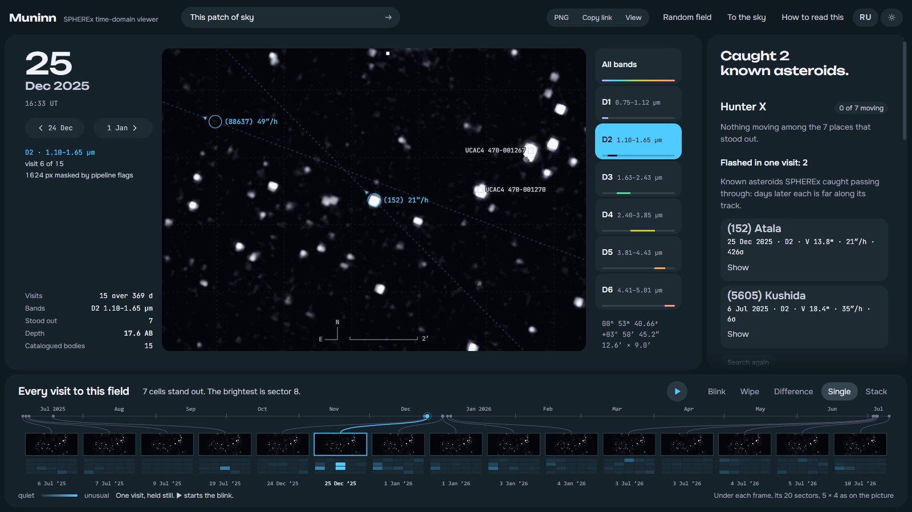
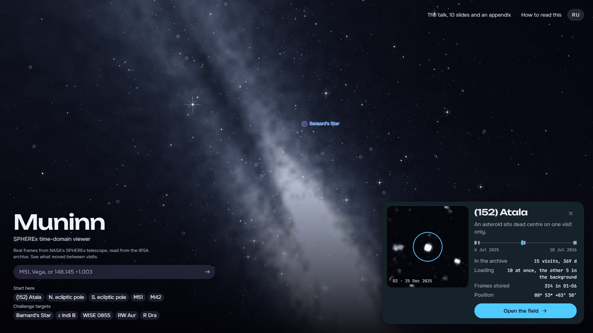

# Muninn

**A public-facing viewer for NASA SPHEREx that shows how a patch of sky changes between visits.**

NASA Space Apps Challenge 2026 — *Planet X and SPHEREx* · team **Yggdrasil**

**Live: <https://muninn.mydevbox.xyz>** · open *(152) Atala* under the search and press Space.
**The talk, ten slides and an appendix: <https://muninn.mydevbox.xyz/talk.html>** — its second slide reads real
frames from the archive as you watch. PDF copies: [English](https://muninn.mydevbox.xyz/talk.pdf),
[Russian](https://muninn.mydevbox.xyz/talk.ru.pdf).





## Team Yggdrasil

- Khurshiddinov Timur Khurshiddinovich (team owner)
- Stepan Ionichev
- Muhammadyusuf Bahtiyarov
- Edem Galiev
- Temur Kholjigitov
- Khamidkhodjayeva Fayziya

Three things it shows on real data:

- **It finds and names a mover.** On 25 Dec 2025 one dot appears in the Atala field at SNR 374 and in
  no other visit. SkyBoT names it at that exposure's own timestamp: asteroid (152) Atala.
- **It refuses a false discovery.** A second "flash" on 6 Jul 2025 (SNR 140) was a single pixel the
  SPHEREx pipeline had already flagged as a cosmic ray. Muninn reads the `FLAGS` plane and masks it.
- **It measures how far SPHEREx is from Planet Nine.** 17.61 AB per visit, from delivered detector
  pixels; the prediction is V 22.6–24.3. That is 5.0–6.7 mag short per visit, and still 2.1–3.8 mag
  short with 200 visits coadded, and the page says so.

Against the challenge: all five named test targets open in one press · WISE and Gaia identify a
marked source by catalogue, and their catalogue positions can be overlaid on the plate, Gaia's
moved to the date of each visit · Gaia has no images, so the wipe can put a model drawn from its
catalogue beside the frame, labelled as one · a marked source gets a spectrum on demand from
up to sixty exposures, each at the wavelength the file gives for its detector pixel, and a light curve
at the wavelength seen most often, where the filter is not what changed.

---

Odin's two ravens flew out over all the worlds each day and came back at evening to
tell him what had changed. The second one was called Muninn — Memory. That is the whole
job here: remember what a piece of sky looked like last time SPHEREx passed over it, and
show you what is different now.

SPHEREx photographs the entire sky in 102 near-infrared bands roughly twice a year. Most
positions have therefore been photographed on several separate dates. Stars stay put.
Asteroids, comets and anything else bound to the Sun do not. Blink two visits against
each other and the movers stop hiding — the same trick Clyde Tombaugh used to find Pluto
in 1930, here on an all-sky survey in 102 infrared bands.

---

## Run it

```bash
node server.js          # Node 18+, no dependencies to install
```

Then open <http://127.0.0.1:5173>.

The server does two things: it serves the page, and it relays the calls to NASA services
that send no CORS headers, which the browser is therefore not allowed to make itself:
IRSA's frame index, IRSA's catalogue service (TAP) and JPL's small-body identification.
Image data never passes through it.

```bash
npm test                # 79 offline tests: a synthetic FITS through the whole pipeline, and more
npm run bake            # refresh the pre-resolved opening fields (optional)
npm run probe           # check the WCS round-trip against a live SPHEREx header
node tools/verify-mover.mjs 13.4194 3.8459 0.15   # the photometry check below
node tools/talk-pdf.mjs 9222 http://127.0.0.1:8080 # talk.pdf and talk.ru.pdf, with the server and a
                                                   # headless Chrome (--remote-debugging-port=9222) running
```

### Showing it to someone, right now

A Cloudflare Quick Tunnel puts the machine you are already running on behind a
public HTTPS address, with no account and no deploy:

```bash
cloudflared tunnel --url http://127.0.0.1:5173
```

It prints a `*.trycloudflare.com` address that serves whatever `server.js` is
serving, live. The address lasts as long as the process and is different every
time, so it is right for a demo and wrong for anything you want to link to
twice.

### Putting it on the web

The live site, <https://muninn.mydevbox.xyz>, is `server.js` itself on our own small
server behind a Cloudflare Tunnel: every relay is there (`/api/search`, `/api/tap`,
`/api/sbident`, `/api/wise`, `/api/archives`). A lighter fallback, with the frame search
only, deploys to Cloudflare Pages as-is:

```bash
npx wrangler login              # once, in a browser
npm run deploy                  # wrangler pages deploy
```

`wrangler.toml` points Pages at `public/`, and `functions/api/search.js` is the
IRSA relay ported to the Workers runtime. Both import the same VOTable parser, but
the port runs under tighter limits (a 20 s wait on IRSA against 150 s, 400 rows per
collection against 500), so a position IRSA has not seen before can time out there.
The live site runs `server.js`. The catalogue and small-body relays (`/api/tap`,
`/api/sbident`) exist only there; on Pages the catalogues come from VizieR alone and
known asteroids from SkyBoT alone.
Pixels are not involved either way: the browser reads them straight from the S3
mirror.

The ten ready fields never reach that function at all, because their frame
indexes ship with the page and are checked first. So the deployment degrades
well: if the edge function is throttled or IRSA is down, the presets still open
and only arbitrary coordinates stop resolving.

`public/_headers` names every origin the page is allowed to reach — the S3
mirror, IRSA, CDS (Sesame, SIMBAD, VizieR), SkyBoT — and nothing else. `server.js`
reads the same file and sends the same policy, so the rule is written once.

---

## What you can do with it

- **Open a field** by object name (`M51`, `Vega`, `Betelgeuse` — resolved through SIMBAD),
  by coordinates in decimal or sexagesimal, by one of the ten ready fields, or at
  random.
- **Blink** every visit in sequence, **wipe** two of them against each other with a
  draggable divider, or take their **difference** — cyan where A is brighter, amber where B
  is, the same colours as the A and B chips.
- **Stack a season.** SPHEREx comes back to a field in seasons — a few visits over a week
  or two, then nothing for half a year. The stack adds one season's visits in one band
  (each pixel takes the middle of three values, or drops the brightest of four or more,
  which takes out a missed cosmic ray or an asteroid passing once) and says how deep that
  gets; ← → steps from season to season. Each visit is first put on the same sky level:
  the zodiacal background changes between visits by more than the noise, and left in,
  "drop the brightest" dropped the visit with the brightest sky instead of the cosmic ray.
- **Put another survey beside the frame**, as B of the wipe: the AllWISE picture of 2010, or
  a Gaia sky. Gaia publishes a catalogue, not images, so that one is a model and says so
  ("Gaia DR3 — drawn from the catalogue, not an image"): every Gaia DR3 source of the field
  down to the overlay's G limit (G 18.5 for a 9′ field, brighter for wider ones), carried by
  proper motion to the date of visit A, drawn as a Gaussian as wide as SPHEREx's own blur in
  that band, with a relative brightness of 10^(−0.4 G) on an empty sky. What is on the left of
  the divider and missing on the right is what Gaia does not account for: an asteroid, a brown
  dwarf too cold and faint for Gaia, a transient. G is optical, so red stars are brighter on the
  SPHEREx side; no calibrated flux is claimed. The widths are the median second-moment FWHM of
  unsaturated stars on the detector pixels of the Atala field, every DR1 and QR3 visit
  (`tools/sharpness-calibrate.mjs`): D1 6.6″, D2 6.9″, D3 7.0″, D4 8.9″, D5 9.1″, D6 9.9″,
  about a pixel and a bit; approximate, since an undersampled star's moments depend on where it
  fell in its pixel.
- **Mark a spot** by clicking it. Muninn re-measures that exact sky position in every
  loaded visit — position, AB magnitude, a bar per visit — classifies what it finds
  (fixed · intermittent · moving · present once),
  and checks it against the IMCCE catalogue of known solar-system objects at the exact
  moment of each exposure.
- **Adjust the stretch** — asinh, log, square root, linear — and the white point, because
  a single frame spans four orders of magnitude between the zodiacal background and a
  bright star.
- **Choose per-visit or shared brightness scaling.** Per-visit stretching makes movement
  easy to see and hides brightness change. Shared scaling does the opposite. The tool says
  so rather than quietly picking one.
- **Share the view** — the URL carries the field, the width, the band and the language.
- English and Russian, switchable at any time.

Keyboard: <kbd>Space</kbd> play/pause, <kbd>←</kbd> <kbd>→</kbd> step between visits,
<kbd>H</kbd> give the sky the whole window.

### The challenge's own test targets

The challenge names five fields to test a tool like this on. Each opens in one press
from the line *Challenge targets* under the search, or by URL, for example
`/#ra=133.7595&dec=-7.2422&fov=0.3&band=D6`. Their frame indexes ship with the
page, like the original five. A field opened this way, or by a name typed into the
search, marks its target on the plate with a thin ring and its name, carried by the
catalogue proper motion to the date of each visit, so the dot that is WISE 0855 is the
one in the ring.

The fast movers are centred where they were at the mean date of their SPHEREx visits.
For WISE 0855−0714 that is 2.1′ west of the challenge's 08h55m10.83s −07°14′42.5″,
which is its WISE designation, a position of about 2010.6: it was found by Luhman (2014)
in multi-epoch WISE/NEOWISE data, and the position and motion used here,
(−8124, +673) mas/yr at epoch 2000, are Kirkpatrick et al. (2021). Barnard's Star and
ε Indi B are carried from Gaia DR3.

| target | why it is a test | what to do in Muninn | archive, at bake time |
| --- | --- | --- | --- |
| Barnard's Star | fastest proper motion in the sky, 10.4″/yr | blink; mark the star and read the verdict | 17 D2 visits over 397 days |
| ε Indi B | a pair of brown dwarfs beside their star, ε Indi A | blink in D2, then D6 | 29 D2 visits over 526 days |
| WISE 0855−0714 | the coldest known brown dwarf, 8.1″/yr | opens in D6, the only band it is bright in. At W2 ≈ 13.9 (about 17.2 AB) it sits below the one-visit limit in D6 (16.7 AB): a test of the Stack, not of a single frame | 17 D6 visits over 370 days |
| RW Aurigae | a young, irregular variable star | switch to shared scaling and blink | 16 D2 visits over 372 days |
| R Draconis | a Mira variable near the north ecliptic pole | shared scaling; step season to season | 55 D3 visits over 414 days (index capped) |

For the two variables, a mark reports an AB magnitude per visit, summed over a 3×3-pixel
aperture (a steady 12th-magnitude star in the Atala field holds within 0.3 mag over ten
visits). What it cannot do is hold the wavelength still: each visit puts the source at a
different wavelength inside the band. A Mira's swing of several magnitudes shows through
that; a few tenths do not, and the mark says so. Both variables are bright enough to
saturate in their opening bands, though, and there a mark reads *saturated* and quotes
no magnitude rather than a wrong one.

What the motion test can and cannot show is stated in *What this can and cannot find*
below: over a baseline of about a year, a star has to move more than one 6.15″ detector
pixel to be seen to move. Barnard's Star would, by 11.3″ over its 397 days of D2 visits,
but at J ≈ 5 it saturates the detector in every one of them: its core runs past the well
(the `OVERFLOW` flag) and the pipeline blanks it. A mark on it reads *saturated*, with no
brightness and no motion quoted, and states the catalogue motion against the pixel
instead; R Draconis and RW Aurigae saturate in their opening bands too. The season link
calls a saturated source, or one still in place half a year later, a star and offers no
candidate for it.

### NASA data and services used

| what | from | used for |
| --- | --- | --- |
| SPHEREx Level-2 spectral images (Data Release 1 and Quick Release 3) | NASA/JPL-Caltech · IPAC/IRSA, via the AWS Open Data mirror `nasa-irsa-spherex` | every pixel on screen, read by HTTP range request |
| SPHEREx frame index | IRSA Simple Image Access v2, collections `spherex_dr1`, `spherex_dr1_deep`, `spherex_qr3`, `spherex_qr3_deep` | which frames cover a position, when, and in which band |
| SPHEREx `FLAGS` plane | the same files | masking cosmic-ray hits and bad pixels before anything is measured; the caption of every frame says how many pixels that was |
| AllWISE Atlas images, W1 and W2 | NASA WISE, through IRSA SIA (`wise_allwise`) and an IBE cutout, relayed by `/api/wise` | the field as WISE saw it in 2010–2011, resampled onto the same north-up grid and shown as B of the wipe; a star that moved in fifteen years sits on either side of the divider at different places. The idea is WiseView's, the blink tool the challenge names as a model |
| AllWISE W1/W2 | NASA WISE, through IRSA TAP (`allwise_p3as_psd`), raced against CDS VizieR | identifying a marked source at 3.4 and 4.6 µm; an overlay of AllWISE positions on the plate (epoch about 2010.5, not moved) |
| CatWISE2020 | NASA WISE and NEOWISE, through IRSA TAP (`catwise_2020`) | whether a marked source moves: a proper motion from ten years of WISE, said only at five times its error. It measures the coldest brown dwarfs Gaia cannot see; WISE 0855−0714 itself was found by Luhman (2014) in WISE/NEOWISE multi-epoch data, and CatWISE2020 splits it into several short-baseline entries |
| 2MASS | NASA/IPAC 2MASS Point Source Catalog, through IRSA TAP (`fp_psc`), raced against CDS VizieR | J, H and K of a marked source, the near infrared SPHEREx works in |
| Gaia DR3 | ESA Gaia, through IRSA TAP (`gaia_dr3_source`), raced against CDS VizieR | identifying a faint marked star, and whether Gaia saw it vary; an overlay of Gaia positions on the plate, carried by proper motion from J2016.0 to the date of the visit; and the Gaia model beside the frame, the same rows drawn as SPHEREx would blur them (a model, not an image: Gaia publishes none) |
| Known solar-system objects | NASA/JPL Small-Body Identification (`sb_ident`), merged with SkyBoT (IMCCE) | naming asteroids and comets at the moment of each exposure; either service alone is enough |
| Gaia DR3, one marked star | NASA MAST (STScI), the Gaia archive the challenge's Resources tab names, through `/api/tap` | what a marked star is, in one or two seconds; IRSA's TAP (ten to fifty seconds) stands behind it |
| Other telescopes of the field | Canadian Astronomy Data Centre, CAOM index (Argus TAP), through `/api/archives` | how many science observations HST, JWST, TESS, Chandra, Gemini, CFHT, JCMT, SDSS, VLASS and the CSA's NEOSSat hold of the field, and over which years; Barnard's Star, for one, has 572 NEOSSat frames from 2019 |

### The challenge's Resources tab, and what became of each

| resource | how Muninn uses it |
| --- | --- |
| NASA/IPAC IRSA, SPHEREx | every pixel (DR1 and QR3 Level-2 images), the frame index, the FLAGS plane; also AllWISE, CatWISE2020, 2MASS and Gaia DR3 catalogues and AllWISE Atlas images. IRSA's SPHEREx cutout service was measured and not used: 4 MB and 13–21 s a frame, against 1–3 MB in a few seconds by byte range from the S3 mirror |
| SPHEREx Tutorial Notebooks | the reference for the DR1 file layout: the IMAGE, FLAGS (Rice-compressed from DR1 on) and WCS-WAVE extensions read in `stamp.js`; `notebooks/verify-with-astropy.ipynb` follows them to check Muninn's numbers with astropy |
| WiseView | the model for the wipe between a SPHEREx visit and the AllWISE picture of the same field |
| Gaia mission data (DR3) | Gaia DR3 from MAST for a marked star, and from IRSA or VizieR for the overlay, carried by proper motion to the date of each visit |
| CADC (CSA partner) | the "In other archives" panel; NEOSSat observations of a field are counted there |
| NEOSSat pages, tutorial and dataset | reached through CADC, where the NEOSSat observations are indexed; the same notebook follows the NEOSSat Data Tutorial to open a frame of Barnard's Star |

### When a new SPHEREx release lands

SPHEREx data arrive in releases, each published by IRSA as a new SIA collection on the
same S3 mirror. Nothing in the page stores pixels, so new data need no rebuild:

1. Arbitrary positions see a new release as soon as its collection name is added to
   `public/js/release.js`. That one list feeds the local relay, the edge function and
   the bake script.
2. `npm run bake` refreshes the frame indexes that ship with the page, so the ten
   ready fields open with the new visits too.
3. `npm test`, then deploy. The relay caches IRSA answers for twelve hours, so new
   frames added to an existing collection reach arbitrary positions within half a day;
   the ten baked fields see them at the next bake.

### Nothing sits on the picture

The layout is one grid of four cells — top bar, rail, sky, dock — and no control
is ever drawn over the frame. An earlier version floated the panels on the sky
and faded them when the pointer went still; that was the wrong fix. A panel in
front of the thing you came to look at is still in front of it, however faint.
<kbd>H</kbd> drops the other three cells so the picture takes the whole window,
leaving only its date and the scale bar — a real change of size rather than a
hiding of overlays.

### Colour

The interface is one hue family — a dark navy ground and a single cyan signal
colour — plus a second, amber hue used only where data needs a sign. Every text
pairing that ships is checked rather than assumed (`public/css/tokens.css`):
ink 16.8:1 on the ground, secondary text 6.3:1, the cyan accent 9.3:1, the text
on an accent fill 9.6:1.

The image ramps live in the same token layer and are verified as data, not
decoration: each sequential ramp rises in luminance across all 256 entries, so
the tint never reports a brightness the pixels do not have, and the diverging
ramp used for the difference view has its two arms solved numerically to equal
weight, so "brighter in A" and "brighter in B" are comparable rather than one
of them simply louder. Each arm wears the colour of its own chip: cyan for A,
amber for B. Chroma is held down in the bottom third of every ramp: that is
where a sky background lands, and a saturated floor turns the survey's own
noise into a coloured wash across the frame. The day theme runs every ramp the
other way, as a photographic negative — black stars on clear glass, the way
plates were blinked in 1930.

---

## How it works

### Reading 65 MB files a few megabytes at a time

A SPHEREx Level-2 spectral image is a 65 MB multi-extension FITS file (DR1). Most of that is
the PSF cube; the flux plane is 2040 × 2040 float32 near the front. Ten visits would be
700 MB, which is not a web page.

The public AWS Open Data mirror `nasa-irsa-spherex` answers HTTP Range requests with
`Access-Control-Allow-Origin: *`. So the browser:

1. Reads the first 64 KB and parses the FITS headers (`public/js/fits.js`).
2. Builds the WCS — `RA---TAN-SIP` with third-order forward **and** inverse SIP
   coefficients (`public/js/wcs.js`).
3. Works out which detector rows the requested field actually lands on, and fetches only
   those — one to three megabytes, depending on the field and the roll, instead of 70.
4. Fetches the same rows of the `FLAGS` plane and blanks every pixel the SPHEREx
   pipeline itself marked as not having seen the sky — a cosmic-ray jump caught up the
   ramp (`TRANSIENT`), an onboard processing error, dead, hot and cold pixels, lost data,
   persistence — before anything is resampled or measured. That doubles the bytes, and it
   is the difference between a search and a cosmic-ray collection (see the Atala field
   below). Bright-star saturation, `OUTLIER` and `SOURCE` are left alone, because
   real sources carry them too; `OVERFLOW` is kept beside the pixels instead, so a
   measurement on a saturated core says *saturated* rather than quoting a brightness or a
   position, and the picture shows that core white rather than as a dark dot.

A ten-visit field costs a few tens of megabytes of the ~680 MB those files occupy at the
archive. The page prints the exact number as you use it.

### Making the frames comparable

SPHEREx rolls between visits. In the Atala field below, the December frames sit at a roll
of −158° and the July frames at +22° — the raw pixel grids are 180° apart, so blinking
them directly would show nothing but rotation.

Every visit is therefore resampled onto one shared north-up tangent plane centred on the
target before it is displayed (`public/js/stamp.js`). Sky positions are mapped through the
full TAN + SIP inverse and sampled bilinearly, with the nearest valid neighbour used
around masked pixels. `npm run probe` checks the forward/inverse round trip against a live
header — worst case 0.015 px across the full 2040 × 2040 detector.

### Cutting the frame into districts

Blinking ten frames and hoping is not a search. A person holds maybe three
places in their head at once; a frame has a hundred thousand pixels. So the
frame is cut into a 5 × 4 grid of numbered sectors, and every sector is scored
in every visit by one question — how unusual is this visit, for this sector?

    score = (peak in this visit − median peak across visits) / noise

A star that is always there scores zero, because it is in the median. Something
that appeared, brightened or moved in scores high. The noise is the larger of
the sector's own spread of peaks and the frame's pixel noise: without that
second floor a flat sector divides by almost nothing and reports scores in the
thousands, which is a bug that looks like a discovery.

The result is a matrix of sectors against visits, lit where a sector stopped
looking like itself. It is drawn as a 5 × 4 signature under each frame of the
run, in the same layout as the picture. Pressing a lit cell goes to that visit and lights
that sector on the picture. That link is the only reason the matrix earns its
space: it has to hand you somewhere to look.

Checked against a synthetic field with a steady star in one sector and a
one-visit transient in another: the steady star scores 0.0 in every visit, the
transient is the single standout.

### Hunter X: reading a distance out of slowness

Almost all of the apparent motion of a distant body is not the body moving. It
is the Earth moving while the body sits still — parallax. At opposition the
body is d − 1 AU away and the Earth outruns it by its own orbital speed less the
body's, which gives

    rate ≈ 2π · 206265 / (d + √d)   arcseconds per year   (d heliocentric, AU)

That inverts to a distance, and sorts the solar system by depth:

| | apparent rate at opposition |
| --- | --- |
| main belt, 2.7 AU | ~34″ per hour |
| Jupiter trojans, 5.2 AU | ~20″ |
| Neptune, 30 AU | ~4″ |
| Sedna near aphelion, ~940 AU | ~0.15″ |
| Planet X, 400–800 AU | 0.18–0.35″ |

For a distant body opposition is where the motion is fastest. Anywhere else the
same body shows less, and less reads as farther — so a distance from a measured
rate is an upper bound, and the interface says "no farther than". An earlier
version used 2π · 206265 / d and called the bound a floor; (152) Atala, at 3 AU,
came out as "no nearer than 7 AU".

SPHEREx does not look at opposition, though: it looks about 90° from the Sun.
There the Earth moves along the line of sight and what is left is the body's own
orbital motion, 2π / d^1.5 radians a year — which inside 2.62 AU is the *faster*
of the two. So the bound is the larger of the two distances a rate allows
(`distanceCeilingAU`), or a body at 2.2 AU would read "no farther than 1.9".

So an asteroid streaks and anything out where the predictions live barely
crawls. Once the last visit is in, Hunter X takes the places the matrix flagged —
the strongest twelve — measures what is at each position in every visit, keeps
whatever moves, and sorts by slowness.
The rate-to-distance arithmetic round-trips exactly (`public/js/hunt.js`).

Three guards stand between that and a false discovery, and all three were added
because the first version tripped over them:

- **A rate has to be distinguishable from zero.** The first run reported a
  candidate at 0.00″ per hour and therefore "no nearer than 74 362 AU", which is
  not a discovery but a division by almost nothing.
- **A line needs enough points that it could have failed to fit.** Two
  detections fit a straight line perfectly, so the scatter is zero and any
  significance test passes on nothing at all. Four is the minimum.
- **The floor under the astrometry is the detector's own pixel.** Resampling
  finely does not create information: a body that crossed less than one 6.15″
  pixel across the whole baseline has not been seen to move, whatever slope the
  fit returns. A mark needs one pixel of motion to be called moving; Hunter X
  ranks a candidate only past three (18.45″). That rejected a second false
  candidate that had crept in at 17.7″ of total motion.

What survives is worth stating precisely, and it is a limit, not a precision. The
three-pixel floor over the whole 369-day baseline is 18.45″, or 0.002″ an hour; inside
one season of about eleven days it is 18.45″ in 264 hours, 0.07″ an hour. SPHEREx looks
near quadrature, where a body at 400–800 AU drifts by roughly 0.006–0.02″ an hour, so
**within a season the motion test is blind at Planet X distances**: such a body would
read as fixed. Across a year it would move, but **the brightness is out of reach**
anyway — 17.61 AB per visit against a prediction of V 22.6–24.3. And the tracker as built measures each
place in a fixed box about ±12″ across, while a body at 400–800 AU shifts by
8–17′ between SPHEREx's two visits a year: it follows a mover within one season,
not across seasons. That is what **Link across seasons** on a mark (or a Hunter X
candidate) is for. It takes the mark's measured position in its own season, places a body
on that line of sight at each trial distance from 30 to 2000 AU, and works out where the
Earth's move to the far side of the Sun would put it at each visit of the next season — a
"parallax arc", drawn on the plate with ticks at 50, 100, 200, 500 and 1000 AU. It reads
that season's visits, finds every ≥ 5σ source with the same photometry the marks use, and
keeps one on the arc only if the same spot is empty (nothing even at 3σ) in every visit
of the first season — a star there in both seasons is a star. With two or more visits in
the second season, the same trial distance has to fit a detection in at least two of them,
moved between them as the arc says. The answer is either "candidate link, check by eye:
d ≈ X AU (range)" with its magnitude, or "nothing along the arc for d in [a, b] AU, down to
the 5σ one-visit limit", and never more than that (`public/js/seasons.js`).

Its limits are part of the answer. The observer is the Earth (the Earth–Moon barycentre
of the ephemeris), not SPHEREx: its low orbit moves the line of sight by 0.3″ at 30 AU,
a twentieth of a pixel. The body's own orbit cannot be neglected — circular speed over
half a year carries a body at 500 AU 58″ (9.4 pixels), at 300 AU 125″, and only past
~2230 AU would it stay under a pixel — and its direction is unknown, so each trial
distance allows a disc of that radius around its arc point. That is a fixed fraction of
the parallax, about π / (2√d): 7% at 500 AU, 16% at 100, 29% at 30, and it is why the
distance comes as a range. And only the part of the arc inside the open field can be
checked; the card says which distances that is. A 36′ field centred on the mark holds the
arc from about 270 AU outward on the Atala field (the jump is 23′ at 300 AU, 13.7′ at 500, 3.4′ at
2000); nearer distances need a wider field. Checked against a synthetic two-season sky
(`tests/seasons.test.mjs`): a source placed at 300 AU links at 300 AU (range 269–321 with
40″ of its own motion), a star on the arc is turned away in every visit, and a peak in one
visit alone links nothing.
That is a far more useful account than either "we found it" or "we cannot look".

### What this can and cannot find

The challenge is named for Planet X, so the first honest thing to establish is
whether SPHEREx could see it. That is one number, and `tools/sensitivity.mjs`
measures it from delivered pixels rather than quoting a mission page: the robust
sky noise of the detector's own pixels (after the pipeline's `FLAGS`), converted
to flux through the 6.15″ pixel's solid angle, summed over a 3×3 aperture, stated
as a 5σ point-source limit. An earlier version took the noise from the resampled
grid, which bilinear interpolation smooths, and came out about 0.4 mag too deep.

| | 5σ point source |
| --- | --- |
| one visit | **17.61 AB** (16.67 in D6 to 18.03 in D4) |
| 10 visits, if coadded (√N) | 18.86 AB |
| 100 visits (√N) | 20.11 AB |
| 200 visits (√N) | 20.48 AB |

These are measured in one field, Atala's (D2, ecliptic, the first three visits of each
band), inside the 3×3-pixel aperture with no correction for the light outside it (worth
0.1–0.4 mag, more in D6); the coadded rows are the √N extrapolation of that one-visit noise,
not measurements. A polar field has less zodiacal light and should go somewhat deeper.

Planet Nine is predicted at V ≈ 22.6–24.3. The range is from Linder & Mordasini (2016,
A&A 589, A134), who model the planet as a small Uranus and give, near aphelion, V = 24.3,
23.7, 23.3 and 22.6 for 5, 10, 20 and 50 Earth masses in reflected light. It is the faint
case: the same paper puts a 10-Earth-mass planet at 700 AU at V = 21.7, and Brown &
Batygin (2021, AJ 162, 219) argue it may be closer and brighter than first thought. Even
at V = 21.7 two hundred coadded visits would be 1.2 magnitudes short. Against the aphelion
range, two hundred visits leave us short by 2.1 magnitudes at the bright end — a factor of
7 in flux — and 3.8 at the faint end, a factor of 33; one visit, by 5.0 to 6.7.
The prediction is in V and SPHEREx works at 0.75–5 µm. For a sunlike reflector V − AB is
about +0.3 at 1.2 µm (D1–D2) and near zero at 1.6 µm (D3), so the comparison above, made
where SPHEREx is deepest, is a fair best case; at 3.4 and 4.6 µm the same body is a
magnitude or two fainter in AB than in V, and a cold, methane-rich one fainter still.

**So this tool does not find Planet Nine, and says so on screen.** Every field it
opens reports the depth its search works at — one visit, since the automatic search
measures visit by visit — and what a coadd would add, computed from that field's own
noise by `public/js/depth.js` — the same module the
command-line tool uses, so the number in the interface and the number here cannot
drift apart.

What is left is a real search rather than a consolation prize:

- **Slow movers brighter than ~17.6 AB per visit.** SPHEREx has only just begun
  delivering, and we know of no published moving-object search of the Quick
  Release data.
- **Season stacks, and the jump between them.** SPHEREx looks about 90° from the Sun,
  where the Earth's own motion is mostly along the line of sight, so a distant body
  near the ecliptic barely moves inside a season. (Away from it the reflex motion grows
  with the sine of the ecliptic latitude: at 20° a body at 500 AU crosses about four
  pixels in eleven days, at the poles about thirteen, and a plain stack smears it.)
  Measured for the Atala field's eleven-day December
  season: at 500 AU the parallax and the body's own orbit move it at most ~1.7 detector
  pixels (at 300 AU, about three). Adding the season's visits therefore keeps a Planet X
  -distance body sharp and gains √n in depth — four visits, about 0.6 mag — and between
  seasons the same body at 500 AU jumps 13.6′. Blinking season stacks is the deep version
  of the blink. We measured shifting each visit along a trial distance before adding
  (shift-and-stack) too, and inside a season at these distances it is the same pixel or so
  as no shift, so the stack does not pretend otherwise.
- **An upper limit.** A null result over a stated area at a stated depth is a
  constraint, not a failure. The depth panel keeps a count of the fields examined
  in this browser and the square degrees they cover, so the coverage is a record
  rather than an impression.
- **A spectrum for anything found.** This is the part no other survey offers.
  Checking the real observing schedule of one field: on 25 Dec 2025 SPHEREx took
  it in D2, D3, D5 and D6 — four bands the same day — and the best three-day
  window covers all six, 0.75–5.01 µm. D4 (2.40–3.85 µm) and D5 (3.81–4.43 µm)
  straddle the 3 µm water-ice band. Behind a linear variable filter every
  exposure sees a source at its own wavelength — the file's `WCS-WAVE` table at
  its detector pixel — so a mark's spectrum is read from as many exposures as
  there is time for, not one per band. First the wavelength of up to 160
  exposures across D1–D6 is looked up (a header and the small table, ~70 KB
  each, kept per file), then up to 60 are measured: every visit on the plate,
  the wavelengths seen most often in full, the rest shared out between the
  bands. Only about thirty detector rows around the mark are read from each
  (~0.3 MB), and they go through the same aperture photometry and
  detector-noise floor as the plate. Every point is drawn, coloured by band:
  detections with 1σ bars, non-detections as 5σ limits, saturated exposures as
  triangles along the top with no flux; a line joins the median detections in
  bins of Δλ/λ = 4/R. The block says how many exposures went in and over how
  many days, and puts a number on what those days can do to the shape.
- **Brightness at one wavelength over time.** The same block finds the
  wavelengths that the most exposures saw the source at, each window one
  resolution element wide — the file's own bandwidth at that pixel, which
  agrees with the published resolving power R = 39, 41, 41, 35, 112, 128 for
  D1–D6 (Crill et al. 2020, Proc. SPIE 11443, 114430I) — and offers the best
  three as chips. Within a window the filter is not what changed, so flux
  against date there is a light curve. It states the peak-to-peak change in
  AB magnitudes with its error (the two 1σ errors in quadrature) and calls it
  a change past 3σ, or "steady within ±Y mag" where Y is half of whichever is
  larger, the change or 3σ. A non-detection deeper than every detection turns
  the change into a lower bound. A window saturated in most of its visits
  gets no light curve, and says so. Two guards keep a steady star steady:
  a detection centred more than a pixel from the rest is a neighbour caught
  by the two-pixel search box, and a detection in a band where the source is
  saturated in most exposures is at the edge of saturation; both are drawn
  hollow and kept out of the line and the light curve. Tried live: R Draconis
  and RW Aurigae are saturated in nearly every exposure, so neither gets a
  light curve; a 2MASS star beside R Dra comes out steady within ±0.14 mag at
  1.67 µm over five visits (±0.22 mag in another run, which had other visits on
  the plate); (152) Atala, seen in one run, gives four D2 and
  four D5 points six minutes apart, 22 mJy at 1.5 µm falling to 5 mJy at
  4.3 µm; and an empty patch gives sixty 5σ limits of 0.2–0.7 mJy.

And what it will not find: **brown dwarfs and nearby stars by their motion**, with a few
exceptions. A star has to cross a 6.15″ pixel over the ~1.2-year baseline to be seen to
move, which takes a proper motion above about 5″ a year. Barnard's star (10.4″/yr, though
saturated in SPHEREx, see above) and
the coldest known brown dwarf, WISE 0855−0714 (8.1″/yr), qualify; a typical nearby brown
dwarf moves 0.1–1″ a year and does not. Its parallax, under one arcsecond, does not
show either.

### Showing all of the frame

The reprojected field is drawn to *fit* its panel, never to fill it. Filling
means scaling until the shorter side is covered and pushing the rest off the
edges — sky that was fetched, reprojected and then thrown away. The grid is
built at the panel's own aspect ratio so the two normally agree exactly; when a
drawer opens and they briefly disagree, the leftover is the well, which is the
same colour as the bottom of every image ramp and so cannot be seen.

Getting that right meant fixing the grid too. Flooring its height — which is
what an earlier version did to avoid a degenerate strip — built a grid squarer
than the panel, and a quarter of it then sat outside the visible area. Holding
the aspect and raising the width instead costs nothing and puts 33% more real
samples across the same screen height.

The field-size control sets the *width*; the height follows from the shape of
the panel, so the readout names both. That is why the presets carry their own
size: an asteroid is a point and a galaxy is not.

SPHEREx samples the sky at 6.15″ per pixel, so an 18′ field holds about 176 real pixels
across — however wide the screen is. Resampling that onto a 1500-pixel grid invents
nothing and turns every bright star into a square plateau, the tent shape a bilinear
filter leaves around a single hot pixel.

So the shared tangent grid is cut to about 2.5 samples per detector pixel, and the last
magnification up to screen size is left to the browser's own high-quality resampler. The
same change makes the aperture photometry honest: a 5-pixel box on the grid is now a few
detector pixels wide rather than a fraction of one.

The black point matters just as much. A flat low percentile leaves the whole sky
background sitting above black, and the asinh stretch then lifts that noise into visible
mottling — which reads as a blurred picture rather than a faint one. The cut is placed
relative to the noise instead: the median plus one standard deviation, where sigma comes
from the lower half of the distribution, which stars cannot contaminate.

### Saying only what the pixels support

Clicking a spot measures it in every visit: local background from an annulus, peak-finding
inside the box, then a flux-weighted centroid. A detection needs 5σ, and σ is the larger of
the annulus's spread and the noise of the detector pixels that visit was cut from. The
annulus alone sits on the resampled grid, which bilinear interpolation smooths to about 0.64
of the detector's noise: against that, "5σ" let roughly one blank position in eight through
as a source over ten visits.

What comes back is a classification, not a fabricated trend:

| verdict | when |
| --- | --- |
| *nothing above the noise* | no 5σ peak in any visit |
| *there on \<date\> and in none of the others* | exactly one detection |
| *in N of M visits — \<dates\>* | two or three detections, not in every visit; the dates are listed, because two points always fit a line perfectly and quoting a scatter would be a number with no information in it |
| *in N of M visits, steady to X″* | four or more, not in every visit, no measurable motion |
| *steady to X″* | in every visit, no measurable motion |
| *moving X″/h* | three or more, and the straight-line motion across the baseline beats both a 6.15″ detector pixel and twice the fit's own residual. Hunter X is stricter and ranks a mover only from four detections |

Brightness ranges are only reported when every detection came from the same band —
position compares across bands, brightness does not.

---

## Taking a measurement out

A marked point can be saved as a table: "Save measurements (CSV)" in the mark's panel
writes one row an exposure — every visit on the plate, and every exposure its spectrum
measured — with the date, the exposure id, the band, the wavelength and bandwidth at the
source's detector pixel, the position found, the result (detection, limit or saturated), the
flux and its 1σ in mJy in a 3×3-pixel aperture (no aperture correction) or the 5σ limit,
the AB magnitude and the peak signal-to-noise. The field itself is in the page's address, so a link reproduces the
view, and the plate can be saved as a PNG or the blink recorded as WebM.

## Does it actually work? The Atala field

The opening preset is not decorative. It was found by searching real SPHEREx frames along
the ecliptic for catalogued objects bright enough to detect (`tools/find-mover.mjs`), then
checked photometrically (`tools/verify-mover.mjs`).

Field: **RA 13.4194, Dec +3.8459**, band D2 (1.10–1.65 µm). Fifteen D2 visits over
369 days in SPHEREx DR1 and QR3, re-measured on 13 Nov 2026 when DR1 replaced the
Quick Release 2 frames. Signal-to-noise at the exact field centre, visit by visit:

```
2025-07-06T11:41:24     1.2   █
2025-07-07T20:18:06     2.0   ██
2025-07-09T03:23:15     0.5   █
2025-07-19T11:04:07     1.6   ██
2025-12-24T11:12:16     2.2   ██
2025-12-25T16:33:36   374.3   ████████████████████████████████████████
2026-01-01T01:44:29     1.5   ██
2026-01-01T08:21:29     0.9   █
2026-01-03T05:59:11     2.4   ██
2026-01-04T14:32:35     0.8   █
2026-07-03T09:52:56     1.9   ██
2026-07-03T19:44:45     1.4   █
2026-07-04T18:27:55     1.3   █
2026-07-05T05:58:03     1.2   █
2026-07-10T06:30:49     0.9   █
```

The noise here is never taken below the detector's own: the ring around the centre is
read on the resampled grid, whose interpolation smooths it to about two thirds of the
detector-pixel noise, and an earlier version of this table quoted against that and read
half as high again (SNR 533 for Atala). The page measures a mark the same way.

One spike. Fourteen visits of pure background.

**25 Dec 2025 — SNR 374.** SkyBoT places **(152) Atala**, a main-belt asteroid at V = 13.81,
2.3″ from the field centre at that exposure's timestamp. Muninn rings it and
names it, live, from the ephemeris.

**6 Jul 2025 — the spike that was not there.** Before Muninn read the `FLAGS` plane,
this visit showed SNR 140 at the same spot, and nothing in the catalogue
explained it. It was one detector pixel at eleven times its neighbours — and the pipeline
had already said what it was: `FLAGS = 0x45` in DR1, `TRANSIENT` + `SUR_ERROR` + `NONFUNC`
(QR2 had `0x80005`, with `OUTLIER` for the last), a cosmic-ray jump caught during the
up-the-ramp readout. DR1 stores `FLAGS` as a Rice-compressed tile image; Muninn decodes
it in the browser (`public/js/rice.js`), and the decoded counts match the `N_TRANSIENT`,
`N_PERSIST` and other totals in the file's own header.
Atala's own pixels on 25 Dec carry only `OUTLIER`, and spread over the point-spread
function the way a real source does. With the flags read, 6 July is background like the
rest.

**And the hits the pipeline did not flag.** The telescope spreads every real source over
several 6.15″ pixels; a cosmic ray or a hot pixel puts its signal in one. So a one-visit
flash is also read on the detector's own pixels, before resampling, for the share of its
3 × 3 light that sits in the brightest pixel (`public/js/sharpness.js`). Measured over every
DR1 and QR3 visit of this field with `tools/sharpness-calibrate.mjs`: 932 unflagged maxima
above 15σ in D1 and D2, stars, never put more than 0.87 of it in one pixel (0.86 in D2, at
130σ); the pipeline's own flagged hits, read with the mask lifted, sit at 0.93–1.0 above
100σ, and the 6 July pixel at 1.00, its neighbours at the background. Atala on 25 Dec: 0.42.
A star cannot leave less than about 15 % of its peak in the eight pixels around it, so a flash
is called *too sharp for a star: likely a cosmic ray or hot pixel* when its neighbours fall
three noise widths short of that — which needs about 57σ before anything is said; fainter
flashes are left unjudged. In D6 the same scan finds unflagged one-pixel spikes the pipeline
let through, up to 855σ at 0.99, in one visit each and in none of the others; in D2, the
Barnard's Star field has one on 21 Aug 2025 at 549σ, 1.00. Such flashes
stay on the page, with the measured share beside the bar, and are never ranked as candidates.

That is the kind of thing this tool exists to settle. Open (152) Atala, click the centre
of the image and read the verdict: one visit, named by SkyBoT as the asteroid.

---

## Limitations, stated plainly

- **Released data only.** The app queries `spherex_dr1`, `spherex_dr1_deep`, `spherex_qr3`
  and `spherex_qr3_deep`: DR1 holds the reprocessed frames from April 2025 to mid-May 2026, QR3 those from
  mid-May to early October 2026. Coverage
  is not uniform over the whole sky; some positions return nothing.
- **The archive caps large queries.** A cone at the ecliptic poles matches over 25 000
  frames and takes four minutes unserved. We ask for `MAXREC=500` per collection and say so
  in the interface when the list came back truncated.
- **Sixty visits at most, unless asked.** A field opens with ten visits spread over the whole
  baseline, then reads the rest in the background, widest gaps first, up to sixty (thirty on a
  phone); beyond that a "Load all" control reads the remainder. The polar fields have over two hundred.
- **Brightness across bands is not comparable.** SPHEREx is a spectral survey with a linear
  variable filter; the wavelength at a given pixel depends on where it falls on the
  detector. The band filter and the per-band wavelength labels exist for this reason.
- **The spectrum of a mark is up to sixty exposures, not one simultaneous spectrum.** Each
  point sits at the wavelength read from that file's `WCS-WAVE` table, in a 3×3-pixel aperture
  with no aperture correction, so part of a source's light is left out of every point. For a
  still source the exposures span the whole archive, over a year; the block says how long and,
  where it can, how much the source changed at one wavelength over it. A mover is followed
  along its fitted track over the dates it was measured; one seen in a single visit only in
  that run's exposures, ten minutes either side. Reading 160 wavelengths and 60 spots takes
  one to four minutes, shown as it goes.
- **The light curve's errors are detector noise alone.** Undersampled 6.15″ pixels, no
  aperture correction and a flux calibration that is taken as given all add scatter that
  the error bars do not hold, so a "change" near 3σ is worth checking by eye on the chart.
  With 60 exposures over roughly a hundred resolution elements a window rarely holds more than
  five or six visits.
- **Known-object marks are geocentric.** SPHEREx is in low-Earth orbit, about 7 000 km from
  the Earth's centre, which shifts a main-belt asteroid by 3–7″ — up to about one pixel,
  inside the two-pixel radius a SkyBoT match allows, but it would matter for anything closer.
- **The photometry is simple.** Background annulus, peak, flux-weighted centre, then a sum
  over a 3×3-pixel aperture on the resampled grid, in AB magnitudes. It is honest about failing
  (it reports "nothing above the noise") but it is not PSF photometry, it is not corrected for
  the light outside the aperture, and it does not match wavelengths between visits.
- **The distance bound assumes a circular orbit in the ecliptic.** It is a ceiling from a rate,
  not an orbit fit.
- **The relay is a small public service.** Each kind of question has its own cap on lookups in
  flight, each visitor 180 archive questions a minute, and the disk cache is swept every ten
  minutes (expired answers, then oldest first above 300 MB). It is not built for heavy traffic.
- **Video.** A 30-second demo and a two-minute walkthrough exist in English and Russian; they
  are linked from the project page rather than kept in the repository.
- **Cosmic rays look like transients.** They are single-frame, sharp, and common. The ones
  the pipeline caught are masked through `FLAGS`. The ones it missed are now partly handled:
  a flash with its light in one detector pixel is labelled as a likely cosmic ray or hot pixel
  and kept out of the candidates. Partly, because the test needs about 57σ to say anything, and a
  hit that lands on a pixel corner splits its charge and can pass for a star. Anything seen
  exactly once still deserves that explanation first.

---

## Data and services

| | |
| --- | --- |
| Images | NASA/JPL-Caltech · SPHEREx · IPAC/IRSA Data Release 1 and Quick Release 3, via the AWS Open Data mirror `nasa-irsa-spherex` |
| Frame index | IRSA Simple Image Access v2 (`irsa.ipac.caltech.edu/SIA`) |
| Known solar-system objects | NASA/JPL Small-Body Identification API (`ssd-api.jpl.nasa.gov/sb_ident.api`), through the relay; SkyBoT, IMCCE / Observatoire de Paris, from the browser. Both asked, merged by number or name |
| What a marked source is, and the Gaia / WISE overlay | Gaia DR3, AllWISE, CatWISE2020 and 2MASS through IRSA TAP (`irsa.ipac.caltech.edu/TAP`), via the relay. Gaia DR3, AllWISE and 2MASS are also asked of VizieR TAP, CDS Strasbourg, and the first answer is used, so either archive being down leaves the other |
| Variable stars | AAVSO VSX through VizieR TAP, CDS Strasbourg; no NASA equivalent |
| Object names | SIMBAD / Sesame, CDS Strasbourg; no NASA equivalent |

Each catalogue is asked on its own: one that does not answer leaves the rest of a
marked source's card standing, and the card names the one that did not. The overlay's
legend says which archive answered, NASA IRSA or CDS VizieR.

Muninn is not affiliated with NASA, and it adds nothing to the data it shows.

---

## Licence

The code is under the MIT licence, see `LICENSE`. The data it displays belongs to its
sources, listed under "Data and services" above.

## Layout

```
server.js                 static host (compressed, with the security headers) + the IRSA and JPL relays + disk cache
public/
  index.html
  css/tokens.css          the design system: colour, type, space, motion
  css/app.css
  js/fits.js              FITS reader that works from partial byte ranges
  js/wcs.js               TAN + SIP, both directions, plus the shared tangent grid
  js/stamp.js             range-fetch one visit and its FLAGS, mask, resample onto that grid
  js/render.js            percentile clip, stretch curves, colour ramps read from CSS
  js/sky.js               the canvas: compositing, overlays, marks, photometry
  js/stack.js             seasons, and adding one season's visits up
  js/depth.js             sky noise, 5σ limits, what a coadd would reach
  js/hunt.js              rate to distance, and the guards on it
  js/sectors.js           the 5 × 4 sector scores
  js/release.js           which SPHEREx release (IRSA collections) is read
  js/net.js               a deadline for every request the page makes
  js/catalog.js           SIA, the catalogues (IRSA and VizieR), SkyBoT and JPL, SIMBAD, coordinate parsing
  js/overlay.js           the catalogue templates for both archives, overlay arithmetic, row parsers
  js/sbident.js           the JPL small-body question and the reading of its answer
  js/csv.js               TAP CSV answers as rows of text
  js/votable.js           just enough IVOA VOTable for both services
  js/i18n.js              English and Russian
  js/app.js               state, wiring, the loading choreography
  js/talk.js              the talk at talk.html: ten slides, then an appendix; slide 2 reads frames live
  data/targets.json       the ten opening fields, with counts from the archive
  data/fields/*.json      their frame indexes, pre-resolved so they open in ~80 ms
tools/                    the scripts that verified all of the above
tests/                    npm test — offline, no network
design/                   a design study, not deployed
```

No build step. No dependencies. No framework.

### Static hosting

`public/` is a complete static site. The pre-resolved field indexes ship inside it,
and the pixels come straight from the CORS-enabled AWS mirror, so the ten ready
fields work on any static host — GitHub Pages, Netlify, Cloudflare Pages — with no
server at all. Searching an arbitrary position is the one thing that needs
`server.js`, because IRSA's index sends no CORS headers; without the relay the page
says so plainly instead of failing silently. The catalogues and known asteroids work
there too, from VizieR and SkyBoT; the NASA routes to them (IRSA TAP, JPL) need the relay.

One place it will *not* work is a sandbox with a strict content-security policy that
blocks cross-origin `fetch` — the whole design depends on reading byte ranges from
the NASA mirror.

---

## По-русски, коротко

SPHEREx снимает всё небо целиком примерно дважды в год, поэтому у большинства точек есть
снимки на несколько разных дат. Звёзды стоят на месте, тела Солнечной системы — нет.
Muninn складывает заходы друг на друга и показывает разницу.

Кадры SPHEREx — файлы по 65 МБ. Браузер читает их прямо из публичного зеркала AWS по
диапазонам байтов: сначала заголовок, потом только те строки детектора, на которые
попадает поле, и флаги качества пайплайна для тех же строк. Заход обходится в
несколько мегабайт. Между заходами аппарат
разворачивается, поэтому перед сравнением каждый кадр пересчитывается на общую
касательную плоскость с севером вверх.

Стартовое поле выбрано не наугад: 25 декабря 2025 года в его центре стоит астероид
**(152) Atala** (V = 13.8) — SNR 374 против фона 0,5–2,4 во всех остальных заходах. Раньше
6 июля в той же точке была «вспышка» SNR 140 без объяснения в каталогах. Это один пиксель,
который пайплайн SPHEREx сам пометил как попадание космической частицы (`FLAGS = 0x45` в DR1,
`TRANSIENT`). С DR1 флаги хранятся в сжатии Rice, Muninn распаковывает их в браузере. Теперь Muninn читает эти флаги и маскирует такие пиксели до любых измерений.

Запуск: `node server.js`, затем <http://127.0.0.1:5173>. Зависимостей нет.
