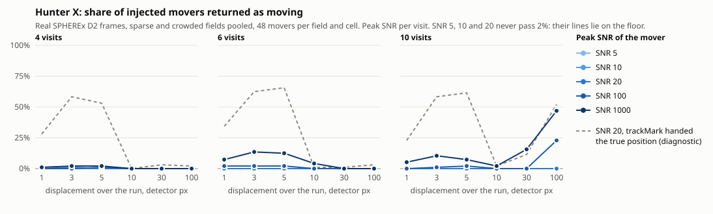

# Hunter X injection–recovery benchmark

How often does Hunter X return a moving source that is really there? Fake
movers were planted into real SPHEREx DR1 frames and the frames were run
through the search exactly as the page runs it. Hunter X was never told where
the movers were. Its answers were compared with the planted tracks afterwards.

**Short answer.** In the range the benchmark was asked about (peak SNR 5–20,
1–10 detector pixels of motion over the run, 4–10 visits, sparse, crowded and
bright-neighbour placements), Hunter X returned **1 of 5 184** planted movers
as moving. The one it found was SNR 20 and moved 3 px in the sparse field,
over 4 visits. The other 5 183 were never reached. The sector matrix never
pointed at them, so the photometry that measures motion never looked. The
photometry itself does work. Handed the true position, it calls 60 % of SNR 20
movers of 3–5 px "moving" and 57 % of the 5 px ones "rate measured". The loss
is in candidate selection, and it is structural, not noise.

Reproduce:

    node tools/hunter-benchmark.mjs --per-cell 48 --cache <dir>   # about 3 minutes once the frames are cached
    node tools/hunter-benchmark.mjs --quick                        # a smoke run
    node tools/hunter-benchmark.mjs --from <dir>/results.json      # tables and chart again from a saved run

The first run reads 20 frames from the public S3 mirror (about 3 MB each) and
caches the cut stamps, so later runs work offline.

## Method

**Frames.** Two real fields, band D2, DR1 (`spherex_dr1`), each cut onto the
page's 0.3° north-up grid. The grid here is 439 × 439 samples, 2.5 samples per
6.15″ detector pixel. The page makes it wider than tall to fit the window,
which changes the sector shapes a little. Each field uses the 10 visits the
page reads first (`spread` over the whole baseline). The 4- and 6-visit runs
are `spread` of those 10, so they also span the full baseline.

| field | centre | galactic b | visits used (D2) | detector σ, MJy/sr |
|---|---|---|---|---|
| sparse: (152) Atala field | 13.4194, +3.8459 | −59° | 2025-07-06, 07-09, 07-19, 12-25; 2026-01-01, 01-03, 01-04, 07-03, 07-04, 07-10 | 0.023–0.032 |
| crowded: RW Aur field | 76.9564, +30.4014 | −6° | 2025-09-08, 09-09, 09-10; 2026-03-01, 03-05, 03-07, 09-10, 09-12, 09-13, 09-15 | 0.035–0.036 |

The visits fall in three seasons a year long. "Linear in time" therefore puts
the mover in three clumps of positions, not at even steps.

**What is planted.** A circular Gaussian. Its FWHM comes from the frame's
`PSF_FWHM` header: 7.46″ = **1.21 detector pixels** in every frame read (the
fallback of 2 px was never needed). It is sampled at the centres of the
detector pixels the stamp keeps, then carried onto the grid by the same
bilinear blend `stamp.js` resamples with. A planted source therefore loses
peak to sub-pixel phase on the grid exactly as a real one does. The detector
patch gets the same pixels, so the single-pixel test (`sharpness.js`) reads the
planted source too. Masked samples stay masked. Every touched value is put
back after each run. See `tools/hunter-inject.mjs` and its test,
`tests/hunter-inject.test.mjs`.

**SNR** is the Gaussian's **peak amplitude over that visit's detector-pixel
sky noise** (`stamp.meta.detectorSigma`, the noise `measure()` floors its own
at). A source centred on a pixel puts exactly SNR × σ in that pixel. For a
1.21 px FWHM, the 3 × 3-pixel aperture SNR is about 0.55 × this peak SNR, so
peak SNR 10 ≈ aperture SNR 5.5. The mover holds the same SNR in every visit.

**Motion.** A straight line in time. The mover is halfway along it at the
midpoint of the run, in a random direction. The **total** displacement between
the first and last visit is 1, 3, 5 or 10 detector pixels, as asked. 30 and
100 px were added to show where the sector stage starts to respond. Over these
~369-day runs, 10 px is 0.17″/day. That is far slower than the 4–8″/day of a
body at 400–800 AU. Such a body would cross 260–500 px between the first and
last season.

**Placement.** Random over the field. The mover is kept 14 px plus half its
track from the edges, and every track position must hold sky in every visit:
no blank, overflow or ghost flag within 3 px. The third scenario, "bright
neighbour (real star)", puts the mover's mid-run position 2–4 px from one of
the 8 real stars in the sparse field that are 30–1500 σ, unsaturated and
unflagged. Its 100 px cells could not be placed.

**One run.** One mover per copy of the visits:

1. plant the mover in every visit;
2. `scoreSectors` (`sectors.js`). The noise floor per visit is the grid noise
   measured before planting. One source moves a few hundred of 193 000
   samples, which does not shift the percentiles that noise is read from;
3. `searchField` (`public/js/huntcore.js`, the code the page now calls): the 12
   strongest standouts ≥ 4, the brightest pixel of each lit sector, the 30″
   same-peak test, `SkyView.trackMark`, the single-pixel test, and
   `rankCandidates`;
4. take the mover out.

SkyBoT/JPL matching was not run, since it can only demote a candidate.

**Matching.** A candidate is on the mover when its standout pixel lies within
1.5 detector pixels of the mover's position in the visit it stood out in, and
the median distance of its measured track points from the mover (visit by
visit) is ≤ 1.5 px. That second test stops a neighbour star's track from being
credited.

- *recovered (moving)*: a candidate on the mover with `kind === 'moving'`;
- *recovered (rate measured)*: that, and `rateIsMeasured` is true. Whether it
  was also ranked (`rankCandidates`, which adds the single-pixel test and the
  60″/h ceiling) is kept as a separate count. The two agree in every cell here;
- *false positives*: candidates called moving (or ranked) whose standout is not
  on the mover. They are counted per run and set against the same field with
  nothing planted.

**Diagnostic, not a recovery.** For each mover, `trackMark` is also called at
the mover's true position in the visit nearest mid-run. This is labelled
"linker given the true position". It shows how much is lost before the
photometry (the sectors never pointed there) and how much after it (pointed
there, but no moving track was made).

48 movers per cell and field. 0 of 48 means the true rate is below about 6 %
(95 %); 0 of 288 means below about 1 %.

## Results

### With nothing planted

| field | visits | standouts followed | called moving | rate measured | ranked |
|---|---|---|---|---|---|
| sparse | 4 | 4 | 0 | 0 | 0 |
| sparse | 6 | 1 | 1 | 0 | 0 |
| sparse | 10 | 3 | 0 | 0 | 0 |
| crowded | 4 | 1 | 0 | 0 | 0 |
| crowded | 6 | 7 | 0 | 0 | 0 |
| crowded | 10 | 6 | 0 | 0 | 0 |

The one "moving" call is a steady star at 13.43926, +3.84658 seen in 6 of 6
visits. Its centroid drifts 11″ over the year with a 4.6″ scatter. That clears
the `moving` bar of 2 × rms but not `rateIsMeasured`'s 3 × max(rms, 6.15″), so
it is never ranked. It reappears as most of the ~0.9 "false moving per run" in
every sparse 6-visit cell. Across all 17 136 planted runs, **2 ranked false
positives** came up. Both were in sparse 10-visit runs with a bright, fast
mover (SNR 50 at 30 px, SNR 300 at 100 px), and are probably the mover's own
light picked up off its track; here they count as false. The ranked list stays
clean, and the reason is that nothing reaches it.

### Pooled: sparse and crowded fields, 4/6/10 visits, 288 movers per row

| SNR | displacement, px | injected | standout on it | recovered (moving) | recovered (rate measured) | linker given the true position: moving / rate measured |
|---|---|---|---|---|---|---|
| 5 | 1 | 288 | 0% | 0% | 0% | 1% / 0% |
| 5 | 3 | 288 | 0% | 0% | 0% | 1% / 0% |
| 5 | 5 | 288 | 0% | 0% | 0% | 0% / 0% |
| 5 | 10 | 288 | 0% | 0% | 0% | 0% / 0% |
| 5 | 30 | 288 | 0% | 0% | 0% | 0% / 0% |
| 5 | 100 | 288 | 0% | 0% | 0% | 0% / 0% |
| 10 | 1 | 288 | 0% | 0% | 0% | 18% / 0% |
| 10 | 3 | 288 | 0% | 0% | 0% | 44% / 20% |
| 10 | 5 | 288 | 0% | 0% | 0% | 41% / 25% |
| 10 | 10 | 288 | 0% | 0% | 0% | 0% / 0% |
| 10 | 30 | 288 | 0% | 0% | 0% | 2% / 0% |
| 10 | 100 | 288 | 0% | 0% | 0% | 9% / 0% |
| 20 | 1 | 288 | 0% | 0% | 0% | 28% / 0% |
| 20 | 3 | 288 | 0% | 0% | 0% | 60% / 25% |
| 20 | 5 | 288 | 0% | 0% | 0% | 60% / 57% |
| 20 | 10 | 288 | 0% | 0% | 0% | 1% / 0% |
| 20 | 30 | 288 | 0% | 0% | 0% | 5% / 0% |
| 20 | 100 | 288 | 0% | 0% | 0% | 19% / 0% |
| 50 | 1 | 288 | 1% | 1% | 0% | 44% / 0% |
| 50 | 3 | 288 | 1% | 1% | 0% | 77% / 41% |
| 50 | 5 | 288 | 0% | 0% | 0% | 75% / 72% |
| 50 | 10 | 288 | 1% | 0% | 0% | 1% / 0% |
| 50 | 30 | 288 | 1% | 0% | 0% | 5% / 0% |
| 50 | 100 | 288 | 6% | 0% | 0% | 21% / 0% |
| 100 | 1 | 288 | 1% | 1% | 0% | 44% / 0% |
| 100 | 3 | 288 | 1% | 1% | 0% | 94% / 49% |
| 100 | 5 | 288 | 2% | 2% | 0% | 92% / 91% |
| 100 | 10 | 288 | 3% | 0% | 0% | 5% / 1% |
| 100 | 30 | 288 | 3% | 0% | 0% | 5% / 0% |
| 100 | 100 | 288 | 19% | 8% | 0% | 23% / 1% |
| 300 | 1 | 288 | 4% | 2% | 0% | 54% / 0% |
| 300 | 3 | 288 | 5% | 5% | 1% | 97% / 52% |
| 300 | 5 | 288 | 6% | 5% | 1% | 97% / 96% |
| 300 | 10 | 288 | 10% | 0% | 0% | 3% / 1% |
| 300 | 30 | 288 | 18% | 3% | 0% | 5% / 0% |
| 300 | 100 | 288 | 37% | 13% | 0% | 20% / 0% |
| 1000 | 1 | 288 | 8% | 5% | 0% | 54% / 0% |
| 1000 | 3 | 288 | 9% | 9% | 0% | 99% / 48% |
| 1000 | 5 | 288 | 8% | 7% | 1% | 100% / 99% |
| 1000 | 10 | 288 | 16% | 2% | 0% | 7% / 3% |
| 1000 | 30 | 288 | 32% | 5% | 0% | 5% / 0% |
| 1000 | 100 | 288 | 47% | 16% | 0% | 22% / 0% |

"Standout on it" is the share of movers that the sector matrix pointed at.
Rows above SNR 20 and beyond 10 px go past what was asked, to show where
anything starts to work at all.

### Every cell asked for: SNR 5/10/20 × 1–10 px × 4/6/10 visits × three placements

Only one row has a recovery. The full table, 108 rows of 48 movers each, is
below.

All 108 cells

| SNR | displacement, px | visits | field | injected | recovered (moving) | recovered (rate measured) | recovery % | false positives per run (moving / ranked) |
|---|---|---|---|---|---|---|---|---|
| 5 | 1 | 4 | sparse (Atala, b −59°) | 48 | 0 | 0 | 0% | 0.00 / 0.00 |
| 5 | 3 | 4 | sparse (Atala, b −59°) | 48 | 0 | 0 | 0% | 0.00 / 0.00 |
| 5 | 5 | 4 | sparse (Atala, b −59°) | 48 | 0 | 0 | 0% | 0.00 / 0.00 |
| 5 | 10 | 4 | sparse (Atala, b −59°) | 48 | 0 | 0 | 0% | 0.00 / 0.00 |
| 10 | 1 | 4 | sparse (Atala, b −59°) | 48 | 0 | 0 | 0% | 0.00 / 0.00 |
| 10 | 3 | 4 | sparse (Atala, b −59°) | 48 | 0 | 0 | 0% | 0.00 / 0.00 |
| 10 | 5 | 4 | sparse (Atala, b −59°) | 48 | 0 | 0 | 0% | 0.00 / 0.00 |
| 10 | 10 | 4 | sparse (Atala, b −59°) | 48 | 0 | 0 | 0% | 0.00 / 0.00 |
| 20 | 1 | 4 | sparse (Atala, b −59°) | 48 | 0 | 0 | 0% | 0.00 / 0.00 |
| 20 | 3 | 4 | sparse (Atala, b −59°) | 48 | 1 | 1 | 2% | 0.00 / 0.00 |
| 20 | 5 | 4 | sparse (Atala, b −59°) | 48 | 0 | 0 | 0% | 0.00 / 0.00 |
| 20 | 10 | 4 | sparse (Atala, b −59°) | 48 | 0 | 0 | 0% | 0.00 / 0.00 |
| 5 | 1 | 6 | sparse (Atala, b −59°) | 48 | 0 | 0 | 0% | 1.00 / 0.00 |
| 5 | 3 | 6 | sparse (Atala, b −59°) | 48 | 0 | 0 | 0% | 1.00 / 0.00 |
| 5 | 5 | 6 | sparse (Atala, b −59°) | 48 | 0 | 0 | 0% | 1.00 / 0.00 |
| 5 | 10 | 6 | sparse (Atala, b −59°) | 48 | 0 | 0 | 0% | 1.00 / 0.00 |
| 10 | 1 | 6 | sparse (Atala, b −59°) | 48 | 0 | 0 | 0% | 1.00 / 0.00 |
| 10 | 3 | 6 | sparse (Atala, b −59°) | 48 | 0 | 0 | 0% | 1.00 / 0.00 |
| 10 | 5 | 6 | sparse (Atala, b −59°) | 48 | 0 | 0 | 0% | 1.00 / 0.00 |
| 10 | 10 | 6 | sparse (Atala, b −59°) | 48 | 0 | 0 | 0% | 1.00 / 0.00 |
| 20 | 1 | 6 | sparse (Atala, b −59°) | 48 | 0 | 0 | 0% | 0.98 / 0.00 |
| 20 | 3 | 6 | sparse (Atala, b −59°) | 48 | 0 | 0 | 0% | 1.00 / 0.00 |
| 20 | 5 | 6 | sparse (Atala, b −59°) | 48 | 0 | 0 | 0% | 1.00 / 0.00 |
| 20 | 10 | 6 | sparse (Atala, b −59°) | 48 | 0 | 0 | 0% | 0.98 / 0.00 |
| 5 | 1 | 10 | sparse (Atala, b −59°) | 48 | 0 | 0 | 0% | 0.00 / 0.00 |
| 5 | 3 | 10 | sparse (Atala, b −59°) | 48 | 0 | 0 | 0% | 0.00 / 0.00 |
| 5 | 5 | 10 | sparse (Atala, b −59°) | 48 | 0 | 0 | 0% | 0.00 / 0.00 |
| 5 | 10 | 10 | sparse (Atala, b −59°) | 48 | 0 | 0 | 0% | 0.00 / 0.00 |
| 10 | 1 | 10 | sparse (Atala, b −59°) | 48 | 0 | 0 | 0% | 0.00 / 0.00 |
| 10 | 3 | 10 | sparse (Atala, b −59°) | 48 | 0 | 0 | 0% | 0.00 / 0.00 |
| 10 | 5 | 10 | sparse (Atala, b −59°) | 48 | 0 | 0 | 0% | 0.00 / 0.00 |
| 10 | 10 | 10 | sparse (Atala, b −59°) | 48 | 0 | 0 | 0% | 0.00 / 0.00 |
| 20 | 1 | 10 | sparse (Atala, b −59°) | 48 | 0 | 0 | 0% | 0.00 / 0.00 |
| 20 | 3 | 10 | sparse (Atala, b −59°) | 48 | 0 | 0 | 0% | 0.00 / 0.00 |
| 20 | 5 | 10 | sparse (Atala, b −59°) | 48 | 0 | 0 | 0% | 0.02 / 0.00 |
| 20 | 10 | 10 | sparse (Atala, b −59°) | 48 | 0 | 0 | 0% | 0.00 / 0.00 |
| 5 | 1 | 4 | crowded (RW Aur, b −6°) | 48 | 0 | 0 | 0% | 0.00 / 0.00 |
| 5 | 3 | 4 | crowded (RW Aur, b −6°) | 48 | 0 | 0 | 0% | 0.00 / 0.00 |
| 5 | 5 | 4 | crowded (RW Aur, b −6°) | 48 | 0 | 0 | 0% | 0.00 / 0.00 |
| 5 | 10 | 4 | crowded (RW Aur, b −6°) | 48 | 0 | 0 | 0% | 0.00 / 0.00 |
| 10 | 1 | 4 | crowded (RW Aur, b −6°) | 48 | 0 | 0 | 0% | 0.00 / 0.00 |
| 10 | 3 | 4 | crowded (RW Aur, b −6°) | 48 | 0 | 0 | 0% | 0.00 / 0.00 |
| 10 | 5 | 4 | crowded (RW Aur, b −6°) | 48 | 0 | 0 | 0% | 0.00 / 0.00 |
| 10 | 10 | 4 | crowded (RW Aur, b −6°) | 48 | 0 | 0 | 0% | 0.00 / 0.00 |
| 20 | 1 | 4 | crowded (RW Aur, b −6°) | 48 | 0 | 0 | 0% | 0.00 / 0.00 |
| 20 | 3 | 4 | crowded (RW Aur, b −6°) | 48 | 0 | 0 | 0% | 0.00 / 0.00 |
| 20 | 5 | 4 | crowded (RW Aur, b −6°) | 48 | 0 | 0 | 0% | 0.00 / 0.00 |
| 20 | 10 | 4 | crowded (RW Aur, b −6°) | 48 | 0 | 0 | 0% | 0.00 / 0.00 |
| 5 | 1 | 6 | crowded (RW Aur, b −6°) | 48 | 0 | 0 | 0% | 0.00 / 0.00 |
| 5 | 3 | 6 | crowded (RW Aur, b −6°) | 48 | 0 | 0 | 0% | 0.00 / 0.00 |
| 5 | 5 | 6 | crowded (RW Aur, b −6°) | 48 | 0 | 0 | 0% | 0.00 / 0.00 |
| 5 | 10 | 6 | crowded (RW Aur, b −6°) | 48 | 0 | 0 | 0% | 0.00 / 0.00 |
| 10 | 1 | 6 | crowded (RW Aur, b −6°) | 48 | 0 | 0 | 0% | 0.00 / 0.00 |
| 10 | 3 | 6 | crowded (RW Aur, b −6°) | 48 | 0 | 0 | 0% | 0.00 / 0.00 |
| 10 | 5 | 6 | crowded (RW Aur, b −6°) | 48 | 0 | 0 | 0% | 0.00 / 0.00 |
| 10 | 10 | 6 | crowded (RW Aur, b −6°) | 48 | 0 | 0 | 0% | 0.00 / 0.00 |
| 20 | 1 | 6 | crowded (RW Aur, b −6°) | 48 | 0 | 0 | 0% | 0.00 / 0.00 |
| 20 | 3 | 6 | crowded (RW Aur, b −6°) | 48 | 0 | 0 | 0% | 0.00 / 0.00 |
| 20 | 5 | 6 | crowded (RW Aur, b −6°) | 48 | 0 | 0 | 0% | 0.00 / 0.00 |
| 20 | 10 | 6 | crowded (RW Aur, b −6°) | 48 | 0 | 0 | 0% | 0.00 / 0.00 |
| 5 | 1 | 10 | crowded (RW Aur, b −6°) | 48 | 0 | 0 | 0% | 0.00 / 0.00 |
| 5 | 3 | 10 | crowded (RW Aur, b −6°) | 48 | 0 | 0 | 0% | 0.00 / 0.00 |
| 5 | 5 | 10 | crowded (RW Aur, b −6°) | 48 | 0 | 0 | 0% | 0.00 / 0.00 |
| 5 | 10 | 10 | crowded (RW Aur, b −6°) | 48 | 0 | 0 | 0% | 0.00 / 0.00 |
| 10 | 1 | 10 | crowded (RW Aur, b −6°) | 48 | 0 | 0 | 0% | 0.00 / 0.00 |
| 10 | 3 | 10 | crowded (RW Aur, b −6°) | 48 | 0 | 0 | 0% | 0.00 / 0.00 |
| 10 | 5 | 10 | crowded (RW Aur, b −6°) | 48 | 0 | 0 | 0% | 0.00 / 0.00 |
| 10 | 10 | 10 | crowded (RW Aur, b −6°) | 48 | 0 | 0 | 0% | 0.00 / 0.00 |
| 20 | 1 | 10 | crowded (RW Aur, b −6°) | 48 | 0 | 0 | 0% | 0.00 / 0.00 |
| 20 | 3 | 10 | crowded (RW Aur, b −6°) | 48 | 0 | 0 | 0% | 0.00 / 0.00 |
| 20 | 5 | 10 | crowded (RW Aur, b −6°) | 48 | 0 | 0 | 0% | 0.00 / 0.00 |
| 20 | 10 | 10 | crowded (RW Aur, b −6°) | 48 | 0 | 0 | 0% | 0.00 / 0.00 |
| 5 | 1 | 4 | bright neighbour (real star, 2–4 px) | 48 | 0 | 0 | 0% | 0.00 / 0.00 |
| 5 | 3 | 4 | bright neighbour (real star, 2–4 px) | 48 | 0 | 0 | 0% | 0.00 / 0.00 |
| 5 | 5 | 4 | bright neighbour (real star, 2–4 px) | 48 | 0 | 0 | 0% | 0.00 / 0.00 |
| 5 | 10 | 4 | bright neighbour (real star, 2–4 px) | 48 | 0 | 0 | 0% | 0.00 / 0.00 |
| 10 | 1 | 4 | bright neighbour (real star, 2–4 px) | 48 | 0 | 0 | 0% | 0.00 / 0.00 |
| 10 | 3 | 4 | bright neighbour (real star, 2–4 px) | 48 | 0 | 0 | 0% | 0.00 / 0.00 |
| 10 | 5 | 4 | bright neighbour (real star, 2–4 px) | 48 | 0 | 0 | 0% | 0.00 / 0.00 |
| 10 | 10 | 4 | bright neighbour (real star, 2–4 px) | 48 | 0 | 0 | 0% | 0.00 / 0.00 |
| 20 | 1 | 4 | bright neighbour (real star, 2–4 px) | 48 | 0 | 0 | 0% | 0.00 / 0.00 |
| 20 | 3 | 4 | bright neighbour (real star, 2–4 px) | 48 | 0 | 0 | 0% | 0.00 / 0.00 |
| 20 | 5 | 4 | bright neighbour (real star, 2–4 px) | 48 | 0 | 0 | 0% | 0.00 / 0.00 |
| 20 | 10 | 4 | bright neighbour (real star, 2–4 px) | 48 | 0 | 0 | 0% | 0.00 / 0.00 |
| 5 | 1 | 6 | bright neighbour (real star, 2–4 px) | 48 | 0 | 0 | 0% | 1.00 / 0.00 |
| 5 | 3 | 6 | bright neighbour (real star, 2–4 px) | 48 | 0 | 0 | 0% | 1.00 / 0.00 |
| 5 | 5 | 6 | bright neighbour (real star, 2–4 px) | 48 | 0 | 0 | 0% | 1.00 / 0.00 |
| 5 | 10 | 6 | bright neighbour (real star, 2–4 px) | 48 | 0 | 0 | 0% | 1.00 / 0.00 |
| 10 | 1 | 6 | bright neighbour (real star, 2–4 px) | 48 | 0 | 0 | 0% | 1.00 / 0.00 |
| 10 | 3 | 6 | bright neighbour (real star, 2–4 px) | 48 | 0 | 0 | 0% | 1.00 / 0.00 |
| 10 | 5 | 6 | bright neighbour (real star, 2–4 px) | 48 | 0 | 0 | 0% | 1.00 / 0.00 |
| 10 | 10 | 6 | bright neighbour (real star, 2–4 px) | 48 | 0 | 0 | 0% | 1.00 / 0.00 |
| 20 | 1 | 6 | bright neighbour (real star, 2–4 px) | 48 | 0 | 0 | 0% | 1.00 / 0.00 |
| 20 | 3 | 6 | bright neighbour (real star, 2–4 px) | 48 | 0 | 0 | 0% | 1.00 / 0.00 |
| 20 | 5 | 6 | bright neighbour (real star, 2–4 px) | 48 | 0 | 0 | 0% | 1.00 / 0.00 |
| 20 | 10 | 6 | bright neighbour (real star, 2–4 px) | 48 | 0 | 0 | 0% | 1.00 / 0.00 |
| 5 | 1 | 10 | bright neighbour (real star, 2–4 px) | 48 | 0 | 0 | 0% | 0.00 / 0.00 |
| 5 | 3 | 10 | bright neighbour (real star, 2–4 px) | 48 | 0 | 0 | 0% | 0.00 / 0.00 |
| 5 | 5 | 10 | bright neighbour (real star, 2–4 px) | 48 | 0 | 0 | 0% | 0.00 / 0.00 |
| 5 | 10 | 10 | bright neighbour (real star, 2–4 px) | 48 | 0 | 0 | 0% | 0.00 / 0.00 |
| 10 | 1 | 10 | bright neighbour (real star, 2–4 px) | 48 | 0 | 0 | 0% | 0.00 / 0.00 |
| 10 | 3 | 10 | bright neighbour (real star, 2–4 px) | 48 | 0 | 0 | 0% | 0.00 / 0.00 |
| 10 | 5 | 10 | bright neighbour (real star, 2–4 px) | 48 | 0 | 0 | 0% | 0.00 / 0.00 |
| 10 | 10 | 10 | bright neighbour (real star, 2–4 px) | 48 | 0 | 0 | 0% | 0.00 / 0.00 |
| 20 | 1 | 10 | bright neighbour (real star, 2–4 px) | 48 | 0 | 0 | 0% | 0.00 / 0.00 |
| 20 | 3 | 10 | bright neighbour (real star, 2–4 px) | 48 | 0 | 0 | 0% | 0.00 / 0.00 |
| 20 | 5 | 10 | bright neighbour (real star, 2–4 px) | 48 | 0 | 0 | 0% | 0.00 / 0.00 |
| 20 | 10 | 10 | bright neighbour (real star, 2–4 px) | 48 | 0 | 0 | 0% | 0.00 / 0.00 |

Pooled over the asked range: sparse 1/1728, crowded 0/1728, real bright
neighbour 0/1728 returned as moving. The same counts hold for rate measured.

### Faint mover beside a bright star

The mover passes a planted steady star (same PSF, constant brightness in every
visit). The star sits on the perpendicular through the mover's mid-run
position, at the given separation. Sparse field, 6 visits, the same 48 movers
in every cell as in the no-star control (same seed). Peak brightness ratios
star:mover are 3, 10, 30, 100. Each cell reads
**pipeline recovered as moving · linker given the true position, moving · false
moving per run**. Rate measured is 0 % in every cell with a star. The SNR 1000,
5 px control has 1 of 48. The planted star was
never itself called moving (0 times in 4 608 runs). SNR 1000 is added as a
reference where the pipeline recovers something without a star.

**SNR 10, 5 px, 6 visits.** No star: pipeline 0% moving (standout on it 0%), trackMark at the true position 77%; 48 movers, false moving per run 1.00.

| separation, px | 3:1 | 10:1 | 30:1 | 100:1 |
|---|---|---|---|---|
| 1.5 | 0% · 0% · 0.94 | 0% · 0% · 0.92 | 0% · 0% · 0.92 | 0% · 0% · 0.92 |
| 3 | 0% · 8% · 0.94 | 0% · 0% · 0.92 | 0% · 0% · 0.92 | 0% · 0% · 0.92 |
| 5 | 0% · 56% · 0.96 | 0% · 40% · 0.94 | 0% · 31% · 0.92 | 0% · 19% · 0.92 |
| 8 | 0% · 77% · 0.96 | 0% · 77% · 0.94 | 0% · 77% · 0.94 | 0% · 77% · 0.94 |

**SNR 10, 10 px, 6 visits.** No star: pipeline 0% moving (standout on it 0%), trackMark at the true position 0%; 48 movers, false moving per run 1.00.

| separation, px | 3:1 | 10:1 | 30:1 | 100:1 |
|---|---|---|---|---|
| 1.5 | 0% · 0% · 0.92 | 0% · 0% · 0.88 | 0% · 0% · 0.88 | 0% · 0% · 0.88 |
| 3 | 0% · 2% · 0.90 | 0% · 0% · 0.88 | 0% · 0% · 0.88 | 0% · 0% · 0.88 |
| 5 | 0% · 0% · 0.94 | 0% · 0% · 0.85 | 0% · 0% · 0.85 | 0% · 0% · 0.85 |
| 8 | 0% · 0% · 0.88 | 0% · 0% · 0.88 | 0% · 0% · 0.88 | 0% · 0% · 0.88 |

**SNR 20, 5 px, 6 visits.** No star: pipeline 0% moving (standout on it 0%), trackMark at the true position 90%; 48 movers, false moving per run 0.98.

| separation, px | 3:1 | 10:1 | 30:1 | 100:1 |
|---|---|---|---|---|
| 1.5 | 0% · 0% · 0.92 | 0% · 0% · 0.92 | 0% · 0% · 0.92 | 0% · 0% · 0.92 |
| 3 | 0% · 4% · 0.92 | 0% · 0% · 0.92 | 0% · 0% · 0.92 | 0% · 0% · 0.92 |
| 5 | 0% · 77% · 0.92 | 0% · 75% · 0.90 | 0% · 69% · 0.90 | 0% · 52% · 0.90 |
| 8 | 0% · 90% · 0.90 | 0% · 90% · 0.90 | 0% · 90% · 0.90 | 0% · 90% · 0.90 |

**SNR 20, 10 px, 6 visits.** No star: pipeline 0% moving (standout on it 0%), trackMark at the true position 2%; 48 movers, false moving per run 1.00.

| separation, px | 3:1 | 10:1 | 30:1 | 100:1 |
|---|---|---|---|---|
| 1.5 | 0% · 0% · 0.88 | 0% · 0% · 0.88 | 0% · 0% · 0.88 | 0% · 0% · 0.88 |
| 3 | 0% · 0% · 0.88 | 0% · 0% · 0.88 | 0% · 0% · 0.88 | 0% · 0% · 0.88 |
| 5 | 0% · 2% · 0.88 | 0% · 0% · 0.88 | 0% · 0% · 0.88 | 0% · 0% · 0.88 |
| 8 | 0% · 2% · 0.90 | 0% · 2% · 0.90 | 0% · 2% · 0.90 | 0% · 2% · 0.90 |

**SNR 1000, 5 px, 6 visits.** No star: pipeline 25% moving (standout on it 27%), trackMark at the true position 98%; 48 movers, false moving per run 0.90.

| separation, px | 3:1 | 10:1 | 30:1 | 100:1 |
|---|---|---|---|---|
| 1.5 | 2% · 0% · 0.90 | 2% · 0% · 0.90 | 2% · 0% · 0.90 | 0% · 0% · 0.90 |
| 3 | 4% · 10% · 0.90 | 0% · 0% · 0.90 | 0% · 0% · 0.90 | 0% · 0% · 0.90 |
| 5 | 2% · 98% · 0.90 | 2% · 98% · 0.90 | 2% · 98% · 0.90 | 2% · 79% · 0.90 |
| 8 | 4% · 98% · 0.90 | 6% · 98% · 0.90 | 4% · 98% · 0.90 | 4% · 98% · 0.90 |

**SNR 1000, 10 px, 6 visits.** No star: pipeline 2% moving (standout on it 27%), trackMark at the true position 6%; 48 movers, false moving per run 0.88.

| separation, px | 3:1 | 10:1 | 30:1 | 100:1 |
|---|---|---|---|---|
| 1.5 | 0% · 0% · 0.85 | 0% · 0% · 0.85 | 2% · 0% · 0.85 | 2% · 0% · 0.85 |
| 3 | 0% · 0% · 0.85 | 0% · 0% · 0.85 | 0% · 0% · 0.85 | 0% · 0% · 0.85 |
| 5 | 2% · 0% · 0.85 | 2% · 0% · 0.85 | 2% · 0% · 0.85 | 0% · 0% · 0.85 |
| 8 | 2% · 4% · 0.85 | 2% · 4% · 0.85 | 2% · 4% · 0.85 | 2% · 2% · 0.85 |

What it shows:

- **At SNR 10 and 20 the star changes nothing in the pipeline result, because
  it is already 0 % without one.** The sector stage does not reach these movers
  at any separation.
- **The photometry fails within 3 px of a brighter star**, even when handed the
  true position. `measure()` searches ±2 detector pixels for the brightest
  pixel, finds the star, and the track becomes the star's. For 5 px movers at
  1.5 and 3 px, the linker drops from 77–98 % (no star) to 0–10 % at every
  ratio. At 5 px it
  depends on the ratio (SNR 20: 77 % at 3:1 down to 52 % at 100:1). At 8 px the
  star makes no difference.
- **With a bright mover (SNR 1000, 5 px) a star 8 px away cuts the pipeline
  from 25 % to 4–6 %.** The star's steady peak is now the sector's peak, so the
  mover no longer changes it. This is the blind spot the sector code's own
  comment describes ("a faint newcomer beside a brighter steady star leaves the
  sector's peak where it was"). It reaches across the whole sector, about
  35 × 44 detector pixels, not just a few pixels.
- With a real star 2–4 px away (the third column of the main grid): 0 of 1 728
  in the asked range. At SNR 1000, 42 of 576 movers of 1–10 px were returned as
  moving, against 60 of 576 in the same field without the neighbour.

## What the numbers mean

1. **The sector matrix cannot see a slow mover.** A sector's score is its
   brightest pixel in one visit against the median of that pixel over the
   visits. A mover that stays inside its sector, as everything moving ≤ 10 px a
   year does, is in every visit, so it is in the median. It looks like a star
   and scores zero. That is why "standout on it" is 0 % for SNR ≤ 20 at every
   displacement, and only 8–16 % even at SNR 1000. A faint source (SNR ≤ 20) is
   also below the brightest steady star of almost every sector (sector peaks in
   these fields run from 19 σ to 29 000 σ), so it never becomes the peak at
   all. Movers start to light sectors only when they cross from one sector to
   another between seasons (30–100 px: 18–47 % at SNR ≥ 300).
2. **The linker works in a narrow window.** Given the right position,
   `trackMark` returns "moving" for 60–100 % of movers of 3–5 px at SNR ≥ 20,
   and "rate measured" for most of the 5 px ones. It fails below that window:
   1 px is not motion by its own rule (`> 1 px`, and `rateIsMeasured` needs
   3 px). It fails above it: at 10 px or more the seasons are more than ±2 px
   apart, the fixed search box holds only one season's visits, and the fit has
   too few points.
3. **For a Planet X–like mover the visits are a year apart, and its motion is
   hundreds of pixels.** Within one season it moves a few pixels a week. Across
   seasons it lands in a different sector. The sector matrix can flag a season
   in which it appeared, but `trackMark` measures at one fixed position. It
   cannot link one season's detection to the next, so such an object would come
   out as a one-visit flash or "intermittent", never as a mover with a rate.
   This benchmark did not test motion within a single season or across
   hundreds of pixels; it is the next thing worth measuring.
4. **False positives are not the problem.** The ranked list held 2 false
   entries in 17 136 runs, and the baseline fields rank nothing. The "moving"
   calls that are not ranked (~0.9 per run in the sparse 6-visit set) are one
   real star with centroid jitter, and `rateIsMeasured` stops it.

## Defects found

No code defect was found in what was measured. Every miss traces to a rule
working as written. The results do expose design limits, listed above, which
are for the owner to weigh:

- the sector score cannot respond to a source present in every visit;
- one strongest peak per sector hides anything fainter in that sector;
- `trackMark` searches ±2 px around one fixed position and so cannot follow a
  mover across seasons;
- a steady star with ~5″ centroid jitter is called `moving` (2 × rms bar),
  though not ranked.

Two changes were made for the benchmark, neither changing behaviour. The
search loop moved out of `app.js` into `public/js/huntcore.js` (`searchField`,
`flashesOf`), and `app.js` now calls it. `npm test` passes.

## Limitations

- **The PSF is a Gaussian** at the header's median FWHM (1.21 px). Real SPHEREx
  PSFs are undersampled and not Gaussian, and they vary across the detector.
  The planted source is point-sampled at pixel centres, with no pixel
  integration.
- **No saturation.** Planted stars up to 100 000 σ never saturate or carry
  flags, as a real star of that brightness would. The bright-star results at
  100:1 and SNR 1000 are therefore kinder than reality.
- Motion is linear in time, with no parallax loop. SNR is constant against
  each visit's noise. One mover per run.
- One band (D2), two fields, one set of 10 visits each, a square grid (the page
  is usually wider). Sector shapes and the visit pattern change the numbers.
  The conclusion does not change, because it follows from how the score is
  defined.
- The sector noise floor is taken before planting. That is justified above,
  not measured cell by cell.
- The real-star neighbour scenario has only 8 qualifying stars, and its 100 px
  cells could not be placed.
- SkyBoT/JPL matching was not run.
