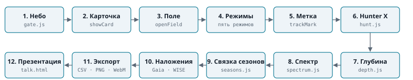
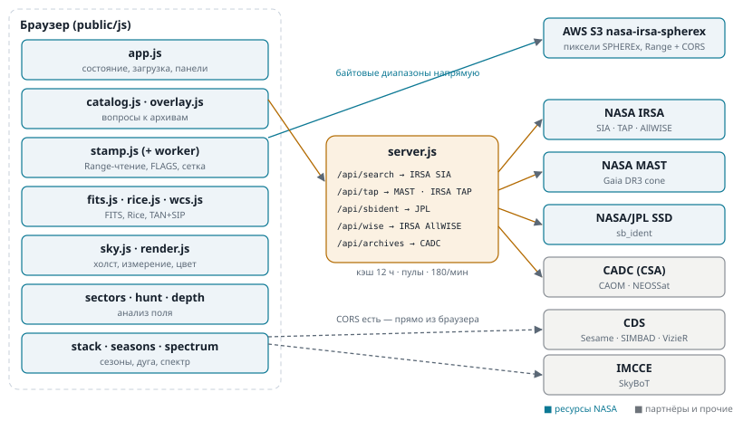
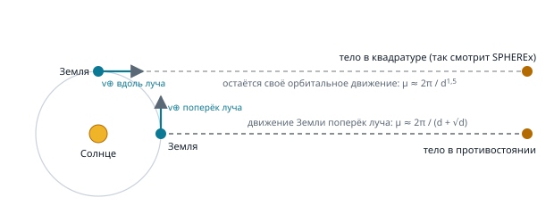
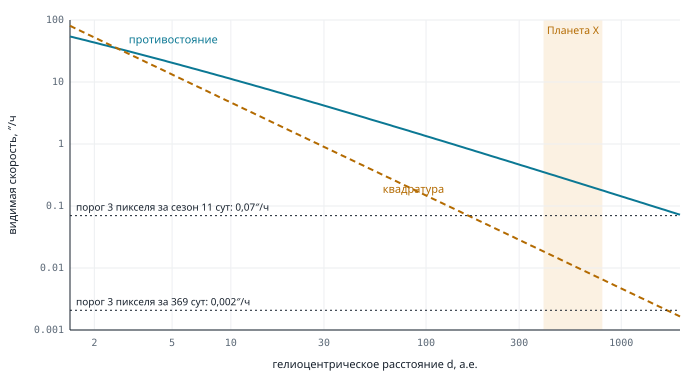

# Muninn изнутри

Учебное руководство по сайту перед защитой на NASA Space Apps 2026 · задание «Planet X and SPHEREx» · команда Yggdrasil

Состояние кода: ветка `main`, коммит `81fb96d` от 14 ноября 2026. Ссылки вида `stamp.js:101` указывают на файл и строку в этом коммите; файлы браузера лежат в `public/js/`, сервер в `server.js` в корне.

<div class="toc-here"></div>

## 0. Как пользоваться этим руководством

Руководство написано по коду, а не по README. Где README, старые шпаргалки и код расходятся, верным считается код, а расхождение отмечено (их список в разделе 17.3).

Что проверено 14 ноября 2026 руками:

- `npm test`: около 190 тестов, все зелёные, около 3 с, без сети.
- `npm run probe`: заголовок настоящего кадра SPHEREx, ошибка WCS туда-обратно по всему детектору 2040×2040 не больше 0,015 пикселя, масштаб 6,139″ на пиксель.
- Заголовок плоскости `FLAGS` настоящего кадра DR1 (поле Atala, D1, 29 июня 2025): список битов `MSKN0000…MSKN0028` в разделе 4 переписан с него.
- `node tools/sensitivity.mjs`: живой замер глубины по 18 настоящим заходам поля Atala (D1–D6, по три на полосу) — 17,61 AB за заход, от 16,68 в D6 до 18,04 в D4. Совпадает с README.
- Все числа формул из разделов 7–12 пересчитаны скриптом, который импортирует модули сайта (`depth.js`, `hunt.js`, `seasons.js`, `sharpness.js`, `overlay.js`).

- `node tools/verify-mover.mjs 13.4194 3.8459 0.15`: SNR в центре поля Atala по 15 заходам D2 — 373,9 на 25 декабря 2025 и 0,5–2,4 в остальных; медиана остальных 1,3.

Первая попытка живых скриптов оборвалась на сбросе соединения с IRSA (`ECONNRESET`), вторая прошла. Что проверить не удалось, сказано в тексте прямо, на месте.

Как читать формулы. Угловые секунды пишутся как ″, угловые минуты как ′. «Пиксель» без уточнения означает пиксель детектора SPHEREx, 6,15″. Отсчёт общей сетки, на которую пересчитывается кадр, назван «отсчётом сетки»; он мельче пикселя детектора.

## 1. Что это и как по нему ходит человек

### 1.1. Суть в одном абзаце

SPHEREx снимает всё небо в ближнем инфракрасном диапазоне (0,75–5,0 мкм, 102 спектральных канала) примерно дважды в год. Поэтому почти у каждой точки неба есть кадры на несколько дат. Звёзды стоят на месте, тела Солнечной системы двигаются. Muninn берёт эти кадры прямо из архива NASA, приводит их к одной сетке с севером вверх и даёт сравнить: промигать, разрезать шторкой, вычесть, сложить сезон. Щелчок по точке измеряет её во всех заходах и говорит, что там: ничего, звезда, вспышка один раз, движущееся тело или насыщенная звезда. Всё считается в браузере; сервер раздаёт страницу и пересылает вопросы к архивам, которые не отдают заголовков CORS. Пиксели через сервер не идут.

Название: Мунин, «память», второй ворон Одина, каждый вечер рассказывал, что изменилось в мирах. Работа сайта та же: помнить, как выглядел кусок неба в прошлый заход, и показывать разницу. Приём мигания тот же, которым Клайд Томбо нашёл Плутон в 1930 году.

### 1.2. Путь пользователя



1. **Небо** (`gate.js`, класс `Gate`, `gate.js:152`). Вход через карту неба. Это не фотография, а каталоги: 15 568 звёзд до V ≈ 7 (Bright Star Catalogue, Hoffleit & Warren 1991, VizieR V/50; слабее V 6 — Hipparcos, VizieR I/239; файл `public/data/sky/stars.json`), 110 объектов Мессье из SIMBAD (`data/sky/deepsky.json`), планеты на текущий момент по методу JPL «Approximate Positions of the Planets» (Standish; `ephemeris.js`, точность несколько угловых минут для внутренних планет). Млечный Путь — модель по галактическим координатам, так и подписано.
2. **Карточка** (`showCard`, `app.js:3964`). Щелчок по звезде, маркеру или пустому месту открывает карточку с настоящим кадром SPHEREx этого места: либо заранее снятым (`public/img/sky/`, `public/img/fields/`), либо прочитанным из архива на лету (`previewLive`, `app.js:4119`). Полёт в поле только по кнопке карточки (`enterFrom`, `app.js:4230`); загрузка стартует одновременно с полётом.
3. **Поле** (`openField`, `app.js:3379`). Список кадров берётся из готового индекса (десять полей зашиты в `public/data/fields/`) или живым запросом к IRSA через сервер. Кадры группируются в заходы, первые десять заходов читаются сразу, остальные дочитываются в фоне до 60 (раздел 5.2).
4. **Режимы сравнения**: мигание (blink), шторка (wipe), разность A−B (difference), один заход (single), стек сезона (stack). Пробел — пуск и пауза, ← → — шаг, H — кадр на всё окно.
5. **Метка**. Щелчок по точке: она измеряется в каждом заходе (`trackMark`, `sky.js:1399`), получает вердикт, имя из SkyBoT и JPL, опознание по каталогам (SIMBAD, Gaia DR3, 2MASS, AllWISE, CatWISE2020, VSX).
6. **Hunter X** (`runHunt`, `app.js:617`). Автоматический поиск: самые выделившиеся сектора кадра (до двенадцати) измеряются во всех заходах, движущееся ранжируется по медленности, вспышки одного захода идут отдельным списком.
7. **Глубина** (`measureDepth`, `app.js:1150`). Предел 5σ одного захода по шуму пикселей детектора и сравнение с предсказанной яркостью Планеты Девять.
8. **Спектр** метки (`readSpectrum`, `app.js:2727`): до 60 экспозиций, каждая на своей длине волны из таблицы `WCS-WAVE` файла, плюс кривая блеска на одной длине волны.
9. **Связка сезонов** (`linkMark`, `app.js:2781`): дуга параллакса для расстояний 30–2000 а.е. и поиск источника на ней в соседнем сезоне.
10. **Наложения**: положения Gaia DR3 (перенесённые по собственному движению на дату захода) и AllWISE поверх кадра; снимок AllWISE W1/W2 или модель неба Gaia как сторона B шторки.
11. **Экспорт**: ссылка с полем, режимом, заходом и метками (`hash.js`), PNG кадра (`savePNG`, `app.js:3722`), WebM мигания (`recordBlink`, `app.js:3745`), CSV измерений метки (`saveTrack`, `app.js:3715`; формат в `export.js:21`).
12. **Презентация** `talk.html` (`talk.js`): десять слайдов и приложение; второй слайд читает настоящие кадры из архива вживую. PDF-копии делает `tools/talk-pdf.mjs`.

### 1.3. Готовые поля

Десять полей с зашитым индексом кадров (`public/data/targets.json`, числа заходов из IRSA на 13 ноября 2026):

| поле | RA, Dec (°) | полоса | заходов | дней | зачем |
|---|---|---|---|---|---|
| (152) Atala | 13,4194, +3,8459 | D2 | 15 | 369 | астероид в центре ровно в одном заходе |
| Северный полюс эклиптики | 269,7, +66,56 | все | 158 | 522 | самое посещаемое место неба |
| Южный полюс эклиптики | 90,0, −66,56 | все | 222 | 528 | южное глубокое поле |
| M51 | 202,4696, +47,1953 | все | 44 | 410 | галактика |
| M42 | 83,8221, −5,3911 | все | 45 | 394 | туманность |
| Звезда Барнарда | 269,4463, +4,768 | D2 | 17 | 397 | цель задания |
| ε Indi B | 331,0967, −56,8012 | D2 | 29 | 526 | цель задания |
| WISE 0855−0714 | 133,7595, −7,2422 | D6 | 17 | 370 | цель задания |
| RW Aurigae | 76,9564, +30,4014 | D2 | 16 | 372 | цель задания |
| R Draconis | 248,1675, +66,755 | D3 | 55 | 414 | цель задания |

Для полюсов и R Dra индекс обрезан лимитом архива (`truncated: true`, раздел 16.2). Пять целей задания открываются одной кнопкой из строки «Цели задания» под поиском.

## 2. Данные и сервисы



Правило проекта: сначала ресурсы NASA, остальное там, где NASA такого не даёт или как второй ответ на случай, если первый архив лежит (`catalog.js:1-27`). Пометка «NASA, из задания» значит, что ресурс назван во вкладке Resources задания или это сам SPHEREx.

### 2.1. Сводная таблица

| что и зачем | владелец | точка доступа | путь | NASA |
|---|---|---|---|---|
| пиксели SPHEREx Level 2 — всё, что на экране | NASA/JPL-Caltech, IPAC/IRSA; зеркало AWS Open Data | S3 `nasa-irsa-spherex` | браузер, Range | да, из задания |
| индекс кадров — что покрывает точку | NASA IRSA | SIA v2, 4 коллекции DR1/QR3 | `/api/search` | да, из задания |
| Gaia DR3, AllWISE, CatWISE2020, 2MASS — опознание, наложение | NASA IRSA | TAP, 4 таблицы | `/api/tap` | да (Gaia — данные ESA) |
| Gaia DR3 для одной звезды — быстро | NASA MAST (STScI) | `Mast.Catalogs.GaiaDR3.Cone` | `/api/tap` | да, Gaia из Resources |
| снимок AllWISE — сторона B шторки | NASA IRSA | SIA `wise_allwise` + вырезка IBE | `/api/wise` | да |
| известные малые тела | NASA/JPL SSD | `sb_ident.api` | `/api/sbident` | да |
| известные малые тела, второй источник | IMCCE (Парижская обсерватория) | SkyBoT `conesearch.php` | браузер | нет |
| другие телескопы поля, NEOSSat | CADC (Канада), партнёр CSA | Argus TAP, CAOM | `/api/archives` | партнёр из Resources |
| имя → координаты | CDS, зеркало CfA | Sesame | браузер | нет |
| что за объект, подписи | CDS, зеркало CfA | SIMBAD TAP | браузер | нет |
| второй дом каталогов; VSX | CDS | VizieR TAP | браузер | нет |

Точные адреса и запросы — в подразделах ниже.

Пиксели SPHEREx и индекс кадров — это главный ресурс задания. IRSA назван во вкладке Resources, туда же входят SPHEREx Tutorial Notebooks (по ним проверена раскладка файла DR1), WiseView (образец шторки WISE), данные Gaia, CADC как партнёр CSA и спутник NEOSSat.

### 2.2. Пиксели: зеркало AWS S3

Где в коде: `catalog.js:39-43` (`toS3`), `stamp.js:32-44` (`fetchRange`), `stamp.js:246` (`loadStamp`).

Индекс IRSA даёт адрес вида `https://irsa.ipac.caltech.edu/ibe/data/spherex/…`; `toS3` заменяет префикс на зеркало `nasa-irsa-spherex` в AWS. Причина: зеркало отвечает на запросы `Range` и отдаёт `Access-Control-Allow-Origin: *`, а IRSA заголовков CORS не отдаёт. Браузер читает только нужные байты:

- заголовки: первые 36 864 байта файла (`HEADER_PROBE`, `stamp.js:29`), при нехватке размер удваивается до 1 МБ (`stamp.js:70-80`);
- строки детектора, на которые попадает поле, с запасом в одну строку (`stamp.js:259-265`);
- те же строки плоскости `FLAGS` (раздел 4), одновременно с пикселями;
- для спектра: последние 2 × 2880 байт файла, это таблица `WCS-WAVE` (`stamp.js:391-401`, запрос `Range: bytes=-5760`).

Защита от ошибки: если сервер проигнорировал `Range` и ответил 200 со всем файлом, то для чтения с нулевого байта берётся нужный кусок, а для любого другого места кадр отвергается, иначе были бы декодированы не те строки без всякой ошибки (`stamp.js:38-43`; тест `pipeline.test.mjs`).

Файл кадра весит 65–72 МБ (в коде принято 65,4 МБ, `release.js:15`; файл, который читал `probe` 14 ноября, 71 634 240 байт). Заход обходится в 1–3 МБ, вдвое больше вместе с флагами. Счётчик прочитанных мегабайт виден на странице.

Кэш в браузере: заголовок и таблица длин волн каждого файла держатся в памяти, до 256 файлов (`stamp.js:52-67`); неудачное чтение забывается, его можно повторить.

### 2.3. Индекс кадров: IRSA SIA v2

Где: `server.js:198-226` (`queryCollectionOnce`, `queryCollection`), `server.js:681-724` (`lookup`), `catalog.js:170` (`searchFrames`), `catalog.js:209` (`frameFromRow`).

Запрос: `GET https://irsa.ipac.caltech.edu/SIA?COLLECTION=<имя>&POS=circle <ra> <dec> <r>&MAXREC=500` для каждой из четырёх коллекций параллельно. Радиус конуса по умолчанию 0,006°, допустимо 0,002–0,03° (`server.js:323`): кадр SPHEREx около 3,5° в поперечнике, так что почти точечный конус уже находит всё, а широкий дорого обходится архиву. Ответ — VOTable, разбирается `votable.js`. Из строк берутся только `dataproduct_subtype = science` и `calib_level ≥ 2`, дубликаты по адресу выбрасываются (`server.js:704-711`).

Из строки получается кадр (`frameFromRow`): `obs_id`, время `t_min` (MJD), полоса из `energy_bandpassname` (`SPHEREx-D2` → `D2`), диапазон длин волн `em_min…em_max` (в метрах, переводится в мкм), центр кадра `s_ra, s_dec`, выдержка `t_exptime`, коллекция, адрес `access_url`.

Лимит `MAXREC=500` (`server.js:65`): без него конус у полюса эклиптики отдаёт 25 000 строк, 54 МБ и думает четыре минуты. Если архив ответил статусом `OVERFLOW`, поле помечается «список обрезан», и страница это пишет.

Повтор: если соединение оборвалось быстрее чем за 30 с, через 800 мс задаётся ещё один вопрос с остатком времени; ответ «нет» (HTTP-ошибка или ошибка в VOTable) не повторяется (`server.js:213-226`). Ответ кэшируется на 12 часов, но только полный: если хоть одна коллекция не ответила, кэш не пишется, иначе один обрыв превращался в 12 часов «SPHEREx тут не был» (`server.js:719-722`).

Готовые поля: их индексы лежат в `public/data/fields/*.json` и отдаются без вопроса к IRSA, поиск по угловому совпадению ближе 0,01° (`catalog.js:170-180`, `server.js:191-194`). Поэтому десять полей открываются за ~80 мс и работают, даже когда IRSA лежит, и даже на чисто статическом хостинге.

Новый выпуск данных: одна строка, список коллекций в `release.js:12`. Этот список читают сервер, функция Cloudflare и скрипт `npm run bake`. 13 ноября 2026 так и переключились с QR2 на DR1 + QR3.

### 2.4. Каталоги через IRSA TAP, MAST и VizieR

Где: `overlay.js:102-160` (шаблоны и ADQL), `server.js:350-456` (`handleTap`, `hedged`, `askMastGaia`, `askIrsaTap`), `catalog.js:448-459` (`catalogueRows`).

Адреса: IRSA TAP `https://irsa.ipac.caltech.edu/TAP/sync` (таблицы `gaia_dr3_source`, `allwise_p3as_psd`, `catwise_2020`, `fp_psc`, ответ CSV), VizieR TAP `https://tapvizier.cds.unistra.fr/TAPVizieR/tap/sync` (таблицы `I/355/gaiadr3`, `II/328/allwise`, `II/246/out`, `B/vsx/vsx`), MAST `https://mast.stsci.edu/api/v0/invoke`.

Каждый каталог описан один раз в `CATALOGUES` (`overlay.js:102`) с именами колонок каждого архива. Строки из IRSA переименовываются в имена VizieR (`renameRow`, `overlay.js:163`), так что дальше всё разбирается одним кодом.

ADQL строится из шаблона (`coneQuery`, `overlay.js:154`):

```sql
SELECT TOP <n> <колонки>
FROM <таблица>
WHERE CONTAINS(POINT('ICRS', ra, dec), CIRCLE('ICRS', <ra>, <dec>, <r>)) = 1
  AND <звёздная величина> <= <предел>
ORDER BY <звёздная величина>
```

Каждое число проходит через `fixed()` (`overlay.js:83`): только конечное число, отформатированное `toFixed`; имена таблиц и колонок берутся только из таблицы `CATALOGUES`. Ничего, что прислал клиент, не становится текстом запроса.

Гонка архивов: браузер одновременно спрашивает IRSA (через сервер) и VizieR TAP (напрямую), берётся первый ответ (`Promise.any`, `catalog.js:448-459`). CatWISE2020 спрашивается только у IRSA. На статическом хостинге без сервера остаётся VizieR.

MAST для Gaia: если спрашивают Gaia в круге не больше 0,04° (одна звезда, `MAST_MAX_DEG`, `server.js:412`), сервер сначала спрашивает MAST (`Mast.Catalogs.GaiaDR3.Cone`, тайм-аут 40 с), а если за 3 с ответа нет или MAST упал, параллельно спрашивает IRSA TAP (`hedged`, `server.js:385`; `MAST_HEDGE_MS = 3000`). MAST отдаёт 64-битный `source_id` голым числом, которое JavaScript округлил бы; поэтому номер берётся из поля `designation` (`overlay.js:168-178`).

Ограничения запроса `/api/tap` (`server.js:359-368`): радиус 1″–1°, строк не больше 301, предел величины от −2 до 30 с округлением до 0,5 (чтобы почти одинаковые вопросы попадали в один кэш). Тайм-аут IRSA TAP 75 с.

### 2.5. Снимок AllWISE

Где: `server.js:473-592` (`handleWise`, `cutWise`, `binFits`), `wise.js:112` (`loadWise`).

Сервер спрашивает SIA коллекции `wise_allwise` в точке поля (конус 0,002°, `MAXREC=40`), выбирает плитку атласа `*-w<полоса>-int-3.fits` с центром ближе всего к полю и просит вырезку той же IBE-службы: `<адрес плитки>?center=<ra>,<dec>&size=<s>deg`. Адрес вырезки берётся из ответа архива, поэтому перед запросом проверяется, что это `https://irsa.ipac.caltech.edu` (`isIrsaUrl`, `server.js:229`). Ответ приходит в gzip, распаковывается (не больше 64 МБ), проверяется подпись `SIMPLE`, усредняется блоками до стороны не больше 640 пикселей (`binFits`, `server.js:543`) с пересчётом `CRPIX` и `CDELT`/`CD`. Пиксель атласа 1,375″, сетка поля грубее, так что вырезка 0,6° (10 МБ) уходит около 1 МБ без видимой потери.

Размер вырезки: клиент просит $\min(0{,}6°,\ 1{,}1\cdot\text{сторона поля} + 0{,}01°)$, сервер округляет вверх до шага 0,05° (`server.js:478`). Обе операции укладываются в 85 с, меньше обрыва туннеля Cloudflare на 100 с. Кэш на диске 12 часов, пул 3 одновременных вырезки.

В браузере вырезка пересчитывается на ту же касательную сетку, что и кадры SPHEREx, через проекцию SIN или TAN с `CD` или `CDELT`+`CROTA2` (`simpleProjection`, `wise.js:33`), билинейно (`resampleOnto`, `wise.js:71`). Если покрыто меньше половины поля, это ошибка.

AllWISE — это сложение снимков 2010 г. январь — 2011 г. февраль. Поэтому звезда с большим собственным движением стоит по разные стороны шторки в разных местах. Идея взята у WiseView, который задание называет образцом.

### 2.6. Известные тела: SkyBoT и JPL

Где: `catalog.js:294-360` (`skybotCone`, `jplBodies`, `knownBodies`), `sbident.js`, `server.js:654-678`.

На момент каждой экспозиции (`DATE-OBS`, до секунды) задаются два вопроса:

- **SkyBoT** (IMCCE), прямо из браузера: `https://ssp.imcce.fr/webservices/skybot/api/conesearch.php?RA=…&DEC=…&SR=<r ≤ 10°>&EPOCH=<время>&mime=text&output=basic&loc=500&filter=0`. Код наблюдателя 500 — геоцентр. Берутся тела не слабее V = 20, не больше 40, ярчайшие первыми.
- **JPL sb_ident**, через сервер: `https://ssd-api.jpl.nasa.gov/sb_ident.api` с параметрами `mpc-code=500`, центр в часах и градусах (`HH-MM-SS.ss`, южное склонение с буквой `M`), полуширина поля по RA и Dec, `two-pass=true`, `suppress-first-pass=true` (первый проход даёт положение до нескольких минут дуги, второй — до долей пикселя; берётся только второй), предел `vmag-lim`. Время проверяется регулярным выражением `ISO_SECOND` (`server.js:646`), полуширина 0,01–2°, предел 10–25. JPL отвечает 20–70 с на загруженном поле, тайм-аут 120 с, отдельный пул из трёх.

Слияние (`mergeBodies`, `sbident.js:121`): ключ — номер тела, иначе нормализованное имя. Где оба знают тело, оставляется запись SkyBoT: у неё есть класс орбиты, расстояние и ошибка положения. SkyBoT не ждёт JPL дольше 3 с (`JPL_GRACE_MS`, `catalog.js:338`); ответ JPL всё равно кэшируется сервером, и при следующем взгляде на поле есть оба. Если SkyBoT упал, ответ JPL ждётся целиком и становится ответом.

Сопоставление с меткой (`matchArcsec`, `app.js:1760`):

$$r_\text{match} = 2 \times 6{,}15'' + \min(\text{ErrPos},\ 60'').$$

Два пикселя плюс собственная ошибка эфемериды SkyBoT, но не больше минуты. Сравнивается только с заходами, где точка действительно измерена (`skybotVerdict`, `app.js:1777`): известный астероид, прошедший то же место в другую ночь, этим объектом не считается.

Почему геоцентр. SPHEREx на низкой орбите, около 7 000 км от центра Земли; для тела главного пояса это сдвиг 3–7″, до одного пикселя, внутри радиуса совпадения в два пикселя. Для близких тел это было бы важно, и это записано в ограничения.

### 2.7. SIMBAD, Sesame, VizieR (CDS)

- **Sesame** (`catalog.js:96-123`): имя → координаты. Два адреса, CDS и зеркало CfA, берётся первый ответ. В ноябре 2026 адрес CDS начал отвечать перенаправлением на зеркало без CORS, и без второго адреса поиск по имени из браузера не работал. Из ответа берётся и собственное движение (`%P`), чтобы метка цели шла за звездой.
- **SIMBAD TAP** (`catalog.js:369-481`): что лежит у метки в радиусе 8″ (имя, тип, J/V/G), и какие известные объекты подписать на кадре (`fieldObjects`, `catalog.js:778`: до 400 строк по числу ссылок, подписываются только те, что ярче 16ᵐ или знамениты и видимы в ИК).
- **VizieR TAP** и cone search CfA: второй дом Gaia, AllWISE, 2MASS; единственный — для AAVSO VSX (индекс переменных звёзд, `askVsx`, `catalog.js:571`).

У NASA эквивалента SIMBAD и VSX нет, поэтому они взяты у CDS.

### 2.8. CADC: другие архивы поля и NEOSSat

Где: `archives.js`, `server.js:596-641`.

Один ADQL-запрос к общему индексу наблюдений CAOM через Argus TAP `https://ws.cadc-ccda.hia-iha.nrc-cnrc.gc.ca/argus/sync` (`archivesQuery`, `archives.js:32`): сколько научных наблюдений (`intent = 'science'`, `calibrationLevel ≥ 1`) каждой коллекции пересекают круг поля, и за какие годы. Радиус зажат в 0,005–0,3°, чтобы опечатка не стала запросом по всему небу. Производные коллекции (HSTHLA, CFHTMEGAPIPE, CFHTTERAPIX, SUBARUCADC) выбрасываются, иначе один телескоп считался бы дважды. Если в списке есть NEOSSat (канадский спутник CSA для поиска астероидов), задаются ещё два вопроса: самое новое наблюдение NEOSSat в круге и его файлы; превью `_prev_256.png` показывается как есть, с адреса `ws-uv.canfar.net/minoc/files/` (этот домен разрешён в CSP для картинок). Кадры NEOSSat в индексе на уровне калибровки 1 без координат неба, поэтому их нельзя положить на сетку поля. Пример: у звезды Барнарда 572 кадра NEOSSat с 2019 года (проверено тетрадкой `notebooks/verify-with-astropy.ipynb`).

### 2.9. Тайм-ауты на стороне браузера

`fetch` своего тайм-аута не имеет, поэтому каждый запрос получает срок (`net.js:9`): кусок кадра 45 с, ответ каталога 30 с, вопрос через сервер к TAP 90 с (сервер сам ждёт 75 с), поиск кадров и JPL 170 с (сервер ждёт 150 и 120 с). Срок объединяется с сигналом отмены поля: открыли другое поле — все старые запросы отменяются.

## 3. Чтение кадра: FITS, WCS, касательная сетка


### 3.1. FITS по кускам

Файл FITS — это блоки по 2880 байт; заголовок — карточки по 80 символов вида `КЛЮЧ    = значение / комментарий`, до карточки `END` (`fits.js:13-62`). `readHeader` возвращает `null`, если в буфере ещё нет всего заголовка, и тогда `scanImageHDU` дочитывает вдвое больше. Значение: строка в кавычках (удвоенная кавычка — экранирование), `T`/`F`, число (экспонента `D` превращается в `e`). Комментарий отрезается по `/` вне кавычек.

Длина данных HDU (`dataLength`, `fits.js:65`):

$$N_\text{bytes} = \frac{|\text{BITPIX}|}{8}\cdot \text{GCOUNT}\cdot\Big(\text{PCOUNT} + \prod_{a=1}^{\text{NAXIS}} \text{NAXIS}_a\Big),$$

дополняется до кратного 2880. Пиксели big-endian, `BITPIX = −32` у плоскости потока; `value = BZERO + BSCALE·raw` (`decodePixels`, `fits.js:115`).

Раскладка файла SPHEREx Level 2 (по SPHEREx Tutorial Notebooks): `PRIMARY`, `IMAGE` (2040×2040, float32, `BUNIT = MJy / sr`), сразу за ней `FLAGS`, дальше дисперсия, модель зодиакального света, куб PSF, и последним расширением `WCS-WAVE`. Muninn читает только `IMAGE`, `FLAGS` и `WCS-WAVE`. В живом кадре DR1 данные `IMAGE` начинаются с байта 28 800; комментарий `stamp.js:25` называет 25 920 или 28 800, `probe` 14 ноября видел файл с началом 23 040. Любой из этих вариантов помещается в первые 36 КБ.

### 3.2. WCS: TAN + SIP в обе стороны

Где: `wcs.js:55-138`.

Заголовок SPHEREx: `CTYPE = 'RA---TAN-SIP' / 'DEC--TAN-SIP'`, матрица `PC` и `CDELT` (код строит $CD = PC \cdot CDELT$, а если в заголовке сразу `CD`, берёт её), и многочлены SIP третьего порядка вперёд (`A_p_q`, `B_p_q`) и назад (`AP_p_q`, `BP_p_q`). Пиксели в соглашении FITS: центр первого пикселя 1,0.

**Пиксель → небо** (`pixToWorld`, `wcs.js:87`). Смещение от опорного пикселя и дисторсия:

$$u = x - \text{CRPIX1},\quad v = y - \text{CRPIX2},$$
$$u' = u + \sum_{p+q\le n} A_{pq}\,u^p v^q,\qquad v' = v + \sum_{p+q\le n} B_{pq}\,u^p v^q .$$

Линейный шаг в координаты касательной плоскости (градусы):

$$\begin{pmatrix}\xi\\ \eta\end{pmatrix} = \begin{pmatrix}CD_{11} & CD_{12}\\ CD_{21} & CD_{22}\end{pmatrix}\begin{pmatrix}u'\\ v'\end{pmatrix}.$$

Обратная гномоническая проекция вокруг $(\alpha_0, \delta_0) = (\text{CRVAL1}, \text{CRVAL2})$:

$$\rho = \sqrt{\xi^2+\eta^2},\quad c = \arctan\rho,$$
$$\delta = \arcsin\!\Big(\cos c\,\sin\delta_0 + \frac{\eta\,\sin c\,\cos\delta_0}{\rho}\Big),$$
$$\alpha = \alpha_0 + \operatorname{atan2}\big(\xi\sin c,\ \rho\cos\delta_0\cos c - \eta\sin\delta_0\sin c\big).$$

**Небо → пиксель** (`worldToPix`, `wcs.js:110`). Прямая гномоническая проекция:

$$\cos c = \sin\delta_0\sin\delta + \cos\delta_0\cos\delta\cos(\alpha-\alpha_0),$$
$$\xi = \frac{\cos\delta\,\sin(\alpha-\alpha_0)}{\cos c},\qquad \eta = \frac{\cos\delta_0\sin\delta - \sin\delta_0\cos\delta\cos(\alpha-\alpha_0)}{\cos c}.$$

Точка дальше 90° ($\cos c \le 0$) лежит за проекцией, ответ `null`. Затем $(U, V) = CD^{-1}(\xi,\eta)$ и обратный SIP:

$$u = U + \sum AP_{pq}\,U^pV^q,\qquad v = V + \sum BP_{pq}\,U^pV^q,\qquad x = u + \text{CRPIX1},\ y = v + \text{CRPIX2}.$$

Масштаб и поворот (`wcs.js:83`, `wcs.js:134`):

$$s = \sqrt{|\det CD|}\ \ [\text{°/пиксель}],\qquad \text{roll} = \operatorname{atan2}(-CD_{12},\ CD_{22}).$$

Многочлены считаются по схеме с плоской таблицей коэффициентов `c[p·(n+1)+q]` (`wcs.js:23-53`): пересчёт поля вызывает их сотни тысяч раз, и версия со списками троек была медленнее самой проекции.

Проверка: `tools/probe.mjs` берёт живой заголовок, гоняет пиксели туда и обратно по детектору и печатает худшую ошибку. 14 ноября: $1{,}5\times10^{-2}$ пикселя в углу [20, 20], масштаб 6,1387″/пиксель, поворот −20,97°.

### 3.3. Общая касательная сетка

SPHEREx между заходами поворачивается. В поле Atala декабрьские кадры имеют поворот −158°, июльские +22°: сетки пикселей развёрнуты на 180°, и мигание сырыми кадрами показывало бы только вращение. Поэтому каждый заход пересчитывается на одну касательную плоскость с центром в цели, севером вверх и востоком влево, без дисторсии (`TangentGrid`, `wcs.js:144`).

Сетка шириной $W$ и высотой $H$ отсчётов, $s$ градусов на отсчёт по обеим осям, центр $c_x = (W-1)/2$, $c_y = (H-1)/2$. Отсчёт $(i, j)$, где $j$ растёт вниз, а $i$ — на запад:

$$\xi = -(i - c_x)\,s,\qquad \eta = -(j - c_y)\,s,$$

дальше та же обратная гномоническая проекция вокруг центра поля (`indexToWorld`, `wcs.js:172`). Минус у $\xi$ ставит восток слева, как на любом снимке неба и как на компасе; без него кадры были зеркальными (тест `science.test.mjs`, «TangentGrid: north up, east left»).

**Размер сетки** (`gridWidthFor`, `app.js:63`; `fieldGrid`, `app.js:3106`). Размер поля задаёт **высоту** (короткую сторону). Число отсчётов по высоте

$$H = \min\Big(768,\ \operatorname{clamp}\big(\operatorname{round}(\tfrac{\text{fov}\cdot 3600}{6{,}15}\cdot 2{,}5),\ 360,\ 1024\big)\Big),$$

то есть около 2,5 отсчёта на пиксель детектора, а ширина $W = \min(1024, \operatorname{round}(H\cdot a))$, где $a$ — пропорция свободного места на экране, от 1 до 2 (`MAX_ASPECT`). Для поля 18′ (0,3°) это $H = 439$ отсчётов, 2,46″ на отсчёт. Для 6′ (0,1°) формула даёт 146, срабатывает нижняя граница 360, и отсчёт становится 1″. Поэтому все размеры в измерении заданы в пикселях детектора и пересчитываются через $p = 6{,}15'' / (s\cdot 3600)$ — число отсчётов на пиксель.

Почему не мельче: кадр 18′ — это около 176 настоящих пикселей поперёк, как ни растягивай экран. Пересчёт на 1500 отсчётов ничего не добавляет и превращает каждую яркую звезду в квадратное плато. Последнее увеличение до экрана делает браузер. В README написано, что размер задаёт ширину; это устаревшая фраза, в коде высота (`app.js:3096-3111`).

### 3.4. Какие строки читать и пересчёт

`sourceBounds` (`stamp.js:219`) проходит по границе сетки (17 точек на каждой стороне и центр), переводит их в пиксели детектора и берёт охватывающий прямоугольник. Не по четырём углам, потому что SIP выгибает края у кромки детектора. Читаются строки от $\lfloor y_0\rfloor - 1$ до $\lceil y_1\rceil + 1$, все 2040 столбцов (строки FITS непрерывны в файле, столбцы — нет).

Каждый отсчёт сетки (`stamp.js:310-348`): центр отсчёта → $(\alpha,\delta)$ → дробный пиксель детектора $(f_x, f_y)$, четыре соседа $a, b, c, d$, доли $t_x, t_y$:

$$I = a(1-t_x)(1-t_y) + b\,t_x(1-t_y) + c\,(1-t_x)\,t_y + d\,t_x t_y .$$

Если среди четырёх есть замаскированный (NaN), берётся ближайший действительный сосед (с наибольшим весом). Если покрыто меньше 15 % сетки, кадр считается непокрывающим поле и выбрасывается (`minCoverage`, `stamp.js:350`).

Вместе с пикселями для каждого отсчёта пишется плоскость качества `quality` по ближайшему пикселю детектора (флаг — это утверждение про один пиксель, усреднять его бессмысленно): `OVERFLOW = 1` (насыщение), `HOLE = 2` (нет значения), `GHOST = 4` (оптический блик) (`stamp.js:125`, `stamp.js:325-329`).

Ещё сохраняется кусок самих пикселей детектора под полем (`detector`, `stamp.js:367`): на нём считаются шум детектора (раздел 6.2) и тест резкости (раздел 10), которые нельзя делать по сглаженной сетке.

Пересчёт идёт в Web Worker (`stamp-worker.js`), четыре кадра одновременно (`FETCH_CONCURRENCY`, `app.js:66`), чтобы интерфейс не замирал. Если воркер не загрузился, тот же код работает в основном потоке.

## 4. Маска флагов конвейера

### 4.1. Зачем

Конвейер SPHEREx для каждого пикселя каждой экспозиции пишет 32-битное слово флагов. Без него первая «находка» в поле Atala была ложной: 6 июля 2025 года в центре стояла «вспышка» SNR 140, один пиксель в 11 раз ярче соседей. Конвейер уже назвал его: `FLAGS = 0x45` в DR1 (биты 0, 2, 6: `TRANSIENT`, `SUR_ERROR`, `NONFUNC`; в QR2 было `0x80005`, с `OUTLIER` вместо `NONFUNC`), то есть скачок от космической частицы, пойманный при чтении рампы. Все выделившиеся места Hunter X в том поле до маски тоже были помеченными пикселями.

### 4.2. Rice-сжатие в DR1

С DR1 плоскость `FLAGS` хранится как сжатая плиткой картинка (`ZIMAGE = T`, `ZCMPTYPE = RICE_1`, одна плитка на строку детектора, `ZTILE1 = 2040`, `ZTILE2 = 1`, `BLOCKSIZE = 32`, `BYTEPIX = 4`; проверено по живому заголовку). Прочитанная как обычная картинка, она даёт 8 байт указателей на строку, и ничего не маскируется.

Чтение (`readRiceRows`, `stamp.js:170`): из таблицы указателей (8 байт на строку: длина и смещение в куче) берутся записи нужных строк; они приходят вместе с заголовком одним запросом (`FLAGS_POINTER_BYTES = 2048·8`, `stamp.js:132`). Потом один запрос за отрезок кучи `THEAP`, который покрывает эти строки, и декодирование каждой строки.

Алгоритм Rice (`rice.js:32`, по соглашению о сжатии FITS: Pence, White & Seaman 2010, и `fits_rdecomp` из cfitsio): первое значение строки — 32 бита как есть; дальше блоки по 32 разности, каждый начинается 5-битным кодом $f_s$ (записано $f_s+1$):

- $f_s < 0$ (код 0): все разности блока нулевые;
- $f_s = 25$: разности переданы целиком, по 32 бита;
- иначе каждая разность — это унарная старшая часть (серия нулей до единицы) и $f_s$ младших битов как есть: $d = (z \ll f_s)\ |\ \text{low}$.

Разности хранятся «сложенными» в беззнаковые: $0, -1, 1, -2, \ldots \mapsto 0, 1, 2, 3, \ldots$; развёртка `unfold` (`rice.js:93`): чётное $d \mapsto d/2$, нечётное $d \mapsto \lnot(d \gg 1)$. Значение пикселя — накопленная сумма разностей.

Проверка: тест `rice.test.mjs` декодирует настоящую строку DR1 (фикстура `tests/rice-row.json`); число пикселей с каждым битом сверено со счётчиками `N_TRANSIENT`, `N_PERSIST` и другими в заголовке файла (и тетрадкой на astropy). Если раскладка любая другая, функция возвращает `null`: кадр показывается без маски и говорит об этом, но не маскируется неправильно.

### 4.3. Все биты и решения

Список битов переписан с заголовка `FLAGS` живого кадра DR1 (ключи `MSKN00nn`). Решение — по `stamp.js:101-125`.

| бит | имя | что значит | что делает Muninn |
|---|---|---|---|
| 0 | TRANSIENT | скачок на рампе: космическая частица | **маска** |
| 1 | OVERFLOW | рампа превысила ёмкость ямы (насыщение) | не маскируется; в `quality` → «насыщено» |
| 2 | SUR_ERROR | ошибка обработки на борту (sample-up-the-ramp) | **маска** |
| 6 | NONFUNC | неработающий пиксель | **маска** |
| 7 | DICHROIC | область дихроичного светоделителя | не трогается |
| 9 | MISSING_DATA | данные потеряны | **маска** |
| 10 | HOT | горячий пиксель | **маска** |
| 11 | COLD | холодный пиксель | **маска** |
| 12 | FULLSAMPLE | по названию: особый режим чтения | не трогается |
| 14 | PHANMISS | по названию: нет данных фантомной поправки | не трогается |
| 15 | NONLINEAR | нелинейный участок | не трогается (открытый вопрос) |
| 17 | PERSIST | остаточный заряд от яркого источника раньше | **маска** |
| 19 | OUTLIER | выброс | не маскируется: стоит и на настоящих источниках |
| 20 | CROSSTALK | копия звезды в другом месте детектора | **маска** |
| 21 | SOURCE | известный источник, то есть само небо | не маскируется |
| 22 | GHOST | оптический блик яркого источника | не маскируется; в `quality` → метка там не меряется |
| 23 | GHOST_FPA | блик (вариант) | не трогается |
| 24 | GHOST_EXT | блик (вариант) | не трогается |
| 25 | STREAK | след спутника | **маска** |
| 26 | BLOOM | растекание заряда | не трогается (открытый вопрос) |
| 27 | SNOWBALL | «снежок»: вспышка заряда от ливня частиц | **маска** |
| 28 | HALO | кольцо вокруг попадания частицы или снежка | **маска** |

Значения DICHROIC, FULLSAMPLE, PHANMISS, GHOST_FPA, GHOST_EXT даны по названиям: в заголовке есть только имена, а их описания в этом руководстве не сверены с документацией SPHEREx.

Маска одним числом:

$$M = \sum_{b\in\{0,2,6,9,10,11,17,20,25,27,28\}} 2^b = \texttt{0x1A120E45}.$$

Пиксель с $\text{FLAGS}\ \&\ M \ne 0$ становится NaN до любого пересчёта и измерения (`maskFlagged`, `stamp.js:205`). Число замаскированных пикселей пишется в подписи кадра.

Почему CROSSTALK и HALO маскируются, а GHOST нет. Копия звезды (CROSSTALK) и кольцо вокруг попадания (HALO) привязаны к детектору, поэтому на небе они каждый заход в новом месте: пятно размером со звезду, ровно один раз — то, что поиск движущихся тел и принял бы за находку. Блик (GHOST) может растекаться на десятки пикселей настоящего неба; вырезать его — значит выбросить небо. Поэтому он остаётся на картинке, но в плоскости качества, и захода с бликом в точке метка не учитывает ни как «есть», ни как «нет» (`covers`, `sky.js:1212`; тесты в `saturation.test.mjs`).

Почему OVERFLOW не маскируется. Это ядро яркой звезды. Если его вырезать, звезда станет тёмной дыркой с кольцом. Поэтому ядро на экране заливается белым (`fillCores`, `whitenOverflow`, `render.js:180`, `render.js:268`), а измерение по таким пикселям отвечает «насыщено», без блеска и без положения (раздел 6.5).

## 5. Заходы, картинка и режимы

### 5.1. Из кадров в заходы

SPHEREx часто снимает одно место несколько раз за минуты. Если показывать все экспозиции, мигание превращается в дрожание. `groupVisits` (`catalog.js:234`) сортирует кадры выбранной полосы по времени и объединяет всё, что ближе 6 часов к предыдущему заходу, в один заход; из группы остаётся кадр, центр которого ближе к цели. Разница RA считается коротким путём через 0ʰ (`deltaRA`, `wcs.js:212`): иначе у поля на нулевом меридиане соседи 359,99° и 0,01° были бы в 360° друг от друга, и неподвижная звезда стала бы быстрым телом.

### 5.2. Сколько заходов читается

`visits.js`: сначала 10 заходов (`VISITS_PER_BATCH`), разнесённых по всему интервалу с сохранением концов (`spread`). Потом заходы дочитываются в фоне, «самый широкий промежуток первым» (`nextVisits`, `visits.js:32`): каждый следующий — тот непрочитанный, чья дата дальше всех от уже прочитанных; при равенстве — более ранний, чтобы выбор был одинаковым от раза к разу.

Потолок фоновой дочитки (`app.js:3258-3272`): 60 заходов, 30 на телефоне (ширина ≤ 40rem) или при памяти устройства ≤ 4 ГБ, и не больше бюджета $3\times10^7$ отсчётов на все заходы; но не меньше 10. Дальше кнопка «Загрузить все N». Дочитка ждёт, пока вкладка скрыта, идёт полёт или человек что-то тащит мышью.

### 5.3. Яркость в цвет

`render.js`. Сначала уровни. Медиана и шум по нижней половине распределения (`limitsFrom`, `render.js:110`):

$$\sigma = Q_{50} - Q_{15{,}87},\qquad \text{lo} = Q_{50} + 1\cdot\sigma,\qquad \text{hi} = \max\big(Q_{99{,}5},\ \text{lo} + 4\sigma\big),$$

где $Q_p$ — значение $p$-го процентиля пикселей кадра. Если lo оказался ниже 5-го процентиля, берётся 5-й процентиль. Белая точка 99,5 % — это ползунок; 99,99 сохраняет только самые яркие ядра.

Почему так. Для нормального распределения медиана минус 15,87-й процентиль ровно одна сигма; звёзды тянут только верхний хвост, поэтому этот шум они не портят. Плоский низкий процентиль оставлял весь фон выше чёрного, и asinh поднимал шум в видимую рябь, которая читалась как размытая картинка.

Затем $t = \operatorname{clamp}\big((I - \text{lo})/(\text{hi}-\text{lo}),\ 0,\ 1\big)$ и кривая (`render.js:16-21`):

$$\text{asinh: } \frac{\operatorname{asinh}(12t)}{\operatorname{asinh}12},\qquad \text{log: } \frac{\ln(1+220t)}{\ln 221},\qquad \text{sqrt: } \sqrt t,\qquad \text{linear: } t .$$

Палитры читаются из CSS-токенов (`tokens.css`) и проверены как данные: яркость каждой последовательной палитры растёт на всех 256 шагах. В дневной теме палитры вывернуты в негатив, как стеклянные пластинки 1930 года.

Масштаб «свой у каждого захода» или «общий». Свой показывает движение и прячет изменение блеска; общий — наоборот. Сайт об этом пишет, а не выбирает молча.

### 5.4. Режимы

- **Мигание**: заходы по очереди. **Один заход**: стоп на выбранном.
- **Шторка** A|B с перетаскиваемым разделителем. B может быть другим заходом, снимком AllWISE или моделью Gaia (раздел 13.4–13.5). Разность между разными инструментами не делается: вычитать единицы одной камеры из единиц другой бессмысленно (`chooseReference`, `app.js:4811`).
- **Разность A − B** (`paintDifference`, `render.js:312`). Масштаб по шуму самой разности:

  $$\Delta = A - B,\quad S = 1{,}4826\cdot \operatorname{med}|\Delta|\cdot 10,\quad u = \operatorname{clamp}(\Delta/S, -1, 1),\quad u' = \operatorname{sign}(u)\,|u|^{1{,}9}.$$

  Множитель 1,4826 переводит медиану модуля в сигму для нормального шума; гамма 1,9 прижимает шум к нейтральной середине палитры, и цвет получает только настоящее изменение. Голубой — ярче в A, янтарный — ярче в B, как цвета значков A и B.

- **Стек сезона** (раздел 11).

### 5.5. Сектора, лента и подписи

Под кадром нижняя лента (`strip.js`, `drawStrip`, `strip.js:63`): шкала времени, миниатюры заходов и подпись 5×4 секторов каждого захода (раздел 8). Нажатие на подсвеченную клетку переходит к этому заходу и подсвечивает сектор на кадре. На кадре ничего не нарисовано поверх, кроме разметки: сетки координат, компаса, масштабной линейки, колец известных тел, меток.

## 6. Измерение точки (метка)

Метка — главный научный инструмент. Щелчок → `trackMark(ra, dec)` (`sky.js:1399`) → для каждого загруженного захода `measure` (`sky.js:1230`) → вердикт.


### 6.1. Размеры в пикселях детектора

Сетка мельче детектора и для разных полей по-разному (раздел 3.3), поэтому все размеры заданы в пикселях детектора и переводятся в отсчёты сетки:

$$p = \frac{6{,}15''}{s\cdot 3600},\qquad r = \max(2, \operatorname{round}(2p)),\qquad g = \max(1, \operatorname{round}(p)),\qquad b = \max(3, \operatorname{round}(1{,}5p)),$$

$r$ — полуширина окна поиска пика (±2 пикселя детектора), $g$ — зазор, $b$ — толщина кольца фона, внешний край $o = r + g + b$. Расстояние $d$ — чебышёвское, $\max(|\Delta i|, |\Delta j|)$, то есть «кольцо» квадратное. Раньше окно было фиксировано в отсчётах, и на узком поле кольцо попадало в свет самой звезды.

### 6.2. Фон и шум

Кольцо: отсчёты с $r + g < d \le o$ (нужно хотя бы 12):

$$B = \operatorname{med}(\text{кольцо}),\qquad \sigma_\text{кольца} = Q_{84}(\text{кольцо}) - B,\qquad \sigma = \max\big(\sigma_\text{кольца},\ \sigma_\text{дет},\ 10^{-6}\big).$$

$\sigma_\text{дет}$ — шум настоящих пикселей детектора этого захода под полем (`stamp.js:289-301`), посчитанный устойчиво (`skySigma`, `depth.js:47`):

$$\sigma_\text{дет} = Q_{50} - Q_{15{,}87}\quad\text{по всем конечным пикселям, если их не меньше 200.}$$

Почему пол из шума детектора. Кольцо лежит на пересчитанной сетке, а билинейная интерполяция сглаживает шум примерно до 0,64 от шума детектора. Против одного кольца порог «5σ» пропускал примерно одну пустую точку из восьми за десять заходов как «источник» (замечание комиссии, исправлено).

Почему не «обрезать хвост и взять MAD». Это читает на 8 % ниже: обрезанный с одной стороны гауссиан смещает оставшиеся отклонения. 8 % — это 0,09 звёздной величины, мелочь, но в числе, которое проект цитирует (`depth.js:42-45`).

### 6.3. Обнаружение, центр, блеск

**Пик**: максимум в окне ±$r$. **Обнаружение**: $P - B > 5\sigma$. Отношение сигнал/шум, которое показывает сайт, — это пик над фоном в шумах одного пикселя:

$$\text{SNR} = \frac{P - B}{\sigma}.$$

Это не SNR апертурной фотометрии; например, SNR 374 у Atala — пиковый. Тетрадка на astropy, которая считает по пикселям детектора, получает 425 (на 14–20 % выше: на сетке пик чуть размыт). Вывод от этого не меняется.

**Центр**: взвешенный по потоку центр положительных $(I - B)$ в квадрате 5×5 отсчётов вокруг пика (`sky.js:1301-1314`).

**Апертура 3×3 пикселя детектора** (`sky.js:1316-1348`). Полуширина $h = \max(1, \operatorname{round}(1{,}5p))$ отсчётов, сумма по $(2h+1)^2$ отсчётам вокруг центра, переведённая в пиксели детектора делением на $p^2$:

$$F = \frac{1}{p^2}\sum_{(2h+1)^2} (I - B)\quad [\text{МЯн/ср}\cdot\text{пиксель}],\qquad A_\text{пикс} = \frac{(2h+1)^2}{p^2}\approx 9 .$$

Если больше 10 % апертуры замаскировано или вне кадра, или хоть один отсчёт апертуры лежит на насыщенном пикселе, блеск не называется (апертура с дыркой — это не свет звезды). Пиковый пиксель как мера блеска не годится: у постоянной звезды он гулял до двух раз в зависимости от того, куда звезда упала на пиксель; апертура держит свет, куда бы он ни упал. Проверено: постоянная звезда 12ᵐ в поле Atala держится в пределах 0,3ᵐ за десять заходов (тест «a marked star: the aperture holds its light», `science.test.mjs`).

### 6.4. Из МЯн/ср в звёздную величину AB

Единица кадра — поверхностная яркость, мегаянский на стерадиан. Телесный угол пикселя 6,15″ (`depth.js:20-22`):

$$\Omega_\text{пикс} = \Big(6{,}15'' \cdot \frac{\pi}{180\cdot3600}\Big)^2 = 8{,}890\times10^{-10}\ \text{ср}.$$

Сумма по апертуре в МЯн/ср·пиксель переводится в янские и в AB (`magAB`, `depth.js:81`):

$$F_\nu[\text{Ян}] = F\cdot 10^{6}\cdot\Omega_\text{пикс},\qquad m_\text{AB} = -2{,}5\,\log_{10}\frac{F_\nu}{3631\ \text{Ян}} .$$

3631 Ян — нуль шкалы AB по определению (Oke & Gunn 1983). Та же цепочка даёт предел глубины (раздел 7), поэтому измеренный блеск и предел, с которым он сравнивается, на одной шкале. Поправки на свет за пределами апертуры нет; по README это 0,1–0,4ᵐ, больше в D6.

### 6.5. Насыщение и дырки

Сначала (`sky.js:1253-1264`) смотрится плоскость качества в окне ±$r$: если там есть насыщенные пиксели, или больше половины окна дырки, а в широком окне ±$o$ есть насыщение, ответ — «насыщено»: положение = центр насыщенных отсчётов, блеск, SNR и шум не называются. Без плоскости `FLAGS` ничего такого не утверждается. Звезда Барнарда ($J\approx5$) насыщает детектор во всех заходах, R Dra и RW Aur — в своих стартовых полосах; метка на них так и говорит.

Заход, который точку не видел (точка вне кадра, на дырке больше половины окна, или на блике), не учитывается вообще (`covers`, `sky.js:1202`). Без этого постоянная звезда, найденная в 36 заходах из 38, читалась как «то есть, то нет».

### 6.6. Вердикт

После измерения во всех заходах, где точку видно (`trackMark`, `sky.js:1399-1486`):

1. ни одного обнаружения — «ничего выше шума»;
2. насыщена в большинстве заходов — «насыщено» (ни «неподвижна», ни «то есть, то нет» эти пиксели не подтверждают);
3. одно обнаружение — «было один раз, в такую-то дату»;
4. иначе — прямая $x(t) = a + b t$ отдельно по RA (в секундах дуги, умноженных на $\cos\delta$) и по Dec методом наименьших квадратов от первого обнаружения:

   $$b = \frac{n\sum t_k x_k - \sum t_k\sum x_k}{n\sum t_k^2 - (\sum t_k)^2},\qquad a = \frac{\sum x_k\sum t_k^2 - \sum t_k\sum t_kx_k}{n\sum t_k^2 - (\sum t_k)^2},$$

   разброс вокруг прямой с учётом двух степеней свободы

   $$\text{rms} = \sqrt{\frac{1}{n-2}\sum_k\Big[(x_k - \hat x_k)^2 + (y_k-\hat y_k)^2\Big]}\quad (n>2),$$

   для двух точек — просто расстояние между ними; скорость $\mu = \sqrt{b_x^2 + b_y^2}$, интервал $T = t_n - t_1$.

   - **«движется»**, если $n \ge 3$ и $\mu T > \max(2\,\text{rms},\ 6{,}15'')$: сдвиг за весь интервал больше пикселя детектора и больше двух разбросов. Пол — пиксель детектора, а не отсчёт сетки: раньше порог стоял на 2,46″, и около 6 % неподвижных звёзд получали «движется».
   - **«неподвижна»** (с разбросом X″), если найдена во всех заходах, где видна;
   - **«то есть, то нет»** иначе; при двух-трёх обнаружениях перечисляются даты, без разброса: две точки ложатся на прямую идеально, и число разброса было бы числом без информации.

Диапазон блеска показывается, только если все обнаружения в одной полосе: положение сравнимо между полосами, блеск — нет.

Почему не «насколько дрейфует». Тело главного пояса идёт ~20–30″ в час; между заходами, разделёнными днями, оно уходит из поля целиком и видно ровно в одном кадре. Назвать разброс между несвязанными шумовыми пиками «дрейфом» значило бы выдать ложь за число (`sky.js:1390-1398`).

### 6.7. Проверка на поле Atala

Поле RA 13,4194°, Dec +3,8459°, D2, 15 заходов за 369 дней в DR1 и QR3, перемерено 13 ноября 2026 (README). SNR в точности в центре поля (`tools/verify-mover.mjs`, прогон 14 ноября): от 0,5 до 2,4 в четырнадцати заходах (медиана 1,3) и 373,9 — 25 декабря 2025, 16:33:36 UTC (в README 374,3; на слайдах округлено до 374). Шум в этих заходах 0,023–0,027 МЯн/ср, превышение у Atala 8,62 МЯн/ср. SkyBoT на момент этой экспозиции ставит **(152) Atala**, астероид главного пояса V = 13,81, в 2,3″ от центра. Пиксели Atala 25 декабря несут только `OUTLIER` и распределены по PSF, как у настоящего источника (доля центрального пикселя 0,42, раздел 10). 6 июля 2025 с маской флагов — фон, как остальные.

## 7. Глубина поиска и Планета X

### 7.1. Предел 5σ одного захода

`limitAB` (`depth.js:87`). Шум одного пикселя в янских, шум апертуры из девяти пикселей, пять таких шумов:

$$\sigma_\text{Ян} = \sigma_\text{дет}\cdot10^6\cdot\Omega_\text{пикс},\qquad \sigma_\text{апертуры} = \sigma_\text{Ян}\sqrt{9},\qquad m_\text{lim} = -2{,}5\log_{10}\frac{5\,\sigma_\text{апертуры}}{3631\ \text{Ян}} .$$

Обратный счёт: 17,61 AB соответствует $\sigma_\text{дет} \approx 0{,}0246$ МЯн/ср. Это ровно то, что измерено 14 ноября на D2-заходах поля Atala (0,0239–0,0248). Для сравнения, собственная плоскость дисперсии конвейера на D2-кадре того же поля даёт около 0,022 МЯн/ср (примерно 0,0005 (МЯн/ср)² на пустой пиксель), то есть устойчивая оценка на ~0,1ᵐ осторожнее (`depth.js:14-16`).

### 7.2. Живой замер (`tools/sensitivity.mjs`, 14 ноября 2026)

Поле Atala, первые три захода каждой полосы, сетка 0,2°, шум пикселей детектора после маски `FLAGS`:

| полоса | λ, мкм | предел за заход, AB |
|---|---|---|
| D1 | 0,75–1,12 | 17,59 |
| D2 | 1,10–1,65 | 17,61 |
| D3 | 1,63–2,43 | 17,80 |
| D4 | 2,40–3,85 | **18,04** (глубже всех) |
| D5 | 3,81–4,43 | 17,11 |
| D6 | 4,41–5,01 | **16,68** (мельче всех) |

Диапазоны длин волн — из полей `em_min…em_max` индекса IRSA. Итог скрипта: **17,61 AB за заход**. Поле эклиптическое, с ярким зодиакальным светом; у полюса должно быть несколько глубже, но NEP-кадр для глубины не замерялся.

Глубина стоит в апертуре 3×3 без поправки на свет за её пределами (0,1–0,4ᵐ). Первая версия брала шум с пересчитанной сетки, сглаженной интерполяцией, и выходила на ~0,4ᵐ глубже, чем есть.

### 7.3. Сложение $N$ заходов

Шум среднего $N$ одинаковых заходов падает как $\sqrt N$:

$$m_N = m_1 + 2{,}5\log_{10}\sqrt N = m_1 + 1{,}25\log_{10} N .$$

| заходов | прибавка | предел, AB |
|---|---|---|
| 1 | 0 | 17,61 |
| 4 (один сезон) | 0,75 (0,60 после выброса самого яркого) | 18,36 (18,21) |
| 10 | 1,25 | 18,86 |
| 100 | 2,50 | 20,11 |
| 200 | 2,88 | 20,49 |

Это экстраполяция шума одного захода, а не замер. В интерфейсе (`stackDepth`, `depth.js:103`) разные полосы не складываются: это разные измерения. Выбирается полоса, у которой один заход глубже всех (раньше выбирали по стеку, и восемь мелких D1 перевешивали два глубоких D2). На экране главное число — глубина одного захода, потому что все обнаружения сайта (метки, сектора, вспышки, Hunter X) делаются по одному заходу; √N-стек подписан как «что дало бы сложение».

Каждое открытое поле записывается в `localStorage` браузера (`rememberExamined`, `app.js:1130`): центр, глубина одного захода, полоса, площадь. Панель глубины показывает, сколько полей и квадратных градусов просмотрено: нулевой результат над заявленной площадью на заявленной глубине — это ограничение, а не провал.

### 7.4. Сравнение с Планетой Девять

`PLANET_NINE_V = { bright: 22.6, faint: 24.3 }` (`depth.js:128`). Источник: Linder & Mordasini (2016), A&A 589, A134 — модель планеты как маленького Урана; около афелия в отражённом свете $V = 24{,}3,\ 23{,}7,\ 23{,}3,\ 22{,}6$ для 5, 10, 20 и 50 масс Земли. Это слабый случай: та же статья даёт для 10 масс Земли на 700 а.е. $V = 21{,}7$, а Brown & Batygin (2021, AJ 162, 219) считают, что планета может быть ближе и ярче.

Недостача (`shortfall`, `depth.js:131`):

$$\Delta m = V_\text{пред} - m_\text{lim},\qquad \text{во сколько раз по потоку} = 10^{0{,}4\,\Delta m}.$$

| глубина | против V 22,6 | против V 24,3 |
|---|---|---|
| один заход, 17,61 | 5,0ᵐ, в 99 раз | 6,7ᵐ, в ~480 раз |
| 200 заходов, 20,49 | 2,1ᵐ, в 7 раз | 3,8ᵐ, в 33 раза |
| 200 заходов против V 21,7 | 1,2ᵐ | — |

Сравнение V с AB — лучший для нас случай. Для солнцеподобного отражателя $V - \text{AB} \approx +0{,}3$ на 1,2 мкм (D1–D2) и около нуля на 1,6 мкм (D3), то есть там, где SPHEREx глубже всего, сравнение честное; на 3,4 и 4,6 мкм то же тело в AB на 1–2ᵐ слабее, чем в V, а холодное с метаном — ещё слабее. **Сайт не находит Планету Девять и прямо это говорит.**

Что осталось реальным поиском: медленные тела ярче ~17,6 AB за заход; сложение сезона и прыжок между сезонами; верхний предел по просмотренной площади; спектр найденного.

## 8. Сектора: карта внимания

### 8.1. Формула

Кадр делится на 5 × 4 = 20 секторов (`sectors.js:35-37`). Для сектора $s$ в заходе $v$ берётся пик — самый яркий действительный отсчёт сетки (`sectorPeak`, нужно больше 8 действительных отсчётов). По заходам, где пик есть (нужно хотя бы 3):

$$z_{s,v} = \frac{P_{s,v} - \operatorname{med}_v P_{s,v}}{N_s},\qquad N_s = \max\Big(\operatorname{med}_v P_s - Q_{15{,}87}(P_s),\ \ \sigma_\text{пикс},\ \ 10^{-6}\Big),$$

где $\sigma_\text{пикс}$ — медиана по заходам устойчивого шума сетки (`skySigma` по данным сетки, `app.js:1155`). Выделившимся считается $z \ge 4$ (`standouts`, `sectors.js:132`). Пустые клетки (нет покрытия) остаются `null`, а не нулём: «нет данных» и «ничего не случилось» — разные ответы и рисуются по-разному.

Постоянная звезда даёт ноль, потому что она в медиане. Второй пол шума нужен потому, что сектор с совпадающими пиками не становится бесконечно чувствительным: без него ровный сектор делится почти на ноль и даёт оценки в тысячи — ошибка, похожая на открытие. Проверка (`science.test.mjs`): синтетическое поле с постоянной звездой в одном секторе и вспышкой одного захода в другом; звезда даёт 0,0 во всех заходах, вспышка — единственный выброс.

### 8.2. Честное ограничение

Оценка ловит **изменение главного пика сектора**: появилось что-то ярче всего остального в секторе, или самый яркий источник стал ярче. Это карта внимания, а не полный детектор движущихся тел. **Слабый новичок рядом с более яркой постоянной звездой пик сектора не меняет и не подсвечивается.** Его находят метка и мигание. Оценку по мелким клеткам внутри сектора пробовали на живом поле Atala: около 350 подсвеченных клеток против ~6 (одиночные непомеченные пиксели, звёзды, разные по яркости в разных полосах), поэтому её откатили (`sectors.js:14-21`).

## 9. Hunter X: расстояние из медленности

### 9.1. Что делает

После загрузки последнего захода (или раньше, если загрузка тянется дольше 12 с и пришло больше половины заходов, `HUNT_PATIENCE_MS`, `app.js:577`) `runHunt` (`app.js:617`):

1. берёт до 12 выделившихся клеток $z \ge 4$, сильнейшие первыми;
2. в каждой — место самого яркого отсчёта в том заходе; одно и то же место в двух соседних клетках (ближе 30″) считается один раз;
3. измеряет это место во всех заходах тем же `trackMark`, что и метка;
4. проверяет резкость обнаружения, давшего выброс (раздел 10);
5. ранжирует кандидатов (`rankCandidates`, `hunt.js:160`) и отдельно собирает вспышки одного захода (`flashesOf`, `app.js:673`).

### 9.2. Скорость при противостоянии



Почти всё видимое движение далёкого тела — это движение Земли (параллакс). Пусть тело на круговой орбите радиуса $d$ а.е. в плоскости эклиптики, Земля на 1 а.е. Скорость на круговой орбите $v = 2\pi/\sqrt{r}$ а.е./год. При противостоянии обе скорости поперёк луча зрения, разность $2\pi(1 - 1/\sqrt d)$ а.е./год, расстояние до тела $d-1$:

$$\mu_\text{опп} = \frac{2\pi\,(1 - 1/\sqrt d)}{d-1}\ \text{рад/год} = \frac{2\pi}{\sqrt d\,(\sqrt d + 1)} = \frac{2\pi}{d + \sqrt d}\ \text{рад/год}.$$

В секундах дуги в час ($206\,265''$ в радиане, $365{,}25\cdot24 = 8766$ ч в году):

$$\mu_\text{опп} = \frac{2\pi\cdot 206\,265}{(d+\sqrt d)\cdot 8766}\ ''/\text{ч}.$$

### 9.3. Скорость в квадратуре

SPHEREx смотрит примерно под 90° к Солнцу. Там скорость Земли направлена вдоль луча зрения и поперёк ничего не даёт; остаётся собственное орбитальное движение тела на расстоянии $\approx d$:

$$\mu_\text{кв} \approx \frac{2\pi/\sqrt d}{d} = \frac{2\pi}{d^{1{,}5}}\ \text{рад/год}.$$

Две формулы равны при $d + \sqrt d = d^{1{,}5}$, то есть $\sqrt d + 1 = d$, $\sqrt d = \varphi$ (золотое сечение), $d = \varphi^2 \approx 2{,}618$ а.е. Ближе этого расстояния квадратура даёт **большую** скорость, дальше — противостояние.

### 9.4. Потолок расстояния

Для далёкого тела противостояние — место самого быстрого видимого движения; в любой другой геометрии тело движется медленнее, а медленнее читается как дальше. Поэтому расстояние из скорости — **верхняя граница**: «не дальше чем». `distanceCeilingAU` (`hunt.js:70`): при измеренной $\mu$ в ″/ч

$$S = \frac{2\pi\cdot206\,265}{\mu\cdot 8766},\qquad d_\text{опп} = \Big(\frac{\sqrt{1+4S}-1}{2}\Big)^2\ \ (\text{решение } d+\sqrt d = S),\qquad d_\text{кв} = S^{2/3},$$
$$D = \max(d_\text{опп},\ d_\text{кв}).$$

Берётся большее из двух: внутри 2,62 а.е. быстрее квадратура, и одна формула противостояния давала телу на 2,2 а.е. «не дальше 1,9» (проверено: $d_\text{опп}$ для квадратурной скорости тела на 2,2 а.е. равно 1,89). Ещё раньше формула $2\pi\cdot206\,265/d$ называла границу нижней, и (152) Atala на 3 а.е. выходила «не ближе 7 а.е.».

Обратная функция `rateAtAU` (`hunt.js:86`) — самая быстрая видимая скорость тела на расстоянии $d$ в любой из двух геометрий.



| где | $d$, а.е. | противостояние, ″/ч | квадратура, ″/ч |
|---|---|---|---|
| внутренний пояс | 2,2 | 40,1 | 45,3 |
| главный пояс | 2,7 | 34,0 | 33,3 |
| троянцы Юпитера | 5,2 | 19,8 | 12,5 |
| Нептун | 30 | 4,17 | 0,90 |
| | 100 | 1,34 | 0,15 |
| Планета X | 400 | 0,352 | 0,0185 |
| Планета X | 800 | 0,178 | 0,0065 |
| Седна у афелия | ~940 | 0,152 | 0,0051 |

Отсюда числа на слайдах: Планета X на 400–800 а.е. при противостоянии 0,18–0,35″/ч, в квадратуре, где смотрит SPHEREx, 0,006–0,02″/ч.

Соседства (`NEIGHBOURHOODS`, `hunt.js:134`): до 6 а.е. — внутренняя система, до 35 — планеты-гиганты, до 120 — пояс Койпера, до 2000 — область гипотез о Планете X, дальше — «за пределами». Самая медленная полоса напоминает, что медленным может быть и близкое тело у точки стояния, где его движение по небу разворачивается.

### 9.5. `rateIsMeasured`: когда скорость — это измерение

Прямая по точкам всегда даёт какой-то наклон. Измерением он становится (`rateIsMeasured`, `hunt.js:97`), если

$$n \ge 4\quad\text{и}\quad \mu\cdot T > 3\cdot\max(\text{rms},\ 6{,}15'').$$

Три защиты, каждая добавлена после настоящей ошибки:

- **Скорость отличима от нуля.** Первый прогон назвал кандидата с 0,00″/ч «не ближе 74 362 а.е.» — это деление почти на ноль, а не открытие.
- **Хотя бы четыре точки.** Две точки ложатся на прямую идеально (разброс ноль), три — почти; любой тест значимости тогда проходит на пустом месте.
- **Пол — пиксель детектора, три пикселя за интервал (18,45″).** Мелкий пересчёт не создаёт информации: тело, которое за весь интервал прошло меньше пикселя 6,15″, не видели движущимся. Этот пол отсёк второго ложного кандидата с 17,7″ общего сдвига.

У метки порог мягче (раздел 6.6: три точки, сдвиг больше пикселя и двух разбросов), Hunter X строже.

Самая медленная различимая скорость (`reach`, `hunt.js:117`): $\mu_\text{min} = 3\max(\text{rms}, 6{,}15'')/T$. За весь интервал 369 дней это $18{,}45''/8856\ \text{ч} = 0{,}002''/\text{ч}$; за сезон в 11 дней $18{,}45''/264\ \text{ч} = 0{,}07''/\text{ч}$. Тело на 400–800 а.е. в квадратуре идёт 0,006–0,02″/ч: **внутри сезона тест движения слеп на расстояниях Планеты X** — такое тело читалось бы как неподвижное. За год оно бы сдвинулось, но окно измерения метки ±2 пикселя (±12″), а между двумя сезонами тело на 400–800 а.е. прыгает на 8–17′. Для этого есть связка сезонов (раздел 12). И в любом случае блеск недостижим (раздел 7).

### 9.6. Ранжирование и вспышки

`rankCandidates` оставляет только: не «слишком резкие» (раздел 10), вердикт «движется», `rateIsMeasured`, скорость не больше 60″/ч. Сортировка: сначала неизвестные каталогам, потом самые медленные. Известный астероид остаётся в списке ниже и подписан: хорошая проверка того, что механика работает, и плохой кандидат.

Вспышки (`flashesOf`, `app.js:673`): вердикт «один раз» или «то есть, то нет» с числом обнаружений не больше $\max(2, \operatorname{round}(0{,}2\cdot N_\text{видно}))$ — второе слабое обнаружение допускается, потому что звезда или шумовой пик в окне другого захода — обычное дело. Именно так в поле Atala находится сам астероид: при 20–30″/ч он пересекает поле за часы, а SPHEREx возвращается через дни, так что движущимся по заходам он не бывает. Каждая вспышка сверяется со SkyBoT и JPL на момент своего захода.

## 10. Резкость: космическая частица или звезда

`sharpness.js`. Телескоп размазывает любой источник неба на несколько пикселей 6,15″: даже звезда, упавшая в центр пикселя, оставляет заметную долю света в восьми соседях. Частица бьёт прямо в кремний, горячий пиксель — дефект самого пикселя; оба кладут почти весь сигнал в один пиксель. Тест считается **по пикселям детектора**, до пересчёта: билинейная сетка размазала бы выброс в оптическую форму.

**Измерение** (`sharpnessAt`, `sharpness.js:65`). Центр — самый яркий пиксель в ±1 пикселе от точки. Фон $B$ — медиана кольца с чебышёвским расстоянием 3–5 пикселей (нужно ≥ 20 значений). Пик $P = I_c - B$, сумма $\Sigma = \sum_{3\times3}(I - B)$ (нужно ≥ 7 действительных пикселей):

$$\text{share} = \frac{P}{\Sigma}.$$

**Калибровка** (`tools/sharpness-calibrate.mjs`, все заходы DR1 и QR3 поля Atala): ни одна из 932 непомеченных звёзд выше 15σ в D1 и D2 не положила в один пиксель больше 0,87 (0,87 в D1 по 415 звёздам, 0,86 в D2 по 517). Помеченные конвейером попадания со снятой маской — 0,93–1,0 выше 100σ; пиксель 6 июля — 1,00; Atala 25 декабря — 0,42. Отсюда `STAR_MAX_SHARE = 0,87` (`sharpness.js:27`): звезда оставляет в восьми соседях не меньше

$$L = \Big(\frac{1}{0{,}87} - 1\Big)P \approx 0{,}149\,P .$$

**Решение с учётом шума** (`sharpVerdict`, `sharpness.js:131`). Восемь соседей несут шум $\sigma\sqrt8$. Вспышка называется слишком резкой, только если её соседи недотягивают до минимума звезды на три таких шума:

$$R = L - 3\sigma\sqrt8,\qquad \text{если } R \le 0:\ \text{«слишком слабо, чтобы судить»},$$
$$\text{иначе}\quad \text{share}_\text{lim} = \frac{P}{P + R},\qquad \text{«резкая»}\iff \text{share} > \text{share}_\text{lim}.$$

Отсюда самый слабый пик, о котором тест вообще что-то говорит (`MIN_JUDGED_SNR`, `sharpness.js:142`):

$$\frac{P}{\sigma} > \frac{3\sqrt8}{1/0{,}87 - 1} \approx 56{,}8 .$$

Вспышка слабее ~57σ не судится. Резкая вспышка остаётся на странице с долей и порогом рядом с полосой, но кандидатом никогда не становится. В D6 тот же скан находит непомеченные одиночные выбросы до 855σ с долей 0,99, ровно в одном заходе; в поле звезды Барнарда в D2 — один 21 августа 2025 на 549σ, 1,00.

## 11. Стек сезона

`stack.js`. SPHEREx приходит к месту сезонами: несколько заходов за одну-две недели, потом полгода ничего.

**Сезоны** (`seasonChunks`, `stack.js:46`): заходы одной полосы по времени; новый сезон начинается после разрыва больше 30 дней (`SEASON_GAP_DAYS`) или если от первого захода сезона прошло больше 20 дней (`SEASON_SPAN_DAYS`; у полюсов эклиптики заходы идут весь год). Сезоны режутся из **всех** заходов, что знает архив, а не из десяти загруженных: те разнесены по году и обычно дают по одному на сезон.

**Состав стека** (`forStack`, `stack.js:72`): заход на экране плюс ближайшие по времени заходы того же сезона, до 6 (`STACK_MAX`); экспозиции ближе 6 часов считаются одним заходом. Недостающие дочитываются (`refreshStack`, `app.js:4529`).

**Сложение по пикселям** (`coadd`, `stack.js:88`). Сначала каждый заход приводится к одному уровню неба: вычитается медиана его действительных пикселей $\ell_k$, потом добавляется средний уровень $\bar\ell$. Без этого зодиакальный фон, который меняется между заходами больше шума, заставлял «выброс самого яркого» выбрасывать заход с самым ярким небом, а не с частицей. Для пикселя с $m$ действительными значениями $x_k = I_k - \ell_k$:

$$S = \begin{cases} \bar\ell + \dfrac{\sum x_k - \max x_k}{m-1}, & m \ge 4,\\[2mm] \bar\ell + \operatorname{med}(x_1,x_2,x_3), & m = 3,\\[1mm] \bar\ell + \dfrac{1}{m}\sum x_k, & m \le 2. \end{cases}$$

Так уходит то, что было в одном заходе: пропущенная частица, пролетевший астероид, пятно рассеянного света. Среднее трёх оставляло такой артефакт с третью яркости, поэтому для трёх берётся медиана.

**Выигрыш в глубине** (`averaged`, `stack.js:137`): $n-1$ заходов шума при $n \ge 4$; медиана трёх — как среднее двух (её эффективность 0,74 от трёх), считается осторожно как 2.

**Почему стек годится для Планеты X.** Замерено для 11-дневного декабрьского сезона поля Atala (элонгация ~100°): отражённое движение Земли сдвигает тело на 500 а.е. не больше чем на 1,1 пикселя, его орбита добавляет ~0,6; на 300 а.е. вместе около трёх пикселей. Значит, сезонный стек держит тело от ~500 а.е. и дальше резким и даёт глубину (четыре захода — это три захода шума после выброса самого яркого, $1{,}25\log_{10}3 \approx 0{,}6^m$), а мигание двух сезонных стеков показывает прыжок между сезонами. Сдвиг каждого захода вдоль пробного расстояния перед сложением (shift-and-stack) тоже измерили: внутри сезона на этих расстояниях это тот же пиксель, что и без сдвига, поэтому его нет. Оговорка: у эклиптики это верно; на широте 20° тело на 500 а.е. проходит около четырёх пикселей за 11 дней, у полюсов около тринадцати, и простой стек его размажет.

## 12. Связка сезонов: дуга параллакса

### 12.1. Идея

Внутри сезона (~11 дней) тело на 400–800 а.е. двигается меньше порога в три пикселя и читается неподвижным. Через полгода Земля на другой стороне Солнца, до 2 а.е. от прежнего места, и тело на расстоянии $d$ видно сдвинутым примерно на $2/d$ радиана: 22,9′ на 300 а.е., 13,8′ на 500, 3,4′ на 2000. Куда оно попадёт, зависит только от $d$. Поэтому положение в одном сезоне плюс пробное расстояние предсказывают положение в другом: одна точка на каждое расстояние, вместе — «дуга параллакса». Кнопка «Связать сезоны» у метки или кандидата Hunter X (`linkMark`, `app.js:2781`; математика в `seasons.js`).

### 12.2. Геометрия

Положение Земли — гелиоцентрическое, эклиптика J2000, а.е., из `ephemeris.js` (барицентр Земля–Луна, метод Standish) (`earthAt`, `seasons.js:63`). Направление на точку $(\alpha,\delta)$ в эклиптической системе ($\varepsilon = 23{,}43928°$):

$$\mathbf n = \big(\cos\delta\cos\alpha,\ \ \cos\delta\sin\alpha\cos\varepsilon + \sin\delta\sin\varepsilon,\ \ -\cos\delta\sin\alpha\sin\varepsilon + \sin\delta\cos\varepsilon\big).$$

**Поставить тело на луч зрения** в момент $t_A$ на гелиоцентрическое расстояние $d$ (`placeBody`, `seasons.js:96`): ищется $\rho>0$, при котором $|\mathbf E_A + \rho\,\mathbf n| = d$:

$$\rho = -(\mathbf E_A\cdot\mathbf n) + \sqrt{(\mathbf E_A\cdot\mathbf n)^2 - |\mathbf E_A|^2 + d^2},\qquad \mathbf X = \mathbf E_A + \rho\,\mathbf n .$$

**Посмотреть на него** из Земли в момент $t_B$ (`seenFrom`, `seasons.js:108`): направление $\mathbf X - \mathbf E_B$ обратно в RA/Dec. Это точка дуги для расстояния $d$ (`arcPoint`, `seasons.js:135`).

**Собственная орбита тела.** Её нельзя пренебречь. На круговой орбите тело проходит $2\pi/\sqrt d$ а.е. в год; за $\Delta t$, видимое с расстояния $\rho$ (`ownMotionArcsec`, `seasons.js:117`):

$$w(d) = \frac{(2\pi/\sqrt d)\,(\Delta t/365{,}25)}{\rho}\ \text{рад}.$$

За полгода: 58″ (9,4 пикселя) на 500 а.е., 125″ на 300, 3940″ на 30; меньше пикселя только дальше ~2230 а.е. Против самого прыжка это постоянная доля $\pi/(2\sqrt d)$: 29 % на 30 а.е., 16 % на 100, 9 % на 300, 7 % на 500, 3,5 % на 2000. Направление орбиты неизвестно, поэтому вокруг каждой точки дуги допускается диск радиуса $w(d)$, плюс пиксель на астрометрию. Поэтому расстояние выходит диапазоном: «d ≈ 300 а.е. (280–330)», а не «d = 300». Тело на вытянутой орбите у перигелия могло бы идти до $\sqrt2$ быстрее круговой; гипотезы о Планете X ставят её у афелия, где она медленнее.

**Наблюдатель — Земля, а не SPHEREx.** Низкая орбита SPHEREx (~7000 км от центра Земли) с 30 а.е. видна под углом 0,3″, это двадцатая доля пикселя.

### 12.3. Алгоритм

1. **Сезоны.** Сезон A — тот, где метка; сезон B — ближайший по времени другой сезон той же полосы. Из каждого читается до 6 заходов (`forStack`), уже загруженные не читаются заново (`linkStamps`, `app.js:2830`).
2. **Якорь.** Положение метки в сезоне A — самое сильное её обнаружение (`runLink`, `app.js:2856`).
3. **Звезда ли это.** Если источник в точке якоря ещё стоит (ближе 1,5 пикселя) хотя бы в половине заходов сезона B, или насыщен в большинстве заходов сезона A — это звезда, кандидатов на дуге не предлагается (`seasons.js:189-197`). На 2000 а.е. параллакс за полгода всё ещё около 200″; то, что осталось в пределах полутора пикселей, не тело внешней Солнечной системы, а насыщающее детектор так ярко ничего там не бывает.
4. **Плотная сетка расстояний.** 2000 расстояний от 30 до 2000 а.е., равномерно по $1/d$ (`denseDistances`, `seasons.js:153`): параллакс идёт как $1/d$, поэтому шаг равномерен по небу, соседние точки на ближнем конце в нескольких секундах дуги.
5. **Что проверяемо.** Расстояние проверяемо, если его точка дуги лежит внутри поля (с отступом 5 пикселей от края, `app.js:2877-2883`) хотя бы в $\min(2, n_B)$ заходах сезона B. Диапазон проверяемых расстояний пишется на карточке. Поле 36′ с меткой в центре держит дугу поля Atala примерно от 270 а.е. и дальше; ближние расстояния требуют поля шире.
6. **Источники сезона B.** В каждом заходе B все локальные максимумы выше $0{,}8\cdot5\sigma$ над медианой проверяются той же фотометрией, что и метка, и остаются при $\ge 5\sigma$ (`sources`, `sky.js:1356`).
7. **Попадание на дугу.** Источник подходит расстоянию $d$, если $\text{sep} \le w(d) + 6{,}15''$.
8. **Пусто ли в сезоне A.** Источник на дуге засчитывается, только если в той же точке нет ничего даже на 3σ (в пределах 1,5 пикселя) во **всех** заходах сезона A (`occupied`, `app.js:2885`). Звезда в обоих сезонах — звезда.
9. **Одно тело в двух заходах B.** При двух и более заходах B связь требует, чтобы одно и то же пробное расстояние подошло обнаружениям хотя бы в двух из них, и чтобы сдвиг между этими двумя обнаружениями совпал со сдвигом дуги между этими моментами с точностью до пикселя плюс собственное движение за этот промежуток (`sameBody`, `seasons.js:263`).
10. **Ответ** (`summarise`, `seasons.js:280`): расстояние, которое ближе всего ко всем обнаружениям сразу ($\arg\min_d\sum\text{sep}$), диапазон расстояний, подходящих всем, средняя величина. Лучшая связь — больше заходов, потом больше суммарный SNR.

Ответ сайта либо «возможная связь, проверьте глазами: d ≈ X а.е. (диапазон)» с величиной, либо «на дуге ничего для d в [a, b] а.е. до предела 5σ одного захода», и никогда больше. Дуга рисуется на кадре с засечками 50, 100, 200, 500 и 1000 а.е. (`showLink`, `app.js:2926`).

### 12.4. Чем проверено

`tests/seasons.test.mjs` на синтетическом небе двух сезонов: тело, поставленное на 300 а.е., связывается на 300 а.е. (диапазон 269–321 при 40″ собственного движения); звезда на дуге отвергается в каждом заходе; пик в одном заходе ничего не связывает; тело, ушедшее с дуги дальше, чем позволяет любое расстояние, не связывается; источник, оставшийся на месте метки, — звезда; насыщенный источник — звезда. **Положительный случай проверен только на синтетике**: настоящего далёкого тела, найденного так, нет.

## 13. Наложения и опознание по каталогам

### 13.1. Перенос по собственному движению

Каталог даёт положение на свою эпоху и собственное движение; снимок — это одна дата. `propagate` (`overlay.js:47`): $\mu_{\alpha*} = \mu_\alpha\cos\delta$ и $\mu_\delta$ в мсд/год, $\Delta t = t - t_0$ в юлианских годах,

$$\Delta\delta = \frac{\mu_\delta\,\Delta t}{3{,}6\times10^6},\qquad \Delta\alpha = \frac{\mu_{\alpha*}\,\Delta t}{3{,}6\times10^6\cdot\cos(\delta + \Delta\delta/2)}\quad[\text{градусы}],$$

косинус берётся на середине пути: склонение звезды по дороге меняется. Источник без движения остаётся на месте и помечен `moved: false`. Дата захода в юлианский год: $t = 2000 + (\text{MJD} - 51544{,}5)/365{,}25$ (`epochOfMjd`, `overlay.js:38`).

Эпохи (`overlay.js:25-26`, `overlay.js:206`, `catalog.js:502-506`):

| каталог | эпоха положений | что делается |
|---|---|---|
| Gaia DR3 | J2016.0 | переносится на дату каждого захода |
| CatWISE2020 | MJD 57170 ≈ 2015,40 | переносится; движение в ″/год → мсд/год |
| AllWISE | ≈ 2010,5 (снимки 2010 янв – 2011 фев) | не переносится: собственные движения AllWISE ненадёжны; так и подписано |
| 2MASS | ≈ 1999,5 ± 2 | спрашивается там, где звезда была тогда |
| SIMBAD, VSX | J2000 | то же |

### 13.2. Наложение на кадр

Круг запроса покрывает углы кадра плюс 2′ на дрейф быстрой звезды (`searchRadius`, `overlay.js:80`): $r = \tfrac12\sqrt{w^2+h^2} + 2'$. Предел величины растёт с размером поля так, чтобы число меток было порядка сотни вдали от Млечного Пути (`magLimit`, `overlay.js:68`): число звёзд растёт примерно в 2,5 раза на звёздную величину, поле вчетверо больше по площади держит то же число меток при пределе на 1,5ᵐ ярче:

$$G_\text{lim} = \operatorname{clamp}\Big(\operatorname{round}_{0{,}5}\big(18{,}5 - 5\log_{10}\tfrac{\text{fov}}{0{,}15°}\big),\ 13,\ 20\Big),\qquad W1_\text{lim} = G_\text{lim} - 2{,}5 .$$

Для 9′ — G 18,5, для 18′ — 17,0, для 36′ — 15,5. Строк не больше 300 (`ROW_CAP`); запрашивается 301, ярчайшие первыми: лишняя строка отличает обрезанный список от полного, и тогда подписывается, до какой величины он полон на самом деле (`cutToCap`, `overlay.js:240`). Радиус значка $\operatorname{clamp}(2{,}5 + 0{,}75(G_\text{lim} - G),\ 2{,}5,\ 7)$ CSS-пикселей. В легенде написано, какой архив ответил: NASA IRSA или CDS VizieR.

### 13.3. Опознание метки

`identifySource` (`catalog.js:664`). Все каталоги спрашиваются сразу, ответы показываются по мере прихода; один упавший архив не роняет остальные и называется.

- **SIMBAD** — имя и род: звезда, галактика, квазар (`simbadFamily`, `catalog.js:403`), радиус 8″.
- **Gaia DR3** — слабые звёзды, которых SIMBAD не называл; флаг переменности; вероятности звезда/галактика/квазар; параллакс.
- **2MASS** — J, H, K, тот самый ближний ИК.
- **AllWISE** — W1 3,4 мкм и W2 4,6 мкм, красный конец диапазона SPHEREx.
- **CatWISE2020** — движется ли: собственные движения за десять лет WISE/NEOWISE; называется, только если $\mu/\sigma_\mu \ge 5$ (`measuredMotion`, `overlay.js:226`).
- **VSX** — известна ли переменность.

Радиус совпадения — один пиксель SPHEREx, 6″ (`NEAR_ARCSEC`, `catalog.js:492`). Несколько каталожных объектов могут делить один пиксель 6,15″; называется самый яркий, его SPHEREx и видел.

Быстрые звёзды. Gaia и CatWISE ищутся в круге $6'' + 11''\cdot|\Delta t|$ (11″/год — округлённая вверх скорость звезды Барнарда, самой быстрой на небе), каждая строка переносится на дату захода и только потом сравнивается в пределах пикселя (`nearbyMoving`, `catalog.js:526`). Найденное движение становится «якорем» (`motionAnchor`, `catalog.js:605`: Gaia, но CatWISE, если её движение больше на 0,5″/год — так ловится холодный коричневый карлик, которого Gaia не видит рядом со слабой неподвижной звездой). Остальные каталоги переспрашиваются там, где якорь был в их эпоху, с радиусом $r_0 + \mu\cdot\text{разброс эпохи}$ (`askedAt`, `catalog.js:622`). Без этого звезда Барнарда, WISE 0855 и ε Indi сопоставлялись с тем, что слабое лежит на их сегодняшнем месте в каталоге 1999 года. Ответы фиксированных каталогов придерживаются, пока не ответила Gaia, чтобы быстрая звезда не показала имя соседа.

### 13.4. Снимок AllWISE под шторкой

Сторона B шторки — AllWISE W1 (3,4 мкм) или W2 (4,6 мкм), пересчитанный на ту же сетку (раздел 2.5). Слева SPHEREx, справа WISE 2010–2011 года; звезда с заметным собственным движением стоит по разные стороны разделителя в разных местах. Подсказка на странице: «Звезда, сдвинувшаяся за эти пятнадцать лет, не там, где была».

### 13.5. Модель неба Gaia

Gaia публикует каталог, а не снимки. Поэтому вторая сторона B — **модель**, и подписано: «Gaia DR3 — нарисовано по каталогу, не снимок» (`gaiasky.js`). Каждый источник Gaia поля до предела наложения переносится на дату захода A и рисуется гауссианой ширины PSF SPHEREx в этой полосе на нулевом небе (`drawGaiaSky`, `gaiasky.js:51`):

$$\sigma_\text{отсч} = \frac{\text{FWHM}\cdot 0{,}4247}{s\cdot 3600},\qquad I(i,j) \mathrel{+}= \frac{10^{-0{,}4(G-15)}}{2\pi\sigma_\text{отсч}^2}\exp\Big(-\frac{(i-x)^2 + (j-y)^2}{2\sigma_\text{отсч}^2}\Big)$$

до $4\sigma$ (там гауссиана меньше 1/3000 пика); $0{,}4247 = 1/(2\sqrt{2\ln2})$. Белая точка — пик пятой по яркости звезды. Ширины FWHM (`gaiasky.js:32`) — медианная ширина по вторым моментам ненасыщенных звёзд (50–3000σ) на пикселях детектора поля Atala, все заходы DR1 и QR3, с вычетом ширины самого пикселя (`tools/sharpness-calibrate.mjs`): D1 6,6″, D2 6,9″, D3 7,0″, D4 8,9″, D5 9,1″, D6 9,9″; для «всех полос» 7,0″. Приблизительно по построению: моменты недосэмплированной звезды зависят от того, куда она упала в пикселе.

Шкала потока относительная, $10^{-0{,}4G}$, и только. G — оптика, SPHEREx видит 0,75–5 мкм, поэтому красная звезда слева ярче, чем справа. Польза модели — в том, чего в ней нет: то, что есть слева и нет справа, каталог Gaia не объясняет (астероид, коричневый карлик, слишком холодный и слабый для Gaia, вспышка).

### 13.6. Звезда Барнарда: правильные цифры

Собственное движение по Gaia DR3: $\mu_{\alpha*} = -801{,}55$, $\mu_\delta = +10\,362{,}39$ мсд/год, всего $\mu = 10{,}39''$ в год (на слайде округлено до 10,3–10,4″).

**Ошибка в речевых материалах.** В сценарии и подготовке к выступлению написано: «звезда Барнарда за 15 лет ушла на 56 угловых секунд». **Это неверно.** Слайд приложения сравнивает пик WISE с местом звезды в **2016** году (эпоха Gaia): за 2010,5 → 2016,0 звезда прошла $10{,}39 \times 5{,}5 \approx 57''$ — отсюда 56″ на слайде. От эпохи AllWISE (≈ 2010,5) до кадра SPHEREx 21 августа 2025 (≈ 2025,64) прошло 15,1 года:

$$10{,}39''/\text{год}\times 15{,}1\ \text{года} \approx 157''\ \ (\approx 2{,}6',\ \text{около 25 пикселей SPHEREx}).$$

Правильная фраза: **«За пятнадцать лет между WISE и SPHEREx звезда Барнарда ушла примерно на 150″ — две с половиной угловые минуты, около 25 пикселей SPHEREx. 56″ на слайде — это расстояние от пика WISE до места звезды в 2016 году.»** От места Gaia 2016 года до лета 2025 — около 100″ (комментарий в коде называет 98″ на 2025 год, `catalog.js:522`).

Внутри одного года SPHEREx звезда сдвигается на ~10″, меньше двух пикселей; за 397 дней заходов D2 — на 11,3″. Но при $J\approx5$ она насыщает детектор во всех заходах, конвейер вырезает ядро, и метка честно говорит «насыщено», без блеска и без движения, и приводит каталожное движение против пикселя. На слове «не движется» на этом поле жюри может поймать: правильно говорить «насыщена, поэтому движение по пикселям не меряется; движение видно на шторке против WISE».

## 14. Спектр и кривая блеска

### 14.1. Откуда длина волны

У SPHEREx нет колеса фильтров. Каждый детектор стоит за линейно-переменным фильтром: длина волны, на которой видна точка, зависит от строки детектора, куда она попала. «D2» — это диапазон 1,10–1,65 мкм, а одна экспозиция видит узкий кусочек. Какой — говорит последнее расширение файла `WCS-WAVE`: таблица в форме `-TAB` FITS WCS (альтернативная ось «W») из одной строки с колонками `X`, `Y` (пиксели детектора, где взяты отсчёты) и `VALUES` формы (2, nx, ny): центральная длина волны и ширина полосы в мкм (`parseWaveTable`, `spectrum.js:388`). Между отсчётами — билинейно, как и определён `-TAB` (`wavelengthAt`, `spectrum.js:433`). Таблица читается запросом последних 5760 байт файла без знания его длины (`stamp.js:391-416`).

Разрешение $R = \lambda/\Delta\lambda$ по полосам (Crill et al. 2020, Proc. SPIE 11443, 114430I): D1 39, D2 41, D3 41, D4 35, D5 112, D6 128 (`RESOLVING_POWER`, `spectrum.js:40`). Файлы согласны: ширина в `WCS-WAVE` даёт 37–43 в D1–D4 и 108–134 в D5–D6. Табличное $R$ используется, только если в файле ширины нет. Если длина волны из файла не попала в диапазон полосы (±0,05 мкм), точка ставится в центр полосы с «усами» во всю полосу (`placeInBand`, `spectrum.js:458`): видели где-то здесь, и ничто не говорит где.

### 14.2. Какие экспозиции

`readSpectrum` (`app.js:2727`). Две ступени:

1. **Длины волн до 160 экспозиций** (`MAX_POOL`), шесть одновременно: каждая уже загруженная, остальные поровну между полосами и равномерно по времени внутри полосы (`visitPool`, `spectrum.js:128`). Где искать источник в каждый момент, решает `motionOf` (`spectrum.js:75`): неподвижный — в одной точке (медиана измеренных положений); движущийся — по подогнанной прямой и только на датах, где он измерен, ± время пересечения одного пикселя; виденный один раз — только в экспозициях того же прохода, ±10 минут (`SAME_RUN_DAYS`; SPHEREx снимает поле сериями экспозиций с интервалом около двух минут, астероид главного пояса пересекает пиксель минут за двадцать).
2. **Измерение до 60** (`MAX_MEASURED`), три одновременно (`chooseMeasured`, `spectrum.js:219`): все заходы с кадра; затем самые населённые окна длины волны целиком — три окна с долями 40 %, 15 % и 15 % (24, 9 и 9 мест), чтобы сравнивать блеск на одной длине волны; остальное поровну между полосами по длине волны, для формы спектра. Из каждой экспозиции читается квадрат 180″ вокруг точки (не меньше 48 отсчётов, `spotGrid`, `app.js:2671`): около тридцати строк детектора, ~0,3 МБ, и та же фотометрия и тот же пол шума, что на кадре (`measureExposure`, `app.js:2682`). Вся процедура занимает одну–четыре минуты, прогресс виден.

### 14.3. Точка спектра

`fluxPoint` (`spectrum.js:485`). Поток в миллиянских из апертурной суммы:

$$F_\text{мЯн} = F\cdot10^6\cdot\Omega_\text{пикс}\cdot10^3,\qquad \sigma_\text{мЯн} = \sigma\sqrt{A_\text{пикс}}\cdot10^6\cdot\Omega_\text{пикс}\cdot10^3 .$$

Обнаружение — точка с усами 1σ; ничего выше шума или неположительная сумма — предел $5\sigma_\text{мЯн}$ (стрелка вниз); насыщенная экспозиция — треугольник у верхнего края без потока (`visitPoint`, `spectrum.js:501`). Ось потока логарифмическая (спектр с пределами легко охватывает два порядка).

Линия по медианам (`medianLine`, `spectrum.js:252`): обнаружения раскладываются по полосе и по корзинам ширины $\Delta\ln\lambda = 4/R$ (четыре элемента разрешения, около десятой в D1–D4), в корзине нужно хотя бы два обнаружения; пределы и насыщенные не входят. Шестьдесят экспозиций на сотню элементов разрешения дают в одиночном элементе одну точку или ни одной; четыре элемента собирают достаточно для медианы и ещё следуют форме.

Две защиты держат постоянную звезду постоянной. Обнаружение, чей центр больше чем на пиксель от медианного смещения всех обнаружений, — это сосед, пойманный окном поиска в два пикселя (`strayDetections`, `spectrum.js:298`). Обнаружение в полосе, где источник насыщен в большинстве экспозиций, — на краю насыщения, с частично вырезанным ядром (`nearSaturation`, `spectrum.js:279`). Оба рисуются полыми и не входят ни в линию, ни в кривую блеска.

### 14.4. Кривая блеска на одной длине волны

Окна длины волны (`wavelengthWindows`, `spectrum.js:191`): ширина один элемент разрешения (ширина полосы из файла в этом пикселе), внутри одной полосы, центрированы на медиане попавших точек, не перекрываются; лучшие три предлагаются кнопками. Внутри окна фильтр не менялся, поэтому поток против даты — это кривая блеска.

`variability` (`spectrum.js:336`). Величина и её ошибка:

$$m = -2{,}5\log_{10}\frac{F}{3{,}631\times10^6\ \text{мЯн}},\qquad \sigma_m = \sqrt{\Big(\frac{2{,}5}{\ln 10}\cdot\frac{\sigma_F}{F}\Big)^2 + 0{,}03^2},$$

0,03ᵐ — пол ошибки апертуры 3×3 для SPHEREx (`PHOTOMETRY_FLOOR_MAG`, `spectrum.js:319`): без него постоянная звезда 12ᵐ «менялась» на 0,01 ± 0,00. Размах между самым ярким и самым слабым обнаружением:

$$A = m_\text{слаб} - m_\text{ярк},\qquad \sigma_A = \sqrt{\sigma_\text{ярк}^2 + \sigma_\text{слаб}^2}.$$

- насыщено в больше чем половине точек — кривой нет, так и сказано;
- меньше двух обнаружений — «мало»;
- есть предел глубже всех обнаружений, и самое яркое обнаружение выше него на $3\sqrt{\sigma_\text{ярк}^2 + \sigma_\text{пред}^2}$ — «меняется», и размах — **нижняя граница** до этого предела;
- $A > 3\sigma_A$ — «меняется на $A \pm \sigma_A$»;
- иначе «постоянна в пределах $\pm\tfrac12\max(A, 3\sigma_A)$».

Испытано вживую (README): R Dra и RW Aur насыщены почти во всех экспозициях, кривой не получают; звезда 2MASS рядом с R Dra постоянна в пределах ±0,14ᵐ на 1,67 мкм за пять заходов; (152) Atala в одном проходе даёт по четыре точки D2 и D5 с интервалом шесть минут, 22 мЯн на 1,5 мкм и 5 мЯн на 4,3 мкм; пустое место — шестьдесят пределов 5σ по 0,2–0,7 мЯн.

Ограничение: ошибки кривой — только шум детектора плюс пол 0,03ᵐ. Недосэмплированный пиксель, отсутствие поправки на апертуру и калибровка потока «как есть» добавляют разброс, которого усы не содержат. «Изменение» около 3σ стоит проверять глазом на графике.

## 15. Экспорт, ссылка, презентация

**Ссылка** (`hash.js`): `#ra=…&dec=…&fov=…&band=…` плюс по необходимости `lang`, `name`, `pm` (движение названного объекта, чтобы его кольцо шло за ним), `cat` (наложение: `gaia`, `wise`, `both`), `mode` (кроме мигания), `v` (заход на экране), `marks=ra,dec;ra,dec` (до 40 меток). Размер поля — только из списка 0,1; 0,15; 0,2; 0,3; 0,45; 0,6° (`FOV_CHOICES`, `hash.js:12`). Всё при чтении проверяется: пустой хэш — это «нет поля», а не точка весеннего равноденствия (`Number(null) = 0`).

**CSV метки** (`export.js:21`): одна строка на экспозицию — каждый заход на кадре и каждая экспозиция спектра. Колонки: `date_utc`, `mjd`, `obs_id`, `band`, `wavelength_um`, `bandwidth_um` (из `WCS-WAVE` в пикселе источника), `ra_deg`, `dec_deg`, `result` (detection / limit / saturated), `flux_mjy` и `flux_err_mjy` (апертура 3×3, без поправки), `limit_5sigma_mjy`, `mag_ab`, `peak_snr`.

**PNG** кадра и **WebM** мигания (`MediaRecorder`, VP9, `app.js:3745`).

**Презентация** `talk.html` (`talk.js`): десять слайдов (обложка; что изменилось между заходами; файл 65 МБ по мегабайту; находит и называет тело; отказывается от ложного открытия; пять целей; даже 200 заходов не дотягивают 2,1–3,8ᵐ; ресурсы задания; призыв открыть) и приложение (вход через небо, пять режимов, полосы, метка, наложения Gaia и WISE, Барнард против WISE, Hunter X и связка сезонов, другие архивы, новый выпуск одной строкой). Второй слайд читает кадры Atala из архива вживую. PDF: `node tools/talk-pdf.mjs 9222 http://127.0.0.1:8080` при запущенных сервере и headless Chrome.

## 16. Сервер

### 16.1. Маршруты

`server.js`, без зависимостей, `node server.js` → `http://127.0.0.1:5173` (`PORT`, `HOST` из окружения).

| маршрут | что | пул | тайм-аут |
|---|---|---|---|
| `/api/search?ra&dec&radius` | кадры SPHEREx (IRSA SIA, 4 коллекции) | search 6 | 150 с |
| `/api/tap?cat&ra&dec&r&top&mag` | Gaia (MAST → IRSA), AllWISE, CatWISE, 2MASS (IRSA TAP) | catalog 8 | 40 / 75 с |
| `/api/sbident?ra&dec&r&time&mag` | известные тела, JPL | jpl 3 | 120 с |
| `/api/wise?ra&dec&size&band` | вырезка AllWISE, FITS | wise 3 | 85 с на всё |
| `/api/archives?ra&dec&r` | CADC: архивы поля, NEOSSat | catalog 8 | 60 с |
| `/api/targets` | `data/targets.json` | — | — |
| остальное | статика из `public/` | — | — |

### 16.2. Пересыльщик, кэш, лимиты

- **Только GET и HEAD** (`server.js:943`); всё read-only.
- **Кэш ответов** (`readCache`, `writeCache`, `server.js:130-159`): в памяти до 256 ответов (вытесняется самый старый), на диске в `.cache/`, срок 12 часов. Чистка при старте и каждые 10 минут (`server.js:996-997`): сначала просроченные, потом самые старые, пока всё не уложится в 300 МБ.
- **Склейка одинаковых вопросов** (`relay`, `server.js:280`): если такой же вопрос уже в пути, новый ждёт его ответа, а не идёт в архив второй раз.
- **Пулы по видам вопросов** (`POOL_MAX`, `server.js:272`): search 6, catalog 8, jpl 3, wise 3. Раньше один общий пул: вопросы эфемерид одной страницы (по одному на заход, до минуты у JPL) занимали все места, и поиск кадров отвечал «занято» всем. Переполненный пул — HTTP 503 с понятным текстом.
- **Медленный ответ** (`answerSlowly`, `server.js:250`): статус и заголовки сразу, затем пробел каждые 10 с (JSON допускает любые пробелы в начале), потом тело. Через туннель Cloudflare источник, который молчит, обрывается на 100 с, а новая точка у IRSA бывает дольше; обрыв приходил страницей прокси, которую клиент принимал за «нет сервера». Ошибка теперь в теле: `ok: false`.
- **Лимит частоты** (`overLimit`, `server.js:918`): 180 вопросов к `/api/*` в минуту с одного адреса (за туннелем — из заголовка `cf-connecting-ip`), иначе 429. Страница при открытии поля задаёт несколько десятков; скрипт, гоняющий небо, — тысячи, и каждый — запрос к чужому архиву от нашего имени.
- **Проверка ввода**: координаты только конечные, RA в [0, 360), |Dec| ≤ 90 (`position`, `server.js:308`); отсутствующий параметр — NaN, а не 0; радиусы, пределы и число строк зажаты (разделы 2.3–2.8); время для JPL — строго `YYYY-MM-DDThh:mm:ss`; каталог — только имя шаблона из `CATALOGUES`; ADQL собирается из шаблона и чисел через `toFixed`.
- **Обрезанный индекс**: `MAXREC=500` на коллекцию, статус `OVERFLOW` → `truncated: true`, страница пишет «список обрезан». У полей полюсов и R Dra так и есть.

### 16.3. Версия кода и кэш на краю

Через туннель каждый запрос к боксу 1–3 с, и при `no-cache` Cloudflare спрашивал бокс о каждом из ~30 файлов на каждом визите: семь секунд до первой отрисовки. Теперь (`server.js:799-906`):

- **метка версии** — первые 10 hex SHA-1 от списка `js/` и `css/` с размерами и временем изменения (`readVersion`, `server.js:846`); перечитывается не чаще раза в 30 с, а перед пометкой «навсегда» — заново (`keptForGood`, `server.js:875`); параллельные запросы делят одно чтение (`freshVersion`);
- страница ссылается на код как `js/app.js?v=<метка>`, а каждый `import` внутри кода получает ту же метку (`versioned`, `server.js:885`);
- файл кода, запрошенный под **текущей** меткой, отдаётся с `Cache-Control: public, max-age=31536000, immutable` — Cloudflare держит его и больше бокс не спрашивает; под старой меткой — `no-cache`, чтобы край никогда не хранил новый код под старым именем; новая выкладка — новая метка, и посетитель не получит страницу одной версии с кодом другой;
- страница и прочее — `no-cache` с ETag и ответом 304; данные (`data/`) — `max-age=600, stale-while-revalidate=86400`; картинки — сутки (`cachePolicy`, `server.js:901`); ETag картинки не меняется при выкладке кода (тест);
- текст сжимается brotli (качество 9) и gzip (9) один раз и держится до изменения файла: код 700 КБ → около четверти, индекс поля 390 КБ → 40 КБ.

### 16.4. Безопасность

- **CSP** (`public/_headers:10`; сервер читает тот же файл, `readSecurityHeaders`, `server.js:88`, так что правило записано один раз). Каждый внешний адрес назван; любой другой — ошибка:

```text
default-src 'none'; base-uri 'none'; form-action 'none'; frame-ancestors 'self';
script-src 'self'; style-src 'self' 'unsafe-inline' https://fonts.googleapis.com;
font-src https://fonts.gstatic.com; img-src 'self' data: https://ws-uv.canfar.net;
connect-src 'self' https://nasa-irsa-spherex.s3.us-east-1.amazonaws.com
  https://irsa.ipac.caltech.edu https://cds.unistra.fr https://vizier.cfa.harvard.edu
  https://simbad.cds.unistra.fr https://simbad.cfa.harvard.edu
  https://tapvizier.cds.unistra.fr https://ssp.imcce.fr;
manifest-src 'self'
```

- `X-Content-Type-Options: nosniff`, `Referrer-Policy: strict-origin-when-cross-origin`, `Permissions-Policy` без геолокации, микрофона, камеры.
- **Статика**: `..` в пути — 403, кривой `%`-escape — 400, путь вне `public/` — 403 (`serveStatic`, `server.js:728`). Кривая строка запроса (`GET //`) — 400; раньше одна такая роняла процесс (тест).
- Адрес вырезки WISE из ответа архива проверяется на `https://irsa.ipac.caltech.edu`; файл NEOSSat — на `cadc:NEOSSAT/<имя>`; planeID — на формат UUID перед вставкой в ADQL.
- `User-Agent: Muninn/1.0 (NASA Space Apps 2026)` к архивам. Секретов и ключей нет: все архивы открыты.

### 16.5. Хостинг

Живой сайт `https://muninn.mydevbox.xyz` — это `server.js` на своём маленьком сервере за Cloudflare Tunnel; все пересыльщики там. Запасной вариант — Cloudflare Pages: `public/` как статика плюс `functions/api/search.js` (тот же поиск кадров, но 20 с на IRSA и 400 строк на коллекцию, `functions/api/search.js:33-34`). Каталоги там идут только через VizieR, известные тела только через SkyBoT. Десять готовых полей работают на любом статическом хостинге вообще без сервера.

## 17. Тесты, инструменты, ограничения

### 17.1. Тесты

`npm test` = `node --test tests/*.test.mjs`. Около 190 тестов, все зелёные (14 ноября, Node 22, около 3 с), без сети. Серверные тесты поднимают `server.js` на порту `TEST_PORT` (по умолчанию 5199).

| файл | тестов | что держит |
|---|---|---|
| `pipeline` | 5 | синтетический FITS через весь путь: помеченная частица маскируется, настоящий источник остаётся; восток слева; шум глубины с пикселей детектора; сервер, игнорирующий Range, отвергается; насыщенное ядро заливается на экране |
| `science` | 10 | TangentGrid туда-обратно; deltaRA через 0ʰ; группировка заходов; скорости противостояния и граница; четыре точки и пиксель для скорости; устойчивая σ и √N; сектора; стек сезона; апертура метки |
| `rice` | 4 | настоящая строка FLAGS DR1; все ширины кодов; обрыв плитки — ошибка, а не нули |
| `saturation` | 11 | насыщение, дырки, блики в плоскости качества; вердикт «насыщено» |
| `sharpness` | 7 | звезда против одиночного пикселя; частица 6 июля и Atala 25 декабря по настоящим пикселям |
| `seasons` | 8 | геометрия дуги; тело на 300 а.е. связывается; звезда отвергается |
| `spectrum`, `spectrum-visits` | 10 + 13 | WCS-WAVE, точки спектра, выбор экспозиций, кривая блеска |
| `overlay`, `gaiasky`, `wise`, `identify` | 21 + 5 + 6 + 3 | перенос по собственному движению, ADQL из чисел, строки IRSA = строки VizieR, модель Gaia, проекция AllWISE, быстрые звёзды в опознании |
| `sbident`, `archives` | 7 + 4 | вопрос к JPL, слияние со SkyBoT, запрос к CADC |
| `server` | 12 | типы, обход каталогов, CSP, сжатие и 304, метка версии и immutable |
| `hash`, `visits`, `export`, `render`, `view` | 7 + 6 + 4 + 3 + 1 | ссылка, выбор заходов, CSV, отрисовка |
| `i18n`, `dates`, `suggest` | 3 + 3 + 11 | одинаковые ключи EN/RU, даты, подсказки поиска |

### 17.2. Инструменты и независимая проверка

`tools/`: `probe.mjs` (WCS против живого заголовка), `sensitivity.mjs` (глубина), `verify-mover.mjs` (SNR точки по заходам), `find-mover.mjs` (поиск поля с ярким известным астероидом, так найден Atala), `sharpness-calibrate.mjs` (порог резкости и ширины PSF), `bake-targets.mjs` (индексы готовых полей), `bake-thumbs.mjs`, `bake-sky-thumbs.mjs` (картинки карточек), `brightstars.mjs`, `deepsky.mjs` (небо входа), `talk-pdf.mjs` (PDF презентации).

`notebooks/verify-with-astropy.ipynb` — независимая проверка ключевых чисел стандартными средствами Python (astropy, astroquery, pyvo), по SPHEREx Tutorial Notebooks и NEOSSat Data Tutorial CSA: кадры DR1 поля Atala через IRSA SIA; счётчики битов FLAGS (декодер Rice из astropy против итогов в заголовке); пиксель 6 июля и Atala 25 декабря через SIP WCS кадра; имя от SkyBoT; кадры NEOSSat звезды Барнарда в CADC (572).

### 17.3. Где документация расходится с кодом

| где | написано | на самом деле |
|---|---|---|
| README, «Run it» | 79 тестов | около 190 |
| старые шпаргалки (`ВОПРОСЫ-ЖЮРИ.md`, `HOW-IT-WORKS.ru.md`) | 53 / ~90 тестов; «больше 10 заходов не грузим»; спектр «по точке на полосу»; маскируются 9 битов | около 190; до 60 заходов в фоне; до 60 экспозиций; 11 битов (плюс CROSSTALK и HALO) |
| `HOW-IT-WORKS.ru.md` | Atala SNR 534, «вспышка» SNR 206, `0x80005`; Планета X V 22–25 | SNR 374 и 140 (с полом шума детектора); `0x45` в DR1; V 22,6–24,3 |
| README, «Showing all of the frame» | размер поля задаёт ширину | задаёт высоту, ширина по экрану (`app.js:3096-3111`) |
| `depth.js:13` | 17,60 AB | 17,61 AB по живому замеру 14 ноября |
| `tools/sensitivity.mjs`, последний блок вывода | сравнение с V ≈ 22 / 23,5 / 25 | сайт и README сравнивают с V 22,6–24,3 (Linder & Mordasini 2016); блок в инструменте устарел |
| `stamp.js:25` | данные IMAGE с 25 920 или 28 800 байт | бывает и 23 040; на работу не влияет |
| `server.js:972-973` | чистка кэша «каждый час» | каждые 10 минут (`server.js:997`) |
| README, таблица глубины | 200 заходов 20,48 | 20,49 по выводу скрипта (разница округления) |
| речевые материалы | «Барнард за 15 лет ушёл на 56″» | ≈150–157″; 56″ — от места 2016 года (раздел 13.6) |

### 17.4. Ограничения и открытые проблемы

Говорить прямо:

1. **Планету X сайт не находит**: 17,61 AB за заход против V 22,6–24,3; даже 200 заходов коротки на 2,1–3,8ᵐ.
2. **Сектора ловят изменение главного пика сектора**; слабый новичок рядом с яркой постоянной звездой пропускается (раздел 8.2).
3. **Тест движения внутри сезона слеп** на расстояниях Планеты X (0,006–0,02″/ч против порога 0,07″/ч); окно метки ±12″, а между сезонами прыжок 8–17′. Связка сезонов это закрывает только для ближайшего сезона, и положительный случай проверен лишь на синтетике.
4. **Фотометрия простая**: кольцо, пик, центр, апертура 3×3 на сетке; не PSF-фотометрия; поправки на апертуру нет (0,1–0,4ᵐ); длина волны внутри полосы от захода к заходу разная, блеск между заходами не приведён к одной длине волны.
5. **Ошибки кривой блеска** — шум детектора плюс 0,03ᵐ; систематика недосэмплирования не учтена.
6. **Известные тела — геоцентрические** (сдвиг 3–7″ для главного пояса, внутри радиуса совпадения).
7. **Потолок расстояния** предполагает круговую орбиту в эклиптике; это граница по скорости, а не подбор орбиты.
8. **Космические частицы**: пропущенные конвейером выбросы ловит тест резкости, но только от ~57σ; попадание в угол пикселя делит заряд и может сойти за звезду. Всё, что видно ровно один раз, сначала стоит объяснить так.
9. **Флаги**: GHOST учитывается в `covers()` (метка), но не в самом `measure()`, поэтому спектр может померить блик; BLOOM (26), NONLINEAR (15), GHOST_FPA (23), GHOST_EXT (24), DICHROIC (7) не учитываются вовсе.
10. **Насыщенные звёзды** (Барнард, R Dra, RW Aur в стартовых полосах) не дают ни блеска, ни движения.
11. **Сервер маленький**: 180 вопросов в минуту с адреса, пулы по 3–8, кэш 300 МБ; под большую нагрузку не рассчитан.
12. **Встраивание**: CSP `frame-ancestors 'self'` не даёт вставить сайт в чужой iframe.
13. **Долг кода**: `app.js` — 5300 строк связующего слоя; `tokens.css` во многом перекрыт `redesign.css`.
14. **Видео** 30 с и двухминутное существуют отдельно, в репозитории их нет.

## 18. Глоссарий

**AB-величина.** Звёздная величина по плотности потока: $m_\text{AB} = -2{,}5\log_{10}(F_\nu/3631\ \text{Ян})$. Ноль — 3631 Ян на любой частоте. Разница в 1ᵐ — в 2,512 раза по потоку, 5ᵐ — в 100 раз.

**V-величина.** Звёздная величина в визуальной полосе Джонсона (~0,55 мкм), шкала Веги. Предсказания для Планеты Девять даны в V.

**Янский (Ян), мЯн, МЯн/ср.** $1\ \text{Ян} = 10^{-26}$ Вт·м⁻²·Гц⁻¹. Кадры SPHEREx — в мегаянских на стерадиан (поверхностная яркость); в поток источника переводит умножение на телесный угол пикселя.

**Телесный угол пикселя.** $(6{,}15''$ в радианах$)^2 = 8{,}89\times10^{-10}$ ср.

**FITS.** Стандартный формат астрономических файлов: заголовок из 80-символьных карточек, данные блоками по 2880 байт; файл может содержать несколько HDU (расширений).

**HDU.** Header-Data Unit, одно расширение FITS: `IMAGE`, `FLAGS`, `WCS-WAVE`…

**WCS.** World Coordinate System — правила в заголовке FITS, переводящие пиксель в координаты неба (и длину волны).

**TAN, гномоническая проекция.** Проекция сферы на касательную плоскость из центра сферы; большие круги становятся прямыми.

**SIP.** Simple Imaging Polynomial — многочлены, описывающие оптическую дисторсию поверх TAN; `A/B` — вперёд (пиксель → плоскость), `AP/BP` — назад.

**CRPIX, CRVAL, CD/PC/CDELT.** Опорный пиксель, его координаты на небе, матрица масштаба и поворота.

**Касательная сетка (TangentGrid).** Общая для всех заходов сетка с севером вверх и востоком влево, центр в цели; на неё пересчитывается каждый кадр.

**Билинейная интерполяция.** Значение в дробной точке как взвешенная сумма четырёх соседних пикселей.

**Range-запрос.** HTTP-заголовок `Range: bytes=a-b` — получить только часть файла; ответ 206 Partial Content.

**CORS.** Cross-Origin Resource Sharing: браузер читает ответ чужого сервера, только если тот разрешил заголовком `Access-Control-Allow-Origin`. Зеркало S3 разрешает, IRSA, JPL, MAST и CADC — нет, поэтому к ним ходит сервер.

**CSP.** Content-Security-Policy — заголовок, перечисляющий, откуда странице можно грузить код, стили, картинки и куда ходить запросами.

**MJD.** Модифицированная юлианская дата: $\text{MJD} = \text{JD} - 2\,400\,000{,}5$, сутки от полуночи 17 ноября 1858 г. MJD 40587 — 1 января 1970 (эпоха Unix), MJD 51544,5 — J2000,0 (1 января 2000, 12ʰ TT).

**Юлианский год, эпоха J2000 / J2016.** Год ровно 365,25 сут; эпоха — момент, к которому отнесены положения каталога.

**ICRS.** Международная небесная система координат; RA (α) и Dec (δ) всех каталогов здесь в ней.

**PSF.** Point Spread Function — изображение точечного источника, размытое оптикой; у SPHEREx FWHM 6,6–9,9″ при пикселе 6,15″ (недосэмплировано).

**FWHM.** Полная ширина на половине максимума; для гауссианы $\text{FWHM} = 2\sqrt{2\ln2}\,\sigma \approx 2{,}355\sigma$.

**Апертурная фотометрия.** Блеск как сумма света в окне вокруг источника минус фон.

**Кольцо фона (annulus).** Область вокруг апертуры, по которой оценивают фон и шум.

**SNR.** Отношение сигнал/шум. В Muninn — пик над фоном в шумах одного пикселя.

**σ, 5σ.** Стандартное отклонение шума; «обнаружение 5σ» — сигнал больше пяти шумов. Для гауссова шума случайное превышение 5σ — примерно $3\times10^{-7}$ на независимую пробу.

**Процентиль $Q_p$.** Значение, ниже которого лежит $p$ % выборки. $Q_{50} - Q_{15{,}87}$ — одна сигма для нормального распределения.

**MAD.** Median absolute deviation, медиана модулей отклонений; $\sigma \approx 1{,}4826\cdot\text{MAD}$ для нормального шума.

**Предел глубины.** Самый слабый точечный источник, обнаружимый на заданном уровне (здесь 5σ в апертуре 3×3).

**√N.** Шум среднего $N$ независимых измерений меньше в $\sqrt N$ раз; в величинах это $+1{,}25\log_{10}N$.

**Коадд, стек.** Сложение нескольких снимков одного места для глубины.

**Shift-and-stack.** Сложение со сдвигом каждого кадра вдоль предполагаемого движения тела; в Muninn измерено и не сделано: внутри сезона на расстояниях Планеты X сдвиг меньше пикселя.

**Параллакс.** Видимое смещение объекта из-за движения наблюдателя (Земли вокруг Солнца). Для тела Солнечной системы — основная часть видимого движения.

**Противостояние.** Тело напротив Солнца (элонгация 180°): видимое движение далёкого тела максимально и попятно.

**Квадратура.** Элонгация 90°: Земля движется вдоль луча зрения; так смотрит SPHEREx.

**Элонгация.** Угол между направлениями на Солнце и на объект, видимый с Земли.

**а.е.** Астрономическая единица, среднее расстояние Земля–Солнце, ≈ 1,496 × 10⁸ км.

**Собственное движение (μ).** Видимое смещение звезды по небу за год, в мсд/год или ″/год; $\mu_{\alpha*} = \mu_\alpha\cos\delta$.

**Точка стояния.** Момент, когда видимое движение тела по небу разворачивается; около неё близкое тело кажется медленным.

**Линейно-переменный фильтр (LVF).** Фильтр, полоса пропускания которого меняется вдоль детектора; поэтому у SPHEREx длина волны зависит от строки пикселя.

**Разрешение R.** $\lambda/\Delta\lambda$ — сколько спектральных элементов умещается; у SPHEREx 35–41 (D1–D4) и 112–128 (D5–D6).

**Полосы D1–D6.** Шесть детекторов SPHEREx: D1 0,75–1,12; D2 1,10–1,65; D3 1,63–2,43; D4 2,40–3,85; D5 3,81–4,43; D6 4,41–5,01 мкм.

**Заход (visit).** В Muninn: экспозиции одной полосы, разделённые меньше чем 6 часами, представленные одним кадром.

**Сезон.** Группа заходов без разрывов дольше 30 дней и не длиннее 20 дней.

**DR1, QR3.** Data Release 1 (переобработанные кадры апрель 2025 — середина мая 2026) и Quick Release 3 (середина мая — начало октября 2026) SPHEREx в IRSA; заменили QR2 13 ноября 2026.

**Level 2.** Калиброванные кадры одной экспозиции (поток в МЯн/ср, флаги, WCS, PSF).

**FLAGS, OVERFLOW, TRANSIENT…** Битовая маска качества пикселя от конвейера (раздел 4).

**Rice (RICE_1).** Простой код без потерь для целых чисел: разности соседних значений, младшие биты как есть, старшие — унарно.

**SIA.** Simple Image Access (IVOA) — протокол «какие снимки покрывают эту точку»; IRSA SIA v2.

**TAP, ADQL.** Table Access Protocol (IVOA) — SQL-подобные запросы к каталогам; ADQL — диалект SQL с функциями неба (`CONTAINS`, `CIRCLE`, `POINT`, `DISTANCE`).

**VOTable.** XML-формат таблиц виртуальной обсерватории; в нём отвечают SIA и SkyBoT.

**HiPS.** Hierarchical Progressive Survey — иерархические плитки неба для просмотрщиков вроде Aladin. **В Muninn не используется**: снимки AllWISE берутся вырезкой из атласа IRSA, а не плитками HiPS (плитки — пересэмплированная картинка, а нам нужен FITS с WCS).

**CAOM.** Common Archive Observation Model — общий индекс наблюдений CADC по многим телескопам.

**MPC-код 500.** Код обсерватории «геоцентр» Центра малых планет.

**Эфемерида.** Таблица положений тела во времени.

**Gaia DR3.** Третий выпуск каталога ESA Gaia: положения, параллаксы, собственные движения ~1,8 млрд источников, эпоха J2016.0, оптическая полоса G.

**AllWISE, CatWISE2020.** Каталоги NASA WISE: AllWISE — снимки и каталог 2010–2011, W1–W4; CatWISE2020 — движения по десяти годам WISE/NEOWISE в W1/W2.

**2MASS.** Обзор неба NASA/IPAC 1997–2001 в J, H, K (1,2–2,2 мкм).

**Планета Девять (Planet X).** Гипотетическая планета 5–10 масс Земли на сотнях а.е., предложенная для объяснения кластеризации орбит далёких тел пояса Койпера (Batygin & Brown 2016).

## 19. Вопросы жюри и короткие ответы

**Что делает Muninn в одном предложении?**
Показывает, что изменилось на куске неба между заходами SPHEREx: настоящие кадры прямо из архива NASA, на одной сетке, мигание, шторка, разность, стек, и измерение любой точки во всех заходах.

**Вы нашли Планету X?**
Нет, и сайт это прямо пишет. Измеренная глубина одного захода 17,61 AB, предсказание V 22,6–24,3 (Linder & Mordasini 2016). Не хватает 5–6,7ᵐ; даже 200 сложенных заходов (20,5 AB по √N) коротки на 2,1–3,8ᵐ.

**Откуда 17,61?**
Не с сайта миссии: измерено по пикселям детектора поля Atala после маски флагов, устойчивая σ (медиана минус 15,87-й процентиль), телесный угол пикселя 6,15″, апертура 3×3, 5σ, перевод в AB. Скрипт `tools/sensitivity.mjs`, тот же код `depth.js`, что на странице. Перемерено 14 ноября: 17,61, от 16,68 в D6 до 18,04 в D4.

**Почему сравниваете V и AB?**
Это лучший для нас случай: для солнцеподобного отражателя V − AB ≈ +0,3 на 1,2 мкм и ≈ 0 на 1,6 мкм, где SPHEREx глубже всего. На 3–5 мкм холодное тело слабее, разрыв только больше.

**Тогда зачем это всё?**
Медленные тела ярче ~17,6 AB за заход; сезонные стеки и прыжок между сезонами; верхний предел по просмотренной площади; спектр 0,75–5 мкм для всего найденного — его не даёт ни один другой обзор. И публичный инструмент для мигания SPHEREx, которого не было.

**Как вы доказываете, что работает?**
Поле Atala: 15 заходов D2 за 369 дней, SNR в центре 0,5–2,4 в четырнадцати и 374 — 25 декабря 2025. SkyBoT на момент экспозиции ставит (152) Atala, V = 13,8, в 2,3″ от центра. Проверено и независимо тетрадкой на astropy.

**А ложные срабатывания?**
6 июля 2025 в той же точке была «вспышка» SNR 140: один пиксель, который конвейер сам пометил (`FLAGS = 0x45`: TRANSIENT, SUR_ERROR, NONFUNC). Мы читаем плоскость FLAGS (в DR1 она сжата Rice, распаковываем в браузере) и маскируем 11 видов плохих пикселей до любого измерения. Пропущенные конвейером одиночные выбросы ловит тест резкости: звезда никогда не кладёт в один пиксель больше 87 % света 3×3, частица — 93–100 %.

**Какая доля ложных обнаружений у метки?**
Порог 5σ против шума пикселей детектора. До привязки к шуму детектора около одной пустой точки из восьми за десять заходов давала «обнаружение» (сетка сглажена до 0,64 шума); после — для гауссова шума порядка $10^{-5}$ на заход. На реальных кадрах после правки долю отдельно не перемеряли.

**Почему SNR 374, а у astropy 425?**
Сайт меряет на пересчитанной сетке, где пик чуть размыт; тетрадка — на пикселях детектора. 14–20 % разницы, вывод тот же. И наш SNR — пиковый, а не апертурный.

**Как отличаете движение от шума?**
Прямая по положениям во всех заходах; «движется», если сдвиг за интервал больше пикселя детектора 6,15″ и двух разбросов, при трёх точках и больше. Hunter X строже: четыре точки и сдвиг больше трёх пикселей (18,45″) и трёх разбросов.

**Почему «не дальше чем», а не «на расстоянии»?**
Скорость при противостоянии — максимальная для далёкого тела; в любой другой геометрии оно медленнее и кажется дальше. Поэтому скорость даёт верхнюю границу. И берётся большее из двух расстояний — для противостояния и для квадратуры, где смотрит SPHEREx: внутри 2,62 а.е. квадратура быстрее.

**Может ли Hunter X найти тело на 500 а.е.?**
Внутри сезона — нет: оно идёт 0,013″/ч, порог 0,07″/ч, и оно читается неподвижным. Между сезонами оно прыгает на ~14′; для этого есть связка сезонов по дуге параллакса. Но блеск всё равно ниже предела на 5ᵐ.

**Что такое связка сезонов?**
Для отмеченной точки мы ставим тело на луч зрения на расстояниях 30–2000 а.е., смотрим, где оно было бы в соседнем сезоне с учётом движения Земли (дуга с засечками 50…1000 а.е.), допускаем диск под собственную орбиту, ищем источник ≥5σ на дуге, которого не было в первом сезоне даже на 3σ, и требуем согласия двух заходов. Ответ — либо «возможная связь, d ≈ X (диапазон)», либо «ничего до предела». Проверено на синтетике: тело на 300 а.е. находится на 300 (269–321).

**Почему звезда Барнарда «не движется»?**
Она насыщает детектор во всех заходах (J ≈ 5): ядро вырезано конвейером, и метка говорит «насыщено», не «неподвижна». За год она уходит на ~10″, меньше двух пикселей. Движение видно на шторке против AllWISE: **за 15 лет около 150″**, две с половиной минуты дуги. (56″ на слайде — от места 2016 года, не за 15 лет.)

**Где WISE и Gaia?**
Опознание метки по Gaia DR3 (MAST, IRSA, VizieR), AllWISE, CatWISE2020, 2MASS с учётом собственного движения на дату захода. Наложение положений Gaia (перенесённых на дату) и AllWISE на кадр. Снимок AllWISE W1/W2 на той же сетке под шторкой, как в WiseView. Модель неба Gaia под шторкой, подписанная как модель: у Gaia нет снимков.

**Изменение блеска RW Aur настоящее?**
RW Aur и R Dra насыщены в стартовых полосах; сайт не называет для них блеска. Для ненасыщенных источников есть кривая блеска на одной длине волны с ошибками и полом 0,03ᵐ; внутри полосы длина волны от захода к заходу разная, поэтому блеск сравнивается только внутри одного элемента разрешения.

**Что за спектр?**
До 60 экспозиций, каждая на своей длине волны из таблицы `WCS-WAVE` файла в пикселе источника; точка с ошибкой 1σ или предел 5σ; линия по медианам в корзинах Δλ/λ = 4/R. Это не одновременный спектр: экспозиции разнесены во времени, и блок пишет, на сколько дней.

**Почему не IRSA cutout service?**
Замеряли: 4 МБ и 13–21 с на кадр. Чтение строк по Range с зеркала S3 — 1–3 МБ за секунды, параллельно, без нагрузки на наш сервер.

**Почему не Astropy или Aladin?**
Всё должно работать у любого человека в браузере без установки. Astropy использован в тетрадке как независимая проверка ключевых чисел.

**Что будет при новом выпуске SPHEREx?**
Одна строка — список коллекций в `release.js`; затем `npm run bake` и выкладка. 13 ноября так переключились с QR2 на DR1 + QR3.

**Как с безопасностью?**
Сервер только читает; запросы к архивам собираются из шаблонов и чисел; CSP перечисляет каждый внешний адрес; лимит 180 вопросов в минуту с адреса; кэш с потолком; секретов нет, все архивы открыты.

**Тесты?**
Около 190 офлайн-тестов, `npm test`, около 3 с: синтетический FITS через весь конвейер, настоящая строка FLAGS DR1, настоящие пиксели частицы и Atala, WCS, Rice, фотометрия, насыщение, связка сезонов, спектр, сервер.

**Какие ресурсы задания использованы?**
NASA IRSA (SPHEREx DR1/QR3 пиксели, индекс, FLAGS; AllWISE, CatWISE2020, 2MASS, Gaia DR3), SPHEREx Tutorial Notebooks (раскладка файла, тетрадка проверки), WiseView (идея шторки), Gaia DR3 (MAST), CADC как партнёр CSA и NEOSSat (панель «В других архивах»). Плюс NASA/JPL sb_ident.

**Чем вы отличаетесь от WiseView?**
WiseView — для WISE. Мы — для SPHEREx (102 канала, 0,75–5 мкм) и можем поставить кадр SPHEREx против WISE 2010 года: пятнадцать лет базы. Плюс измерение точки: положение, AB, вердикт, имя, спектр.

**Что самое слабое место?**
Глубина (до Планеты X далеко), простая фотометрия без поправки на апертуру, сектора не видят слабого новичка рядом с яркой звездой, связка сезонов проверена только на синтетике.

## Приложение. Шпаргалка цифр

| что | число | источник |
|---|---|---|
| пиксель SPHEREx | 6,15″ (по WCS 6,14″) | `depth.js:20`, `probe` |
| полосы | D1–D6, 0,75–5,01 мкм, R 35–41 и 112–128 | индекс IRSA, Crill et al. 2020 |
| файл кадра | 65–72 МБ, читается 1–3 МБ (+флаги) | `release.js:15` |
| ошибка WCS туда-обратно | ≤ 0,015 пикселя | `tools/probe.mjs` |
| маскируемые биты | 0, 2, 6, 9, 10, 11, 17, 20, 25, 27, 28 = `0x1A120E45` | `stamp.js:101` |
| сетка | ~2,5 отсчёта на пиксель, 360–1024 | `app.js:59-64` |
| окно метки / апертура | ±2 пикселя / 3×3 пикселя | `sky.js:1242`, `sky.js:1322` |
| обнаружение | 5σ, σ ≥ шума детектора | `sky.js:1285`, `sky.js:1296` |
| глубина за заход | 17,61 AB (16,68–18,04) | `tools/sensitivity.mjs` |
| 10 / 100 / 200 заходов | 18,86 / 20,11 / 20,49 AB | √N |
| Планета Девять | V 22,6–24,3 (V 21,7 для 10 M⊕ на 700 а.е.) | Linder & Mordasini 2016 |
| недостача | 5,0–6,7ᵐ за заход; 2,1–3,8ᵐ за 200 | `depth.js:131` |
| Atala | SNR 374 (25.12.2025), фон 0,5–2,4; V 13,81; 2,3″ | `verify-mover`, SkyBoT |
| «вспышка» 6.07.2025 | SNR 140, `0x45`, доля 1,00 | README, `sharpness` |
| сектора | 5×4, выброс от z ≥ 4, до 12 в Hunter X | `sectors.js`, `app.js:619` |
| скорость 400–800 а.е. | 0,18–0,35″/ч (опп.), 0,006–0,02″/ч (кв.) | `hunt.js` |
| пороги движения | метка: 1 пиксель и 2 rms, ≥3 точки; Hunter X: 3 пикселя и 3 rms, ≥4 точки | `sky.js:1482`, `hunt.js:97` |
| порог 3 пикселя | 0,07″/ч за сезон 11 сут; 0,002″/ч за 369 сут | `hunt.js:117` |
| резкость | звезда ≤ 0,87; судится от ~57σ | `sharpness.js` |
| прыжок между сезонами | 2/d рад: 22,9′ (300), 13,8′ (500), 3,4′ (2000 а.е.) | `seasons.js` |
| собственная орбита за полгода | 58″ (500 а.е.), доля π/(2√d) | `seasons.js:117` |
| сезон | разрыв > 30 сут, длина ≤ 20 сут, стек ≤ 6 | `stack.js` |
| спектр | 160 длин волн → 60 измерений | `spectrum.js:43-44` |
| Барнард | 10,39″/год; ≈157″ от WISE 2010,5 до 21.08.2025; 57″ от 2016,0 | Gaia DR3 |
| заходы | 10 сразу, до 60 в фоне (30 на телефоне) | `visits.js`, `app.js:3258` |
| сервер | кэш 12 ч, 300 МБ; 180/мин; пулы 6/8/3/3 | `server.js` |
| тесты | около 190, офлайн, около 3 с | `npm test` |
